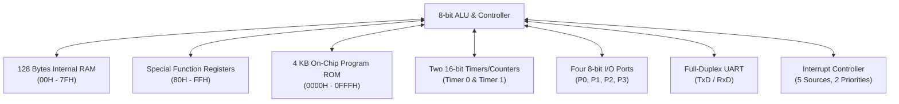
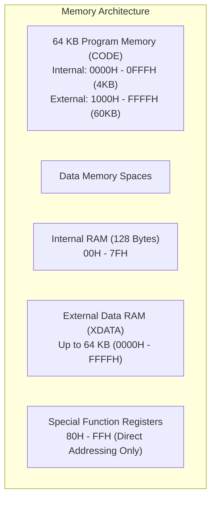
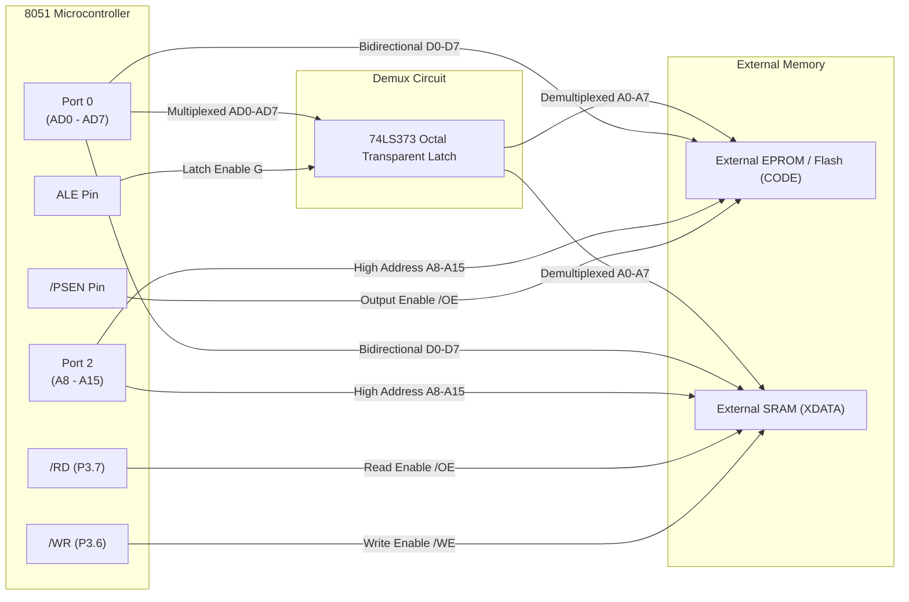
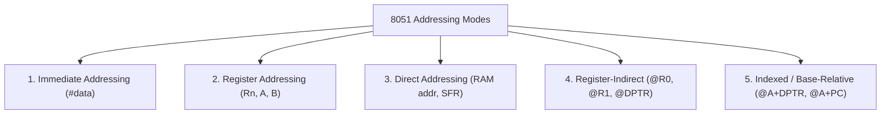
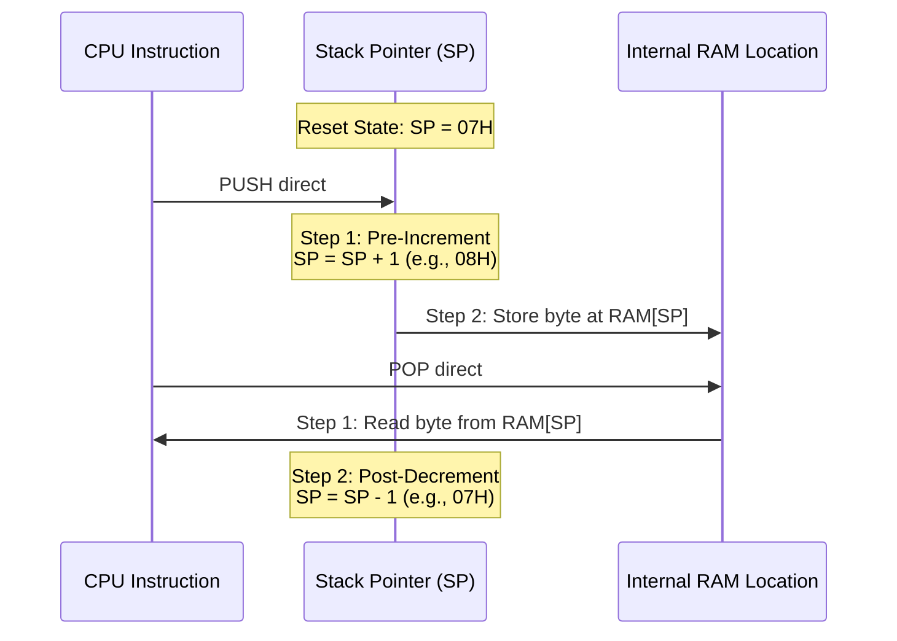
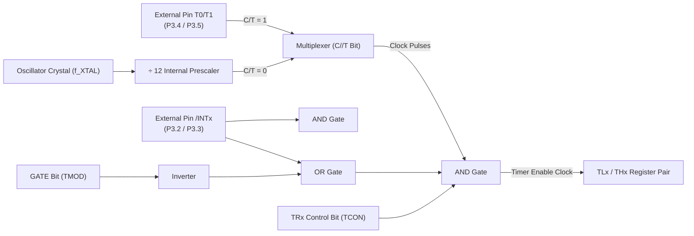
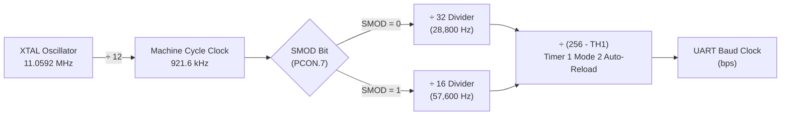
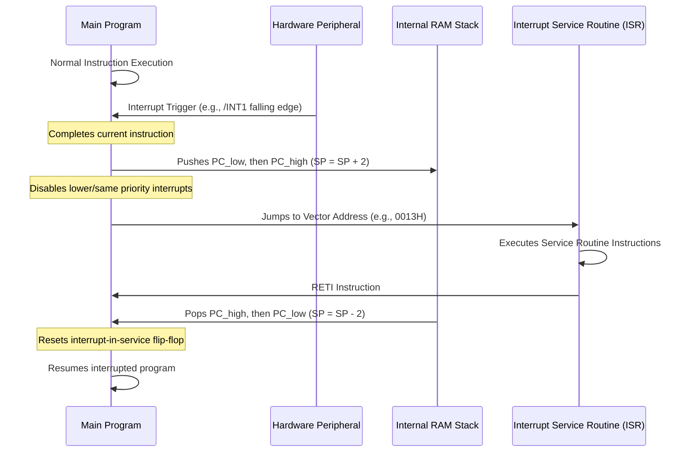
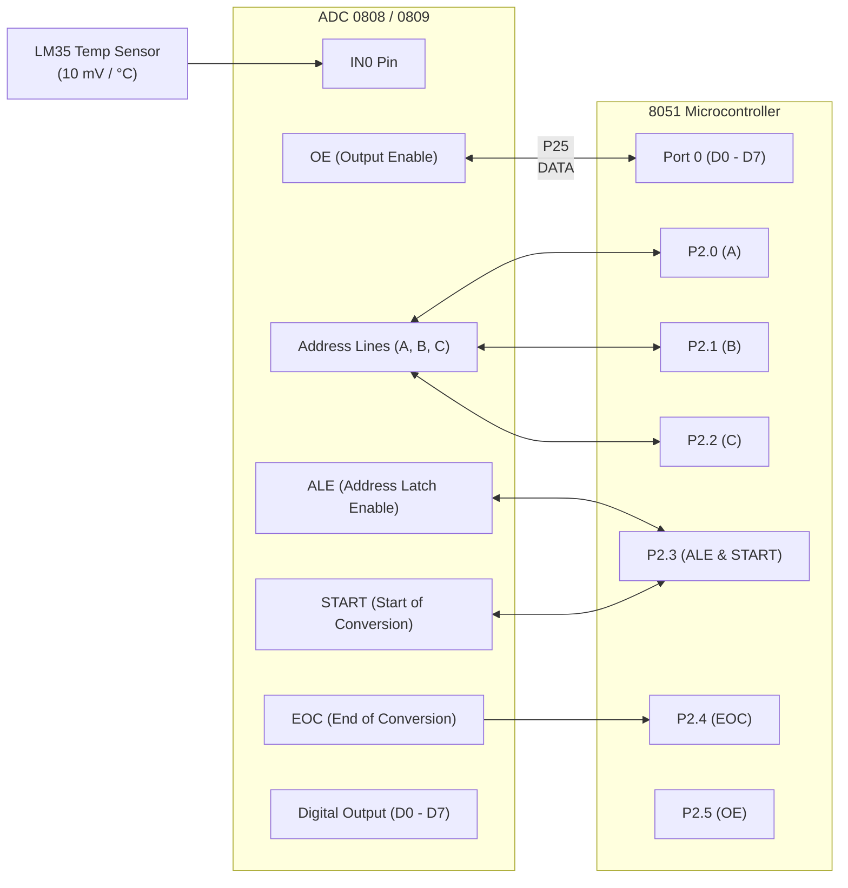

# EMBEDDED SYSTEMS (CSN15402) - COMPLETE EXAM MASTERY & REFERENCE NOTES
> **Course:** CSN15402 — Embedded Systems  
> **Target Institution:** Motilal Nehru National Institute of Technology (MNNIT) Allahabad  
> **Target Degree / Semester:** B.Tech V Semester (Computer Science & Engineering)  
> **Core Texts & Materials Integrated:**  
> - Unit III Lecture Slides: Slide 2 (Jump/Loop/Call), Slide 3 (Assembly & Addressing), Slide 4 (Delays & I/O) — Dr. Divyansh Thakur  
> - Unit IV Lecture Slides: 8051 C Programming, Timers/Counters, Serial Communication, Interrupts & Data Manipulation — Dr. Divyansh Thakur  
> - Reference Lecture Series Notes: Bharat Acharya Education (Mumbai) — 8051 Core Architecture, Instruction Set, Peripheral Interfacing (LCD, Keypad, ADC 0808, DAC 0808, Stepper Motor, DC Motor, 8255 PPI)  
> - Official Examination Reference: End-Semester Examination 2025-26 Question Paper & Detailed Solutions  

---

## MASTER TABLE OF CONTENTS

- **[MODULE 1: 8051 Architecture, Memory Organization & Hardware Fundamentals](#module-1-8051-microcontroller-architecture-memory-organization--hardware-fundamentals)**
  - 1.1 Architectural Overview & Core Specifications
  - 1.2 Functional Block Diagram & Bus Structure
  - 1.3 Complete Memory Organization (IRAM 128B, SFR 128B, Bit-Addressable Area, External RAM & ROM)
  - 1.4 Special Function Registers (SFRs) Map & Bit-Addressability Rules
  - 1.5 External Memory Interfacing & Bus Demultiplexing (74LS373 Latch, ALE, PSEN, EA)
  - 1.6 40-Pin DIP Configuration & Detailed Pin Functionality
  - 1.7 I/O Port Circuitry & Characteristics (Port 0 Open-Drain Pull-ups, Read-Modify-Write Hazard)

- **[MODULE 2: 8051 Assembly Language Fundamentals, Addressing Modes & Instruction Set](#module-2-8051-assembly-language-fundamentals-addressing-modes--instruction-set)**
  - 2.1 Anatomy of an Assembly Statement & Assembler Directives (ORG, DB, EQU, END)
  - 2.2 Program Counter (PC) & ROM Space Allocation
  - 2.3 The 5 Addressing Modes of the 8051 (Immediate, Register, Direct, Register Indirect, Indexed)
  - 2.4 Program Status Word (PSW) & Arithmetic Flags (CY, AC, OV, P, Bank Select RS1:RS0)
  - 2.5 Arithmetic & Logical Operations (ADD, ADDC, SUBB, DA A, MUL AB, DIV AB, Logic)
  - 2.6 Data Rotations, Swaps & Bit Manipulation (RL, RR, RLC, RRC, SWAP, SETB, CLR, CPL)
  - 2.7 Stack Mechanics, Stack Pointer (SP) & LIFO Principle

- **[MODULE 3: Program Flow Control — Branching, Loops, Subroutines & Stack Operations](#module-3-program-flow-control--branching-loops-subroutines--stack-operations)**
  - 3.1 Unconditional Jumps: Range, Syntax & Relative Offset Mathematics (SJMP, AJMP, LJMP, JMP @A+DPTR)
  - 3.2 Conditional Jumps (JZ, JNZ, JC, JNC, JB, JNB, JBC)
  - 3.3 Loop Architectures with `DJNZ` (Single-loop and Nested-loop patterns)
  - 3.4 Compare and Jump (`CJNE`) Mechanics & Carry Flag Generation Rules
  - 3.5 Subroutine Calls, Stack Frames & Return Instructions (ACALL, LCALL, RET, RETI)

- **[MODULE 4: Machine Cycle Timing, Software Delay Calculations & Port Manipulation](#module-4-machine-cycle-timing-software-delay-calculations--port-manipulation)**
  - 4.1 Oscillator Frequency, Machine Cycles & Instruction Execution Timing
  - 4.2 Machine Cycle Derivations for Common Crystals (11.0592 MHz, 12 MHz, 22 MHz, 24 MHz)
  - 4.3 Rigorous Mathematical Modeling of Software Delay Loops (1-loop, 2-loop, 3-loop formulas)
  - 4.4 Port Toggle Operations, Waveform Generation & Arbitrary Duty Cycles

- **[MODULE 5: Hardware Timers & Counters (Timer 0 and Timer 1)](#module-5-hardware-timers--counters-timer-0-and-timer-1)**
  - 5.1 Timer vs Counter Hardware Architecture & Clock Sources
  - 5.2 Control Registers: TMOD (89H) & TCON (88H) Bit-by-Bit Breakdown
  - 5.3 Operating Modes: Mode 0 (13-bit), Mode 1 (16-bit), Mode 2 (8-bit Auto-reload), Mode 3 (Split)
  - 5.4 Step-by-Step Mathematical Design of Accurate Delays (Preload Formula & Calculations)
  - 5.5 Waveform Generation & Arbitrary Duty Cycles in Mode 2
  - 5.6 Complete Counter Mode Programming (External Falling-Edge Triggering on P3.4/P3.5)
  - 5.7 Counter Setup & TMOD Values Table (05H, 06H, 50H, 60H)
  - 5.8 Software vs Hardware Limit Detection (CJNE with Carry vs TF Overflow)
  - 5.9 Application: Precision Dual-Timer Frequency Meter (Example 8.5)
  - 5.10 Pulse Width Measurement Using Hardware GATE Control (Example 8.6)
  - 5.11 Section 8 Review Questions & Comprehensive Solutions

- **[MODULE 6: UART Serial Communication & RS232 Interfacing](#module-6-uart-serial-communication--rs232-interfacing)**
  - 6.1 Fundamentals: Parallel vs Serial, Synchronous vs Asynchronous, Simplex, Half & Full Duplex
  - 6.2 Asynchronous Framing (8N1 Format) & Line Idle Conditions
  - 6.3 Electrical Interfacing: RS232 Standard, Bipolar Levels & MAX232 Level Shifter
  - 6.4 DTE vs DCE & Three-Wire Null Modem Cable Connections
  - 6.5 Serial Registers: SBUF (99H Post Box), SCON (98H) & PCON (87H)
  - 6.6 The Two Doorbells: TI and RI Flags Mechanics & Software Clearing Rule
  - 6.7 Mathematical Derivation of Baud Rates & The 11.0592 MHz Magic
  - 6.8 Baud Rate Doubling via SMOD (PCON.7) & Master Baud Rate Table
  - 6.9 Step-by-Step Procedures: 8-Step Serial Transmission & 8-Step Serial Reception
  - 6.10 Complete Assembly Language Programs (Single char, YES, ROM string with MOVC, Echo, Ack)
  - 6.11 Complete Keil C51 Serial Programs
  - 6.12 Second Serial Port Architecture in DS89C4x0 Family
  - 6.13 Common Serial Programming Traps & Section 9-10 Review Questions

- **[MODULE 7: Interrupt System & Interrupt Service Routines (ISRs)](#module-7-interrupt-system--interrupt-service-routines-isrs)**
  - 7.1 Polling vs Interrupt Architecture & 5-Step Interrupt Acceptance Sequence
  - 7.2 Vector Table & Vector Locations (Reset, INT0, TF0, INT1, TF1, Serial RI/TI, TF2)
  - 7.3 Control Registers: Interrupt Enable (`IE`, A8H) & Interrupt Priority (`IP`, B8H)
  - 7.4 Keil C51 ISR Syntax & the `interrupt` and `using` Keywords
  - 7.5 Timer Interrupts in Assembly & C (Examples 11.1, 11.2, 11.3 Dual Timers)
  - 7.6 External Hardware Interrupts: Level-Triggered vs Edge-Triggered (`IT0`/`IT1`)
  - 7.7 External Interrupts in Assembly & C (Examples 11.4, 11.5, 11.6 Event Counting)
  - 7.8 Serial Communication Interrupt: Shared Vector 0023H, TI/RI Disambiguation
  - 7.9 Combined Multi-Interrupt System in C (Foreground + Timer Wave + Serial Echo)
  - 7.10 Interrupt Priority System, 4-Step Priority Resolution Method & Examples (IP=0CH, 05H, 10H)
  - 7.11 Interrupt Inside Interrupt (Preemption & Nesting Rules)
  - 7.12 Protecting Registers in ISRs (PUSH/POP, Bank Switching, 16-Bit Shared Variable Hazard)
  - 7.13 7-Step Interrupt Programming Checklist & Section 11 Review Questions

- **[MODULE 8: 8051 Programming in Embedded C (Keil C51)](#module-8-8051-programming-in-embedded-c-keil-c51)**
  - 8.1 Keil C51 Extensions & Data Types (`bit`, `sbit`, `sfr`, `sfr16`, unsigned char/int)
  - 8.2 Memory Specifiers: `data`, `idata`, `xdata`, `pdata`, and the Vital `code` Keyword
  - 8.3 Bitwise Operations, Masking, Toggling & Data Serialization in C
  - 8.4 Time Delay Modeling in C (Loop Calibration & NOP Insertion)
  - 8.5 Bidirectional Port I/O Programming in C
  - 8.6 Data Conversions: BCD, ASCII, Hexadecimal & Checksum Calculation in C

- **[MODULE 9: Data Manipulation, Pointers & Array Processing](#module-9-data-manipulation-pointers--array-processing)**
  - 9.1 Register-Indirect Addressing Using R0 and R1 as 8-Bit Pointers & RAM Safe Zones
  - 9.2 Block Summation (Example 12.1 — Reading Count from Direct Memory vs Immediate)
  - 9.3 Series Generation: Fibonacci Series Generation up to 10 Terms (Example 12.2)
  - 9.4 Block Transfer & The Overlap Problem (Forward vs Backward Copy Direction Rules)
  - 9.5 Block Transfer Assembly Programs (Example 12.3 Forward & Backward Copy; Block Exchange with XCH)
  - 9.6 Reversing a Block of Data In-Place (Example 12.4 with N/2 Swaps)
  - 9.7 Palindrome Verification Program (Example 12.5 Inward Pointers & B Register Matching)
  - 9.8 Common Data-Handling Skeleton & Section 12 Review Questions

- **[MODULE 10: Interfacing Real-World Peripherals](#module-10-interfacing-real-world-peripherals)**
  - 10.1 16x2 Alphanumeric LCD Display Interfacing (8-bit & 4-bit Modes, Pinout, Commands, Assembly & C Drivers)
  - 10.2 4x4 Matrix Keyboard Interfacing (Scanning Algorithm, Grounding Rows, Reading Columns, Debouncing)
  - 10.3 8-Bit ADC 0808/0809 Interfacing & LM35 Temperature Sensor (Pinout, Timing, SOC/EOC Handshaking)
  - 10.4 8-Bit DAC 0808 Interfacing & Waveform Synthesis (Square, Sawtooth, Triangular, Staircase, Sine)
  - 10.5 Stepper Motor Control with ULN2003 Driver (Wave, Full, Half Step Sequences, Step Angle to Degree Math)
  - 10.6 DC Motor Interfacing with L293D H-Bridge Driver & Relays (Direction Control & PWM Speed)
  - 10.7 8255 Programmable Peripheral Interface (PPI) (Pinout, Control Word Register, Modes 0/1/2/BSR, Memory Mapping)

- **[MODULE 11: Complete Solutions to 2025-26 Endsem Examination with Marking Insights](#module-11-complete-solutions-to-2025-26-endsem-examination-with-marking-insights)**
  - 11.1 Question 1: (a) Stack/SP Step-by-Step Tracing; (b) LED Blink 22 MHz Delay; (c) CJNE Carry Flag Rules
  - 11.2 Question 2: (a) Rotate/Swap Bit Tracing; (b) ROM Checksum Calculation; (c) ROM Checksum Verification Program
  - 11.3 Question 3: (a) 16-Bit Timer 0 Mode 1 50ms Delay Math; (b) 7-Segment Display Counter; (c) Waveform Frequency & Duty Cycle
  - 11.4 Question 4: (a) SMOD Baud Rate Derivation; (b) Full-Duplex PC Terminal Program; (c) Display Baud Rate on Ports
  - 11.5 Question 5: (a) External Interrupt Waveform Generator; (b) Memory Map Trace at RETI with In-Service Latch

- **[MODULE 12: High-Yield Practice Question Bank & New Variation Practice Problems](#module-12-high-yield-practice-question-bank--new-variation-practice-problems)**
  - 12.1 Category A: Architecture, Memory Organization & Bit Address Variations (5 Problems)
  - 12.2 Category B: Assembly Language, Arithmetic, Rotations & Jumps (5 Problems)
  - 12.3 Category C: Hardware Timers & Precision Delay Calculations (6 Problems Across 11.0592, 12, 22, 24 MHz)
  - 12.4 Category D: UART Protocols, Baud Rates & PC Interfacing (5 Problems)
  - 12.5 Category E: Interrupt Service Routines, Nesting & Priorities (5 Problems)
  - 12.6 Category F: Peripheral Interfacing (LCD, Keypad, ADC, DAC, Stepper Motor, DC Motor — 5 Problems)

- **[MODULE 13: Quick Revision Master Tables, Cheat Sheets & Formula Vault](#module-13-quick-revision-master-tables-cheat-sheets--formula-vault)**
  - 13.1 Complete 8051 Instruction Set Reference with Machine Cycle Counts & Bytes
  - 13.2 Master Special Function Register (SFR) Table (Addresses, Reset values, Bit-addressability)
  - 13.3 5 Addressing Modes Summary & Examples
  - 13.4 Complete TMOD & TCON Configuration Lookup Tables
  - 13.5 Master Baud Rate vs TH1 Lookup Table (with SMOD=0 and SMOD=1)
  - 13.6 7-Segment Display Encoding Table (Common Cathode & Common Anode)
  - 13.7 Standard ASCII Code Reference (0 to 127)
  - 13.8 8051 Memory Map Quick Diagram
  - 13.9 Formula Vault (All mathematical equations for delays, timers, baud rates, step angles, ADC resolutions)
  - 13.10 Top 15 Exam Traps & Mistakes to Avoid

---


# MODULE 1: 8051 MICROCONTROLLER ARCHITECTURE, MEMORY ORGANIZATION & HARDWARE FUNDAMENTALS

## 1.1 Architectural Overview & Core Specifications
The Intel 8051 is an 8-bit Harvard-architecture microcontroller designed for embedded control systems. Introduced in 1980, its architecture remains the foundational standard for understanding low-level hardware-software interaction, memory-mapped I/O, deterministic real-time response, and peripheral interfacing.



### Key Technical Specifications of Standard 8051 (e.g., AT89C51):
* **Word Size**: 8-bit CPU (Arithmetic Logic Unit, Accumulator, and internal buses are 8 bits wide).
* **Clock System**: Standard division factor of 12 oscillator periods per machine cycle.
* **Internal Data RAM**: 128 Bytes (addresses `00H` to `7FH`). Extended derivatives (e.g., 8052, AT89S52) include an upper 128 Bytes (`80H` to `FFH`) accessed exclusively via indirect addressing.
* **Special Function Registers (SFRs)**: 128-byte address space (`80H` to `FFH`), housing 21 SFRs in standard 8051.
* **Internal Program Memory (Code ROM)**: 4 KB on-chip ROM/Flash (addresses `0000H` to `0FFFH`).
* **External Memory Addressing Capability**:
  * Up to 64 KB Program Memory (accessed via 16-bit Program Counter `PC`).
  * Up to 64 KB External Data RAM (accessed via 16-bit Data Pointer `DPTR` and `MOVX` instructions).
* **I/O Ports**: Four 8-bit parallel bidirectional I/O ports ($P_0, P_1, P_2, P_3$), totaling 32 programmable I/O lines.
* **Timers/Counters**: Two 16-bit independent timer/counter modules (Timer 0 and Timer 1).
* **Serial Interface**: One full-duplex Universal Asynchronous Receiver/Transmitter (UART).
* **Interrupt Structure**: 5 interrupt sources (2 external hardware interrupts, 2 timer overflow interrupts, 1 serial communication interrupt) with 2 programmable priority levels.

---

## 1.2 Functional Block Diagram & Bus Structure
The internal structure comprises functional units communicating over an 8-bit internal data bus, supervised by instruction decoding logic and synchronization clocks.

```
       +-------------------------------------------------------------+
       |                     8-bit Internal Data Bus                 |
       +-----+---------+--------+---------+--------+--------+--------+
             |         |        |         |        |        |
         +---+---+ +---+---+ +--+---+ +---+---+ +--+---+ +--+---+
         |  ACC  | |   B   | | PSW  | |  SP   | | DPTR | |  PC  |
         | (8-bit| |(8-bit)| |(8-bit| | (8-bit| |(16-bit|(16-bit|
         +---+---+ +---+---+ +--+---+ +---+---+ +--+---+ +--+---+
             |         |        |         |        |        |
         +---+---------+---+    |         |        |        |
         |     8-bit ALU   |    |         |        |        |
         +--------+--------+    |         |        |        |
                  |             |         |        |        |
         +--------v-------------v---------v--------v--------v--------+
         |     Internal 128-byte RAM & Special Function Registers    |
         +-----------------------------------------------------------+
                  |                 |                  |
             +----v----+       +----v----+        +----v----+
             | Timer 0 |       | Timer 1 |        |  UART   |
             +---------+       +---------+        +---------+
```

### Core Registers:
1. **Accumulator (`ACC` or `A`, SFR `E0H`)**: The primary operand and destination register for all arithmetic (`ADD`, `SUBB`, `MUL`, `DIV`) and many logical operations.
2. **B Register (SFR `F0H`)**: Dedicated math helper register. Used in conjunction with `A` for multiplication (`MUL AB` puts high byte in `B`, low byte in `A`) and division (`DIV AB` puts quotient in `A`, remainder in `B`). For non-math operations, it functions as a general scratchpad byte.
3. **Program Status Word (`PSW`, SFR `D0H`)**: Contains the ALU status flags (Carry, Auxiliary Carry, Overflow, Parity) and Register Bank select bits ($RS1, RS0$).
4. **Data Pointer (`DPTR`, 16-bit)**: Composed of two 8-bit SFRs: `DPH` (High Byte, `83H`) and `DPL` (Low Byte, `82H`). Used to hold 16-bit addresses for external RAM (`MOVX`) and code ROM lookup tables (`MOVC`).
5. **Program Counter (`PC`, 16-bit)**: Not part of the SFR space. Holds the memory address of the next machine code instruction byte to be fetched from ROM. Reset value is `0000H`.
6. **Stack Pointer (`SP`, SFR `81H`)**: 8-bit register pointing to the current top of the stack in internal RAM. On hardware reset, `SP` initializes to `07H`.

---

## 1.3 Complete Memory Organization

The 8051 implements a strict **Harvard Architecture**, maintaining physically distinct memory spaces for program instructions (Code ROM) and runtime data (Data RAM).



### Internal RAM Architecture (128 Bytes: `00H` to `7FH`)
The 128 bytes of low-order on-chip RAM are partitioned into three distinct functional zones:

```
+-------------------------------------------------------------------------+
| Address Range | Size     | Functional Purpose                           |
+---------------+----------+----------------------------------------------+
| 30H - 7FH     | 80 Bytes | General Purpose Scratchpad RAM               |
+---------------+----------+----------------------------------------------+
| 20H - 2FH     | 16 Bytes | Bit-Addressable RAM (128 bits: 00H - 7FH)    |
+---------------+----------+----------------------------------------------+
| 18H - 1FH     | 8 Bytes  | Register Bank 3 (R0 to R7)                   |
| 10H - 17H     | 8 Bytes  | Register Bank 2 (R0 to R7)                   |
| 08H - 0FH     | 8 Bytes  | Register Bank 1 (R0 to R7) [Default Stack]   |
| 00H - 07H     | 8 Bytes  | Register Bank 0 (R0 to R7) [Default Active]  |
+-------------------------------------------------------------------------+
```

```
=============================================================================
DETAILED INTERNAL RAM BIT-ADDRESSABLE MAP (Byte Addresses 20H to 2FH)
=============================================================================
Byte Addr | Bit 7 | Bit 6 | Bit 5 | Bit 4 | Bit 3 | Bit 2 | Bit 1 | Bit 0 |
----------+-------+-------+-------+-------+-------+-------+-------+-------+
   2FH    |  7FH  |  7EH  |  7DH  |  7CH  |  7BH  |  7AH  |  79H  |  78H  |
   2EH    |  77H  |  76H  |  75H  |  74H  |  73H  |  72H  |  71H  |  70H  |
   2DH    |  6FH  |  6EH  |  6DH  |  6CH  |  6BH  |  6AH  |  69H  |  68H  |
   2CH    |  67H  |  66H  |  65H  |  64H  |  63H  |  62H  |  61H  |  60H  |
   2BH    |  5FH  |  5EH  |  5DH  |  5CH  |  5BH  |  5AH  |  59H  |  58H  |
   2AH    |  57H  |  56H  |  55H  |  54H  |  53H  |  52H  |  51H  |  50H  |
   29H    |  4FH  |  4EH  |  4DH  |  4CH  |  4BH  |  4AH  |  49H  |  48H  |
   28H    |  47H  |  46H  |  45H  |  44H  |  43H  |  42H  |  41H  |  40H  |
   27H    |  3FH  |  3EH  |  3DH  |  3CH  |  3BH  |  3AH  |  39H  |  38H  |
   26H    |  37H  |  36H  |  35H  |  34H  |  33H  |  32H  |  31H  |  30H  |
   25H    |  2FH  |  2EH  |  2DH  |  2CH  |  2BH  |  2AH  |  29H  |  28H  |
   24H    |  27H  |  26H  |  25H  |  24H  |  23H  |  22H  |  21H  |  20H  |
   23H    |  1FH  |  1EH  |  1DH  |  1CH  |  1BH  |  1AH  |  19H  |  18H  |
   22H    |  17H  |  16H  |  15H  |  14H  |  13H  |  12H  |  11H  |  10H  |
   21H    |  0FH  |  0EH  |  0DH  |  0CH  |  0BH  |  0AH  |  09H  |  08H  |
   20H    |  07H  |  06H  |  05H  |  04H  |  03H  |  02H  |  01H  |  00H  |
=============================================================================
```

### Mathematical Conversion Formula: Bit Address $\leftrightarrow$ Byte Address & Bit Position
This conversion is a guaranteed question in MNNIT examinations (e.g., Endsem 2025-26 Q5b).
Given a bit address $b$ (where $00H \le b \le 7FH$ in decimal $0 \le b \le 127$):
$$	ext{Byte Address} = 20H + \lfloor b / 8 
floor$$
$$	ext{Bit Position within Byte} = b \pmod 8 \quad (D_0 	ext{ to } D_7)$$

* **Exam Example 1**: What byte and bit correspond to bit address `42H`?
  1. Convert to decimal: $42H = 4 	imes 16 + 2 = 66_{10}$.
  2. Byte offset: $66 / 8 = 8$ (integer quotient), Remainder: $66 \pmod 8 = 2$.
  3. $	ext{Byte Address} = 20H + 8 = 28H$.
  4. $	ext{Bit Position} = D_2$.
  * Therefore, setting bit `42H` (`SETB 42H`) sets bit $D_2$ of byte location `28H` to `1`!

* **Exam Example 2**: What byte and bit correspond to bit address `67H`?
  1. Convert to decimal: $67H = 6 	imes 16 + 7 = 103_{10}$.
  2. Byte offset: $103 / 8 = 12 = 0CH$. Remainder: $103 \pmod 8 = 7$.
  3. $	ext{Byte Address} = 20H + 0CH = 2CH$.
  4. $	ext{Bit Position} = D_7$.
  * Therefore, `SETB 67H` sets bit $D_7$ of byte location `2CH` to `1`!

---

## 1.4 Special Function Registers (SFRs) Map & Bit-Addressability Rules
The Special Function Registers control the CPU operation, timers, serial communications, and I/O ports. They reside in addresses `80H` to `FFH`.

> [!IMPORTANT]
> **Golden Rule of Bit-Addressability for SFRs**:
> An SFR is bit-addressable **IF AND ONLY IF** its hexadecimal byte address ends with `0` or `8` (i.e., is evenly divisible by 8: `80H`, `88H`, `90H`, `98H`, `A0H`, `A8H`, `B0H`, `B8H`, `D0H`, `E0H`, `F0H`).
> Registers whose addresses do not end in 0 or 8 (e.g., `TMOD = 89H`, `SP = 81H`, `PCON = 87H`, `DPTR = 82H/83H`) are **BYTE-ADDRESSABLE ONLY**!

### Master SFR Summary Table:
| Symbol | Name | Direct Address | Bit-Addressable? | Reset Value | Bit Addresses (if bit-addressable) |
|---|---|---|---|---|---|
| **ACC / A** | Accumulator | `0E0H` | **Yes** | `00H` | `E0H` to `E7H` |
| **B** | B Register | `0F0H` | **Yes** | `00H` | `F0H` to `F7H` |
| **PSW** | Program Status Word | `0D0H` | **Yes** | `00H` | `D0H` to `D7H` |
| **SP** | Stack Pointer | `081H` | **No** | `07H` | None |
| **DPL** | Data Pointer Low | `082H` | **No** | `00H` | None |
| **DPH** | Data Pointer High | `083H` | **No** | `00H` | None |
| **P0** | Port 0 Latch | `080H` | **Yes** | `0FFH` | `80H` to `87H` |
| **P1** | Port 1 Latch | `090H` | **Yes** | `0FFH` | `90H` to `97H` |
| **P2** | Port 2 Latch | `0A0H` | **Yes** | `0FFH` | `A0H` to `A7H` |
| **P3** | Port 3 Latch | `0B0H` | **Yes** | `0FFH` | `B0H` to `B7H` |
| **IP** | Interrupt Priority | `0B8H` | **Yes** | `xxx00000B` | `B8H` to `BFH` |
| **IE** | Interrupt Enable | `0A8H` | **Yes** | `0xx00000B` | `A8H` to `AFH` |
| **TMOD** | Timer Mode | `089H` | **No** | `00H` | None |
| **TCON** | Timer Control | `088H` | **Yes** | `00H` | `88H` to `8FH` |
| **TH0** | Timer 0 High Byte | `08CH` | **No** | `00H` | None |
| **TL0** | Timer 0 Low Byte | `08AH` | **No** | `00H` | None |
| **TH1** | Timer 1 High Byte | `08DH` | **No** | `00H` | None |
| **TL1** | Timer 1 Low Byte | `08BH` | **No** | `00H` | None |
| **SCON** | Serial Control | `098H` | **Yes** | `00H` | `98H` to `9FH` |
| **SBUF** | Serial Data Buffer | `099H` | **No** | Undefined | None |
| **PCON** | Power Control | `087H` | **No** | `0xxxxxxxB` | None |

---

## 1.5 External Memory Interfacing & Bus Demultiplexing
When the internal 4 KB ROM or 128 bytes RAM are insufficient, external memory must be attached. The 8051 uses a 16-bit address bus to access up to 64 KB of external code memory and 64 KB of external data memory.



### Why Demultiplexing is Necessary:
To conserve physical pins on a 40-pin package, Intel multiplexed the lower 8 bits of the address bus ($A_0 - A_7$) and the 8 bits of the data bus ($D_0 - D_7$) onto the same physical pins of **Port 0** ($AD_0 - AD_7$).
1. **During Phase 1 (Address Generation)**: The 8051 asserts the lower 8-bit memory address on $P_0$ and drives the **Address Latch Enable (ALE)** pin HIGH.
2. The **74LS373 transparent octal D-latch** detects the falling edge of ALE and latches the address lines $A_0 - A_7$, holding them stable at its outputs.
3. **During Phase 2 (Data Transfer)**: The 8051 releases $P_0$ from address duty and uses it as a bidirectional data bus ($D_0 - D_7$) to read or write the actual data byte.

### Memory Control Signals:
* **$\overline{EA}$ (External Access, Pin 31)**:
  * When tied to $V_{CC}$ (HIGH): The CPU executes code from internal on-chip ROM ($0000H - 0FFFH$). If program execution exceeds $0FFFH$, it automatically switches to external ROM ($1000H - FFFFH$).
  * When tied to $GND$ (LOW): The CPU completely bypasses internal ROM and fetches **all** code from external ROM starting at $0000H$.
* **$\overline{PSEN}$ (Program Store Enable, Pin 29)**: The read strobe signal connected to the Output Enable ($\overline{OE}$) of external EPROM/Flash. It pulses LOW twice per machine cycle during instruction fetches. It is inactive during data RAM access.
* **$\overline{RD}$ (P3.7, Pin 17)**: Active-LOW read strobe for external Data RAM (`MOVX A, @DPTR`).
* **$\overline{WR}$ (P3.6, Pin 16)**: Active-LOW write strobe for external Data RAM (`MOVX @DPTR, A`).

---

## 1.6 40-Pin DIP Configuration & Detailed Pin Functionality

```
                 +-----------+--+-----------+
    (AD0)   P1.0 | 1                    40 | VCC (+5V)
    (AD1)   P1.1 | 2                    39 | P0.0 (AD0)
    (AD2)   P1.2 | 3                    38 | P0.1 (AD1)
    (AD3)   P1.3 | 4                    37 | P0.2 (AD2)
    (AD4)   P1.4 | 5        8051        36 | P0.3 (AD3)
    (AD5)   P1.5 | 6     Dual-In-Line   35 | P0.4 (AD4)
    (AD6)   P1.6 | 7       Package      34 | P0.5 (AD5)
    (AD7)   P1.7 | 8                    33 | P0.6 (AD6)
             RST | 9                    32 | P0.7 (AD7)
     (RxD)  P3.0 | 10                   31 | /EA / VPP
     (TxD)  P3.1 | 11                   30 | ALE / /PROG
    (/INT0) P3.2 | 12                   29 | /PSEN
    (/INT1) P3.3 | 13                   28 | P2.7 (A15)
      (T0)  P3.4 | 14                   27 | P2.6 (A14)
      (T1)  P3.5 | 15                   26 | P2.5 (A13)
     (/WR)  P3.6 | 16                   25 | P2.4 (A12)
     (/RD)  P3.7 | 17                   24 | P2.3 (A11)
           XTAL2 | 18                   23 | P2.2 (A10)
           XTAL1 | 19                   22 | P2.1 (A9)
             GND | 20                   21 | P2.0 (A8)
                 +--------------------------+
```

### Pin Categorization:
1. **Power & Clock**:
   * **Pin 40 ($V_{CC}$)**: Supply voltage (+5V DC $\pm 10\%$).
   * **Pin 20 ($GND$)**: Ground reference (0V).
   * **Pins 19 ($XTAL1$) & 18 ($XTAL2$)**: Input/output connections for the internal crystal oscillator inverter. A quartz crystal (typically 11.0592 MHz or 12 MHz) and two 30 pF ceramic capacitors are connected between these pins and ground.
2. **System Control**:
   * **Pin 9 ($RST$)**: Active-HIGH Reset input. A HIGH pulse held for at least two machine cycles resets the CPU. Internal registers are cleared, $SP$ is initialized to $07H$, ports are set to $0FFH$, and $PC$ is cleared to $0000H$.
   * **Pin 30 ($ALE / \overline{PROG}$)**: Address Latch Enable for demultiplexing $P_0$. Emits a constant clock at $1/6$ the crystal frequency when idle.
   * **Pin 29 ($\overline{PSEN}$)**: Program Store Enable. Read signal for external ROM.
   * **Pin 31 ($\overline{EA} / V_{PP}$)**: External Access enable. High = internal ROM; Low = external ROM.
3. **Dedicated Port Pins**:
   * **Port 0 (Pins 32-39)**: 8-bit open-drain bidirectional port. Serves as multiplexed low-order address/data bus ($AD_0-AD_7$).
   * **Port 1 (Pins 1-8)**: 8-bit quasi-bidirectional I/O port with internal pull-up resistors. Dedicated purely to general-purpose I/O.
   * **Port 2 (Pins 21-28)**: 8-bit quasi-bidirectional I/O port with internal pull-up resistors. Emits high-order address byte ($A_8-A_{15}$) during external memory access.
   * **Port 3 (Pins 10-17)**: 8-bit quasi-bidirectional I/O port with internal pull-ups, where each pin possesses a critical alternate hardware function.

### Port 3 Alternate Functions Master Table:
| Pin | Alternate Name | Function Description |
|---|---|---|
| **P3.0** | **RXD** | Serial Asynchronous Input (Receive Data) |
| **P3.1** | **TXD** | Serial Asynchronous Output (Transmit Data) |
| **P3.2** | $\overline{	extbf{INT0}}$ | External Hardware Interrupt 0 (active LOW or falling-edge) |
| **P3.3** | $\overline{	extbf{INT1}}$ | External Hardware Interrupt 1 (active LOW or falling-edge) |
| **P3.4** | **T0** | Timer 0 External Clock Input (for event counting) |
| **P3.5** | **T1** | Timer 1 External Clock Input (for event counting) |
| **P3.6** | $\overline{	extbf{WR}}$ | External Data Memory Write Strobe (active LOW) |
| **P3.7** | $\overline{	extbf{RD}}$ | External Data Memory Read Strobe (active LOW) |

---

## 1.7 I/O Port Circuitry & Characteristics

### The Distinct Anatomy of Port 0 vs Ports 1, 2, 3
The electrical behavior of 8051 ports is one of the most frequently tested concepts.

```
       PORT 0 INTERNAL BIT CIRCUIT               PORTS 1, 2, 3 INTERNAL BIT CIRCUIT
       
            Internal VCC                              Internal VCC
                 |                                         |
                 x  (NO INTERNAL PULL-UP!)               [Internal] Pull-Up Resistor (~20k - 50k)
                 |                                         |
         +-------+-------+                         +-------+-------+
         |               |                         |               |
       --+--           --+--                     --+--             |
       |FET| Control   |FET| Pull-Down           |FET| Pull-Down   |
       --+--           --+--                     --+--             |
         |               |                         |               |
     (Address)           +-----> PIN P0.x          |               +-----> PIN Px.y
                         |                         |               |
                       [Pad]                     [Pad]           [Pad]
```

1. **Port 0 (Open-Drain)**:
   * Has **no internal pull-up resistors**. It consists of a pair of push-pull FETs only during external memory access.
   * When used as an output port for general I/O, driving a `1` causes the internal pull-down FET to turn off, leaving the pin floating in a **high-impedance (tri-state)** condition.
   * **Design Rule**: To use Port 0 as a standard digital output port driving logic `1` to external circuits (such as LEDs or 7-segment displays), you **MUST connect external pull-up resistors** (typically $4.7	ext{ k}\Omega$ to $10	ext{ k}\Omega$ resistor pack) to $V_{CC}$!
2. **Ports 1, 2, and 3 (Quasi-Bidirectional)**:
   * Contain **internal pull-up resistors** (FETs configured as passive pull-ups).
   * They can sink current effectively (logic 0 pulls strongly to ground), and when outputting logic 1, the internal pull-up gently pulls the line to $+5	ext{V}$.
3. **Configuring Any Port as an Input Port**:
   * At power-up, ports reset to `0FFH` (all output latch bits = `1`).
   * When an internal port latch bit contains `0`, the lower pull-down FET is turned hard ON, clamping the external pin to $0	ext{V}$.
   * Therefore, to read an external input signal from a pin, the programmer **MUST FIRST WRITE A `1` TO THE LATCH BIT**:
     ```assembly
     MOV P1, #0FFH      ; Configures all 8 pins of Port 1 as inputs
     MOV A, P1          ; Reads the external logic levels from pins into Accumulator
     ```

### The "Read-Modify-Write" Hazard
Certain instructions modify a port by reading the existing state, changing it, and writing it back.
* **Instructions that read the Port Latch (not the external pin)**:
  `ANL`, `ORL`, `XRL`, `JBC`, `CPL`, `INC`, `DEC`, `DJNZ Px, rel`, `MOV Px.y, C`, `CLR Px.y`, `SETB Px.y`.
* **Why this distinction matters**:
  If a pin is connected to the base of a transistor, the transistor may pull the external pin voltage down to $0.7	ext{V}$ (which the input buffer reads as a logic `0`). If a regular pin read occurred, the CPU would mistakenly think the pin was outputting `0` and overwrite it. By reading the internal **latch** rather than the physical pin, the CPU reads the true commanded output state without corruption!

# MODULE 2: 8051 ASSEMBLY LANGUAGE FUNDAMENTALS, ADDRESSING MODES & INSTRUCTION SET

## 2.1 Anatomy of an Assembly Statement & Assembler Directives
An assembly language program (ALP) is translated into machine-executable hex opcodes by an assembler (such as Keil A51). 

### Syntax of an Assembly Statement:
```assembly
[Label:]   Mnemonic   [Operands]   [; Comment]
```
* **Label**: An optional symbolic name representing the memory address of the instruction (must end with a colon `:`).
* **Mnemonic**: The operation code (e.g., `MOV`, `ADD`, `CJNE`).
* **Operands**: The data fields manipulated by the mnemonic (destination operand always precedes source operand: `Mnemonic Destination, Source`).
* **Comment**: Explanatory notes ignored by the assembler, preceded by a semicolon `;`.

### Core Assembler Directives (Pseudo-Ops):
Directives provide instructions to the assembler during compilation and generate no runtime machine code:
1. **`ORG` (Origin)**: Defines the starting ROM address where subsequent machine code bytes will be placed.
   * `ORG 0000H` (Reset vector address).
   * `ORG 0030H` (Bypasses interrupt vectors to start main program).
2. **`DB` (Define Byte)**: Allocates and initializes constant 8-bit data bytes directly into Program ROM.
   ```assembly
   ORG 0250H
   MY_DATA: DB 25H, 62H, 3FH, 52H    ; Stores 4 raw hexadecimal bytes
   GREETING: DB "Hello MNNIT", 0      ; Stores ASCII bytes terminated with null byte
   ```
3. **`EQU` (Equate)**: Defines a symbolic constant that replaces repeated literals at compile time.
   ```assembly
   BAUD_RATE EQU 9600
   COUNT     EQU 50
   MOV R1, #COUNT                     ; Assembler translates to MOV R1, #50
   ```
4. **`END`**: Informs the assembler of the physical end of the source file. Any text beyond `END` is ignored.
5. **`BIT` & `DATA`**: Assigns symbolic names to bit addresses and byte addresses in internal RAM.

---

## 2.2 Program Counter (PC) & ROM Space
* The **Program Counter (`PC`)** is a 16-bit register pointing to the ROM address of the next byte to be fetched.
* Upon power-up or hardware reset, $PC = 0000H$.
* Because $PC$ is 16 bits wide, it can address $2^{16} = 65,536 	ext{ bytes} = 64	ext{ KB}$ of program memory ($0000H$ to $FFFFH$).
* In chips like AT89C51, on-chip Flash ROM occupies $0000H$ to $0FFFH$ ($4	ext{ KB}$).

---

## 2.3 The 5 Addressing Modes of the 8051
Addressing modes determine how the CPU specifies the operand (data) for an instruction.



### 1. Immediate Addressing Mode
* **Mechanism**: The operand value is supplied directly within the instruction itself as a numeric constant, prefixed by the `#` symbol.
* **Format**: `MOV destination, #data`
* **Machine Code Representation**: The literal byte immediately follows the opcode byte in ROM.
  ```assembly
  MOV A, #25H        ; Loads literal hex value 25H into Accumulator A
  MOV R3, #7FH       ; Loads literal hex value 7FH into Register R3
  MOV DPTR, #0250H   ; Loads 16-bit constant 0250H into DPTR (DPH=02H, DPL=50H)
  ```
* **Critical Trap**: Omitting the `#` turns an immediate instruction into a **direct** memory access!
  * `MOV A, #30H` $
ightarrow$ loads the number `30H` ($48_{10}$) into `A`.
  * `MOV A, 30H` $
ightarrow$ reads the contents of internal RAM byte `30H` into `A`!

### 2. Register Addressing Mode
* **Mechanism**: The operand resides in one of the eight general-purpose registers ($R_0$ to $R_7$) of the currently selected register bank, or Accumulator `A`, or register `B`.
* **Execution Speed**: Extremely fast (1 machine cycle) because register specifiers are encoded directly within the 3 least significant bits of the opcode byte itself ($11101	ext{rrr}_2$).
  ```assembly
  MOV A, R0          ; Copy contents of R0 into Accumulator
  MOV R7, A          ; Copy contents of Accumulator into R7
  ADD A, R4          ; Add contents of R4 to Accumulator
  ```
* **Constraint**: Direct register-to-register transfers are **illegal** (e.g., `MOV R1, R2` is invalid syntax). One must transit through `A` or use direct RAM addresses (`MOV 01H, 02H`).

### 3. Direct Addressing Mode
* **Mechanism**: The operand is specified by its exact 8-bit memory address in internal RAM (`00H` to `7FH`) or Special Function Register space (`80H` to `FFH`).
  ```assembly
  MOV A, 30H         ; Read byte from internal RAM location 30H into A
  MOV 50H, A         ; Write byte from A into internal RAM location 50H
  MOV 090H, #55H     ; Write 55H directly to Port 1 (address 90H)
  MOV P1, #55H       ; Equivalent to above using predefined SFR symbol
  ```
* **Vital Rule for PUSH and POP**:
  The `PUSH` and `POP` instructions operate **ONLY via Direct Addressing**!
  * `PUSH R0` is **INVALID SYNTAX**!
  * `PUSH 0` or `PUSH 00H` is the **CORRECT SYNTAX** (pushes RAM byte `00H`, which is register $R_0$ of Bank 0).

### 4. Register-Indirect Addressing Mode
* **Mechanism**: The instruction specifies a register that holds the *memory address* of the actual operand (acting as a pointer).
* **Pointer Registers Available**:
  * For Internal RAM (`00H` - `7FH` / `FFH`): Only **`R0`** and **`R1`** can serve as 8-bit pointers, prefixed by `@`.
  * For External Data RAM (`0000H` - `FFFFH`): Only **`DPTR`** can serve as a 16-bit pointer (`MOVX A, @DPTR`).
  ```assembly
  MOV R0, #30H       ; R0 points to RAM address 30H
  MOV A, @R0         ; Read data byte from RAM address pointed to by R0 into A
  MOV @R0, #0AAH     ; Store literal AAH into RAM location pointed to by R0
  INC R0             ; Advance pointer to next RAM location (31H)
  ```
* **Why Register-Indirect is Essential**: It is the only addressing mode capable of iterating over arrays, blocks of memory, and runtime buffers using loops.

### 5. Indexed Addressing Mode (Base + Offset)
* **Mechanism**: Used exclusively to read constant lookup tables from Program ROM (`MOVC` = Move Code). The effective 16-bit ROM address is computed dynamically at runtime as the sum of a 16-bit base register and an 8-bit unsigned index offset in the Accumulator:
$$	ext{Target ROM Address} = 	ext{Base Register} + 	ext{Accumulator (A)}$$
* **Base Registers Supported**:
  1. `DPTR` (Data Pointer): `MOVC A, @A+DPTR`
  2. `PC` (Program Counter): `MOVC A, @A+PC`
  ```assembly
  ; Reading 7-segment code from ROM lookup table
  MOV DPTR, #0400H   ; Base address of table in ROM
  MOV A, #05H        ; Index 5 (to fetch 7-segment pattern for digit '5')
  MOVC A, @A+DPTR    ; Reads ROM[0405H] directly into Accumulator
  ```

---

## 2.4 Program Status Word (PSW) & Arithmetic Flags

The PSW register (`D0H`, bit-addressable) reflects the operational status of the ALU after arithmetic and logic operations.

```
       Bit 7   Bit 6   Bit 5   Bit 4   Bit 3   Bit 2   Bit 1   Bit 0
      +-------+-------+-------+-------+-------+-------+-------+-------+
      |  CY   |  AC   |  F0   |  RS1  |  RS0  |  OV   |  --   |   P   |
      +-------+-------+-------+-------+-------+-------+-------+-------+
       PSW.7   PSW.6   PSW.5   PSW.4   PSW.3   PSW.2   PSW.1   PSW.0
```

### Detailed Flag Bit Functions:
1. **CY (Carry Flag, PSW.7)**:
   * Set to `1` whenever an arithmetic operation (`ADD`, `ADDC`) generates a carry out of bit $D_7$, or when a subtraction (`SUBB`) requires a borrow into bit $D_7$.
   * Cleared to `0` otherwise.
   * Also functions as a single-bit Boolean accumulator for bit-manipulation instructions (`SETB C`, `CLR C`, `CPL C`, `MOV C, bit`, `ANL C, bit`).
2. **AC (Auxiliary Carry Flag, PSW.6)**:
   * Set to `1` if an addition generates a carry out of bit $D_3$ into bit $D_4$ (half-carry).
   * Used exclusively by the `DA A` (Decimal Adjust) instruction to perform BCD arithmetic correction.
3. **F0 (User Flag 0, PSW.5)**: General-purpose bit flag available to the programmer.
4. **RS1, RS0 (Register Bank Select Bits, PSW.4, PSW.3)**:
   * Selects the currently active register bank in internal RAM:
     | RS1 (PSW.4) | RS0 (PSW.3) | Active Register Bank | RAM Address Range |
     |---|---|---|---|
     | **0** | **0** | **Bank 0** (Default upon Reset) | `00H` - `07H` |
     | **0** | **1** | **Bank 1** | `08H` - `0FH` |
     | **1** | **0** | **Bank 2** | `10H` - `17H` |
     | **1** | **1** | **Bank 3** | `18H` - `1FH` |
   * **Exam Crucial**: To switch to Register Bank 2:
     ```assembly
     SETB PSW.4      ; RS1 = 1
     CLR  PSW.3      ; RS0 = 0 -> Bank 2 active (R0 is now at RAM 10H)
     ```
5. **OV (Overflow Flag, PSW.2)**:
   * Set to `1` whenever the result of a **signed two's-complement** arithmetic operation exceeds the 8-bit signed range ($-128$ to $+127$).
   * Mathematical condition:
$$OV = C_6 \oplus C_7$$
     where $C_6$ is carry out of bit 6 and $C_7$ is carry out of bit 7.
   * Also modified by `MUL AB` (OV = 1 if result > 255, meaning register B $
e 0$) and `DIV AB` (OV = 1 if division by zero).
6. **P (Parity Flag, PSW.0)**:
   * Automatically updated by hardware after every instruction to reflect the parity of Accumulator `A`.
   * **P = 1** if Accumulator contains an **ODD number of 1s**.
   * **P = 0** if Accumulator contains an **EVEN number of 1s**.

---

## 2.5 Arithmetic & Logical Operations

### Addition Instructions: `ADD` and `ADDC`
* `ADD A, operand`: $A \leftarrow A + 	ext{operand}$.
* `ADDC A, operand`: $A \leftarrow A + 	ext{operand} + CY$. Essential for multi-byte additions.

### Subtraction: `SUBB` (Subtract with Borrow)
> [!WARNING]
> The 8051 has **NO standalone `SUB` instruction**! It only provides `SUBB A, operand`.
> Operation: $A \leftarrow A - 	ext{operand} - CY$.
> To perform a standard single-byte subtraction, you **MUST explicitly clear the carry flag first**:
> ```assembly
> CLR C              ; Ensure borrow is zero!
> SUBB A, R2         ; A = A - R2
> ```

### Multiplication and Division: `MUL AB` and `DIV AB`
* Both instructions require operands to be strictly in registers `A` and `B`:
  * `MUL AB`: Multiplies unsigned 8-bit integers in `A` and `B`. Result is 16-bit:
    * Low byte stored in `A`.
    * High byte stored in `B`.
    * Flag: $OV = 1$ if high byte ($B$) is non-zero (result > 255); $CY = 0$ always.
  * `DIV AB`: Divides unsigned 8-bit integer in `A` by unsigned integer in `B`:
    * Quotient stored in `A`.
    * Remainder stored in `B`.
    * Flag: If $B = 00H$ prior to instruction (division by zero), $OV = 1$ and result is undefined; otherwise $OV = 0, CY = 0$.

### BCD Arithmetic & `DA A` (Decimal Adjust Accumulator)
When adding Binary Coded Decimal (BCD) numbers (where each nibble represents a decimal digit $0-9$), binary addition yields illegal hex codes ($A-F$) or missing decimal carries.
The `DA A` instruction inspects the Accumulator and flags and applies the following hardware rules:
1. If the lower nibble ($D_3-D_0$) is $> 9$ OR if Auxiliary Carry ($AC$) = 1:
   * Add `06H` to `A`.
2. If the upper nibble ($D_7-D_4$) is $> 9$ OR if Carry Flag ($CY$) = 1:
   * Add `60H` to `A`, and set $CY = 1$.
```assembly
MOV A, #38H        ; Packed BCD 38
ADD A, #45H        ; Packed BCD 45 -> Binary addition: 38H + 45H = 7DH (illegal BCD!)
DA A               ; Lower nibble 0DH > 9 -> Adds 06H -> 7DH + 06H = 83H (Correct BCD 83!)
```

### Logical Instructions:
* `ANL dest, source`: Bitwise AND.
* `ORL dest, source`: Bitwise OR.
* `XRL dest, source`: Bitwise XOR. (Used to toggle bits or test equality: `XRL A, #55H`).
* `CPL A`: One's complement (inverts all 8 bits of Accumulator).
* `CLR A`: Clears Accumulator to `00H`.

---

## 2.6 Data Rotations, Swaps & Bit Manipulation

Rotate instructions are prime candidates for exam questions (e.g., Endsem 2025-26 Q2a).

```
   RR A (Rotate Right without Carry)          RL A (Rotate Left without Carry)
   +---------------------------------+        +---------------------------------+
   |                                 |        |                                 |
   +--> [D7][D6][D5][D4][D3][D2][D1][D0] --+  +-- [D7][D6][D5][D4][D3][D2][D1][D0] <--+
                                           |        |
                                           +--------+
   
   RRC A (Rotate Right through Carry)         RLC A (Rotate Left through Carry)
   +---------------------------------------+  +---------------------------------------+
   |                                       |  |                                       |
   +--> [CY] --> [D7][D6]...[D1][D0] ------+  +-- [D7][D6]...[D1][D0] <-- [CY] <------+
```

1. **`RR A` (Rotate Right)**:
   * 8-bit closed rotation right. Bit $D_0$ wraps around into bit $D_7$.
   * **CY flag is NOT affected!**
2. **`RL A` (Rotate Left)**:
   * 8-bit closed rotation left. Bit $D_7$ wraps around into bit $D_0$.
   * **CY flag is NOT affected!**
3. **`RRC A` (Rotate Right through Carry)**:
   * 9-bit rotation consisting of `CY` and the 8 bits of `A`.
   * Bit $D_0 
ightarrow CY$, and the old $CY 
ightarrow D_7$.
4. **`RLC A` (Rotate Left through Carry)**:
   * 9-bit rotation consisting of `CY` and the 8 bits of `A`.
   * Bit $D_7 
ightarrow CY$, and the old $CY 
ightarrow D_0$.
5. **`SWAP A` (Swap Nibbles)**:
   * Exchanges the lower 4 bits ($D_3-D_0$) with the upper 4 bits ($D_7-D_4$) of Accumulator `A`.
   * Flags are unaffected.
   * Example: If $A = 56H$ ($0101\ 0110_2$), executing `SWAP A` results in $A = 65H$ ($0110\ 0101_2$).

---

## 2.7 Stack Mechanics, Stack Pointer (SP) & LIFO Principle

The 8051 stack resides entirely within the internal RAM (`00H` to `7FH`).



### Golden Rules of the 8051 Stack:
1. **Push Operation (`PUSH direct`)**:
   * **Step 1 (Pre-increment)**: $SP \leftarrow SP + 1$.
   * **Step 2 (Memory write)**: $	ext{RAM}[SP] \leftarrow (	ext{direct})$.
2. **Pop Operation (`POP direct`)**:
   * **Step 1 (Memory read)**: $(	ext{direct}) \leftarrow 	ext{RAM}[SP]$.
   * **Step 2 (Post-decrement)**: $SP \leftarrow SP - 1$.
3. **Default Reset Value**:
   * At power-on/reset, **`SP = 07H`**.
   * Therefore, the first pushed byte goes to RAM address `08H`.
   * RAM locations `08H` to `0FH` correspond to **Register Bank 1**. If an application uses Bank 1, the stack pointer must be re-initialized (e.g., `MOV SP, #2FH` or `MOV SP, #30H`) to avoid data collision!
4. **LIFO Restitution Order**:
   * Data is popped in the exact reverse order of being pushed.
   * If pushed in order: `PUSH A`, `PUSH B`, `PUSH C`.
   * To restore original registers, pop in order: `POP C`, `POP B`, `POP A`!

---


# MODULE 3: PROGRAM FLOW CONTROL — BRANCHING, LOOPS, SUBROUTINES & STACK OPERATIONS

## 3.1 Unconditional Jumps: Range, Syntax & Offset Mathematics

The 8051 provides three distinct unconditional jump instructions optimized for different code distances:

| Instruction | Name | Opcode Bytes | Machine Cycles | Jump Target Address Range |
|---|---|---|---|---|
| **`SJMP rel`** | Short Jump | **2 Bytes** | 2 | Relative: **$-128$ to $+127$ bytes** from next instruction |
| **`AJMP addr11`**| Absolute Jump| **2 Bytes** | 2 | Within current **2 KB page** of ROM ($addr_{10-0}$) |
| **`LJMP addr16`**| Long Jump | **3 Bytes** | 2 | Anywhere within entire **64 KB ROM** ($0000H - FFFFH$) |

### Mathematical Modeling of `SJMP` Relative Offset:
`SJMP` is a 2-byte instruction:
* Byte 1: Opcode (`80H`).
* Byte 2: Signed 8-bit two's-complement displacement (`rel`, range $-128$ to $+127$).

$$	ext{Target Address} = PC_{	ext{next}} + rel$$
where $PC_{	ext{next}} = PC_{	ext{current}} + 2$ (the address of the instruction immediately following `SJMP`).

* **Calculating Offset for Forward Jump**:
  * Suppose `SJMP TARGET` is at ROM address `0010H`.
  * Target instruction is at `0040H`.
  * $PC_{	ext{next}} = 0010H + 2 = 0012H$.
  * $rel = 	ext{Target} - PC_{	ext{next}} = 0040H - 0012H = +2EH$ ($+46_{10}$).
  * Hex code stored in ROM: `80 2E`.

* **Calculating Offset for Backward Jump (Looping / Infinite Loop)**:
  * Consider `HERE: SJMP HERE` at address `0100H`.
  * $PC_{	ext{next}} = 0100H + 2 = 0102H$.
  * $rel = 0100H - 0102H = -2 = 1111\ 1110_2 = 0FEH$.
  * Hex code stored in ROM: `80 FE`.

### How `AJMP` Operates (2 KB Page Window):
* `AJMP` is a 2-byte instruction. It specifies an 11-bit target address ($A_{10} - A_0$).
* When executed, the CPU replaces the lower 11 bits of the Program Counter with $A_{10} - A_0$, while keeping the upper 5 bits ($A_{15} - A_{11}$) of $PC_{	ext{next}}$ unchanged!
$$	ext{New } PC = [PC_{15..11}] \mathbin{\Vert} [A_{10..0}]$$
* Hence, `AJMP` can only reach targets located within the same 2 KB memory page as the instruction immediately following the `AJMP`.

---

## 3.2 Conditional Jumps
All conditional jumps in the 8051 are **short jumps** (relative range $-128$ to $+127$ bytes from $PC_{	ext{next}}$).

1. **Accumulator Zero Testing**:
   * **`JZ label`**: Jump if $A = 00H$.
   * **`JNZ label`**: Jump if $A 
e 00H$.
   * *Note*: They test the Accumulator contents directly; they do **not** rely on a zero flag bit.
2. **Carry Flag Testing**:
   * **`JC label`**: Jump if $CY = 1$.
   * **`JNC label`**: Jump if $CY = 0$.
3. **Direct Bit Testing**:
   * **`JB bit, label`**: Jump if specified bit is `1`.
   * **`JNB bit, label`**: Jump if specified bit is `0`.
   * **`JBC bit, label`**: Jump if specified bit is `1`, and **atomically clear the bit to `0`**! (Widely used for interrupt and status flags).

---

## 3.3 Loop Architectures with `DJNZ`
The **`DJNZ` (Decrement and Jump if Not Zero)** instruction is the workhorse for software loops.
* Operation: Decrements the specified counter register/byte. If the decremented value is non-zero, it takes the relative jump; if zero, execution falls through to the next sequential instruction.

### Single Loop Architecture:
```assembly
      MOV R2, #100       ; 1 MC: Initialize loop counter to 100
LOOP: 
      ; ... Loop Body ...
      DJNZ R2, LOOP      ; 2 MC: R2 = R2 - 1; Jump if R2 != 0
```

### Multi-Register Nested Loops (for large delays):
Because an 8-bit register can hold a maximum count of 255 ($FFH$), nesting registers is necessary for counts exceeding 255.
```assembly
      MOV R2, #10        ; Outer loop counter
OUTER:
      MOV R1, #200       ; Middle loop counter
MID:
      MOV R0, #250       ; Inner loop counter
INNER:
      DJNZ R0, INNER     ; Inner loop repeats 250 times
      DJNZ R1, MID       ; Middle loop repeats 200 times
      DJNZ R2, OUTER     ; Outer loop repeats 10 times
```
Total iterations of innermost statement = $10 	imes 200 	imes 250 = 500,000$ iterations!

---

## 3.4 Compare and Jump (`CJNE`) Mechanics & Carry Flag Generation Rules

The `CJNE` instruction is one of the most powerful and heavily examined instructions on the 8051.

### Syntax:
```assembly
CJNE destination, source, relative_label
```
* Allowed operand combinations:
  1. `CJNE A, #data, rel`
  2. `CJNE A, direct, rel`
  3. `CJNE Rn, #data, rel`
  4. `CJNE @Ri, #data, rel`

### Operation & Internal Hardware Behavior:
1. The CPU compares `destination` with `source` by internally computing the subtraction:
$$	ext{Difference} = 	ext{destination} - 	ext{source}$$
2. The comparison is purely relational: **Neither operand is modified**!
3. If $	ext{destination} 
e 	ext{source}$: Execution branches to `relative_label`.
4. If $	ext{destination} = 	ext{source}$: Execution falls through to the next instruction.

> [!IMPORTANT]
> **Rigorous Carry Flag (CY) Rule for `CJNE`**:
> * If $	extbf{destination} < 	extbf{source}$ (unsigned magnitude): A borrow is required during subtraction $\implies$ **`CY = 1`**!
> * If $	extbf{destination} \ge 	extbf{source}$ (unsigned magnitude): No borrow is required $\implies$ **`CY = 0`**!
> 
> *Notice that whether the jump is taken or not, `CY` is deterministically updated according to magnitude!*

### Complete Verification of CJNE Examples (from Endsem Exam Q1c):
* **Case (i)**:
  ```assembly
  MOV A, #25H
  CJNE A, #44H, OVER
  ```
  Comparison: $25H < 44H \implies$ Borrow generated $\implies$ **`CY = 1`** (Jump taken).
* **Case (ii)**:
  ```assembly
  MOV A, #0FFH
  CJNE A, #6FH, NEXT
  ```
  Comparison: $FFH \ge 6FH \implies$ No borrow $\implies$ **`CY = 0`** (Jump taken).
* **Case (iii)**:
  ```assembly
  MOV A, #34
  CJNE A, #34, NEXT
  ```
  Comparison: $34 = 34 \implies$ Equal, no borrow $\implies$ **`CY = 0`** (Jump NOT taken).
* **Case (iv)**:
  ```assembly
  MOV R1, #0
  CJNE R1, #0, NEXT
  ```
  Comparison: $0 = 0 \implies$ Equal, no borrow $\implies$ **`CY = 0`** (Jump NOT taken).
* **Case (v)**:
  ```assembly
  MOV R5, #54H
  CJNE R5, #0FFH, NEXT
  ```
  Comparison: $54H < FFH \implies$ Borrow generated $\implies$ **`CY = 1`** (Jump taken).
* **Case (vi)**:
  ```assembly
  MOV A, #0AAH
  ANL A, #55H
  CJNE A, #00, NEXT
  ```
  $AAH = 10101010_2$, $55H = 01010101_2$. Bitwise AND yields $A = 00H$.
  `CJNE A, #00, NEXT` compares $00H$ with $00H$.
  $00H = 00H \implies$ Equal, no borrow $\implies$ **`CY = 0`** (Jump NOT taken).

---

## 3.5 Subroutine Calls, Stack Frames & Return Instructions

Subroutines modularize code, saving program ROM by allowing reusable sequences to be called from multiple program locations.

```
                  CALLING PROGRAM                      SUBROUTINE
               +--------------------+              +--------------------+
               | MOV R1, #25H       |              | DELAY:             |
               | ACALL DELAY        |----+         |   MOV R2, #100     |
    (Return ->)| MOV P1, A          |<---+----+    | L1: DJNZ R2, L1    |
     Address)  | ...                |    |    |    |   RET              |
               +--------------------+    |    +----|--------------------+
                                         |         | (Pops PC_high,     |
                                         +-------->|  PC_low from stack)|
                                                   +--------------------+
```

### Call Instructions: `ACALL` vs `LCALL`
1. **`ACALL addr11` (Absolute Call, 2 Bytes, 2 Machine Cycles)**:
   * Target must be within the current 2 KB page.
   * Execution steps:
     1. $PC \leftarrow PC + 2$ (computes 16-bit return address of sequential instruction).
     2. $SP \leftarrow SP + 1$; $	ext{RAM}[SP] \leftarrow PC_{	ext{low}}$.
     3. $SP \leftarrow SP + 1$; $	ext{RAM}[SP] \leftarrow PC_{	ext{high}}$.
     4. $PC_{10-0} \leftarrow addr_{10-0}$.
2. **`LCALL addr16` (Long Call, 3 Bytes, 2 Machine Cycles)**:
   * Target can be anywhere in the entire 64 KB ROM ($0000H - FFFFH$).
   * Same stack push sequence as `ACALL`, then loads full 16-bit target address into $PC$.

### Return Instructions: `RET` vs `RETI`
* **`RET` (Return from Subroutine, 1 Byte, 2 Machine Cycles)**:
  * Used at the end of standard subroutines called via `ACALL` or `LCALL`.
  * Execution:
    1. $PC_{	ext{high}} \leftarrow 	ext{RAM}[SP]$; $SP \leftarrow SP - 1$.
    2. $PC_{	ext{low}} \leftarrow 	ext{RAM}[SP]$; $SP \leftarrow SP - 1$.
* **`RETI` (Return from Interrupt, 1 Byte, 2 Machine Cycles)**:
  * Used **EXCLUSIVELY** at the conclusion of an Interrupt Service Routine (ISR).
  * In addition to popping the 2-byte return address from the stack into $PC$, **`RETI` resets the internal interrupt-in-service flip-flop**!
  * **Critical Exam Warning**: If you use `RET` instead of `RETI` inside an ISR, the CPU will return to the main program, but the internal hardware will permanently believe the interrupt is still active. As a consequence, **all future interrupts of the same or lower priority will be blocked indefinitely**, freezing the real-time response of the embedded system!

# MODULE 4: MACHINE CYCLE TIMING, SOFTWARE DELAY CALCULATIONS & PORT MANIPULATION

## 4.1 Oscillator Frequency, Machine Cycles & Instruction Execution Timing
To write precise real-time embedded software, an engineer must calculate instruction execution durations from fundamental crystal oscillator physics.

```
+-----------------------------------------------------------------------------+
| ONE MACHINE CYCLE (Standard 8051) = 12 Oscillator Clocks                     |
|                                                                             |
|  State 1  |  State 2  |  State 3  |  State 4  |  State 5  |  State 6        |
|  P1 | P2  |  P1 | P2  |  P1 | P2  |  P1 | P2  |  P1 | P2  |  P1 | P2        |
| _   _     | _   _     | _   _     | _   _     | _   _     | _   _           |
|| |_| |_   || |_| |_   || |_| |_   || |_| |_   || |_| |_   || |_| |_         |
+-----------------------------------------------------------------------------+
```
* **Oscillator Clock Frequency ($f_{XTAL}$)**: The frequency of the quartz crystal connected between $XTAL1$ and $XTAL2$.
* **Standard 8051 Architecture**: One Machine Cycle (MC) consists of 6 states ($S_1$ to $S_6$), and each state contains 2 clock phases ($P_1$ and $P_2$), totaling **12 oscillator clock periods**:
$$f_{MC} = 
rac{f_{XTAL}}{12}$$
$$T_{MC} = 
rac{1}{f_{MC}} = 
rac{12}{f_{XTAL}}$$

### Derivatives with Faster Cores:
* **DS89C4x0 (Dallas / Maxim High-Speed Core)**: 1 clock period per machine cycle ($T_{MC} = 1 / f_{XTAL}$). Runs 12 times faster than standard 8051 at identical crystal frequencies!
* **Philips / NXP 6-clock Core**: 6 clock periods per machine cycle ($T_{MC} = 6 / f_{XTAL}$).

---

## 4.2 Machine Cycle Derivations for Common Crystal Frequencies
The following reference table must be memorized for calculations:

| Crystal Frequency ($f_{XTAL}$) | Machine Cycle Frequency ($f_{MC}$) | Machine Cycle Period ($T_{MC}$) | Primary Engineering Use Case |
|---|---|---|---|
| **11.0592 MHz** | $921.6	ext{ kHz}$ | **$1.08507\ \mu	ext{s} pprox 1.085\ \mu	ext{s}$** | Universal UART Baud Rates (Exact integer division) |
| **12.0000 MHz** | $1.0000	ext{ MHz}$ | **$1.00000\ \mu	ext{s} = 1.0\ \mu	ext{s}$** | Clean microsecond timing calculations |
| **22.0000 MHz** | $1.8333	ext{ MHz}$ | **$0.54545\ \mu	ext{s} pprox 0.546\ \mu	ext{s}$** | High-speed processing (Endsem 2025-26 Q1b) |
| **22.1184 MHz** | $1.8432	ext{ MHz}$ | **$0.54253\ \mu	ext{s} pprox 0.5425\ \mu	ext{s}$**| Double-speed UART baud rates (Endsem 2025-26 Q3a) |
| **24.0000 MHz** | $2.0000	ext{ MHz}$ | **$0.50000\ \mu	ext{s} = 0.5\ \mu	ext{s}$** | High throughput systems |

---

## 4.3 Rigorous Mathematical Modeling of Software Delay Loops
Software delays use loops where the CPU executes dummy instructions whose cycle durations sum to the target delay time.

### Instruction Cycle Costs (Standard 8051):
* **1 Machine Cycle (1 MC)**: `NOP`, `MOV Rn, #data`, `MOV A, Rn`, `ADD`, `INC`, `DEC`, `CLR`, `SETB`, `CPL`.
* **2 Machine Cycles (2 MC)**: `DJNZ Rn, rel`, `CJNE`, `SJMP`, `AJMP`, `LJMP`, `ACALL`, `LCALL`, `RET`, `RETI`, `PUSH`, `POP`.
* **4 Machine Cycles (4 MC)**: `MUL AB`, `DIV AB`.

### Case 1: Single Loop Analysis
```assembly
      MOV R0, #N         ; 1 MC (executed once)
HERE: DJNZ R0, HERE      ; 2 MC (executed N times)
```
$$	ext{Total Machine Cycles} = 1 + (N 	imes 2)$$
$$	ext{Delay Time} = [1 + 2N] 	imes T_{MC}$$

### Case 2: Three-Register Nested Loop (Exam 2025-26 Q1b Walkthrough)
When required delay $T_{	ext{target}}$ is large (e.g., $0.5	ext{ s} = 500	ext{ ms}$ at $f_{XTAL} = 22	ext{ MHz}$), two registers ($255 	imes 255 	imes 2 	imes 0.545\ \mu	ext{s} pprox 71	ext{ ms}$) cannot produce sufficient duration. Three registers must be cascaded.

```assembly
; Delay Subroutine: AT89C51 with XTAL = 22 MHz (T_MC = 0.54545 us)
DELAY:
      MOV R2, #K         ; 1 MC (Outer loop counter)
HERE1:
      MOV R1, #M         ; 1 MC (Middle loop counter)
HERE2:
      MOV R0, #N         ; 1 MC (Inner loop counter)
HERE3:
      DJNZ R0, HERE3     ; 2 MC (Inner loop: repeats N times)
      DJNZ R1, HERE2     ; 2 MC (Middle loop: repeats M times)
      DJNZ R2, HERE1     ; 2 MC (Outer loop: repeats K times)
      RET                ; 2 MC
```

#### Exact Timing Formulation:
1. Inner loop body: For each run of middle loop, `MOV R0, #N` takes 1 MC, and `DJNZ R0, HERE3` executes $N$ times ($2N$ MC). Total inner cost $= 1 + 2N$.
2. Middle loop body: Executes inner loop, then `DJNZ R1, HERE2` takes 2 MC. Plus `MOV R1, #M` overhead.
$$	ext{Cycles per middle iteration} = (1 + 2N) + 2 = 2N + 3$$
3. Repeating $M$ times:
$$	ext{Middle loop total} = 1 + M 	imes (2N + 3)$$
4. Repeating $K$ times:
$$	ext{Outer loop total} = K 	imes [1 + M 	imes (2N + 3) + 2]$$
$$	ext{Total MC} = 1 + K 	imes [M(2N + 3) + 3] + 2$$

#### Engineering Approximation (for Exam Calculations):
For maximum counts $N = 255, M = 255$:
$$	ext{Inner loop cycles} pprox 255 	imes 2 = 510	ext{ MC}$$
$$	ext{Middle loop cycles} pprox 255 	imes 510 pprox 130,050	ext{ MC}$$
At $f_{XTAL} = 22	ext{ MHz}$, $T_{MC} = 12 / (22 	imes 10^6) pprox 0.54545\ \mu	ext{s}$.
Time per outer iteration $= 130,050 	imes 0.54545 	imes 10^{-6}	ext{ s} pprox 0.07094	ext{ s} pprox 71	ext{ ms}$.
To achieve $0.5	ext{ seconds}$ ($500	ext{ ms}$):
$$K = 
rac{0.5	ext{ s}}{0.07094	ext{ s}} pprox 7.048 \implies \mathbf{K = 7}$$

Verification with exact equation:
$$[(255 	imes 2 + 1 + 2) 	imes 255 + 1 + 2] 	imes 7 	imes 0.54545\ \mu	ext{s} = [513 	imes 255 + 3] 	imes 7 	imes 0.54545\ \mu	ext{s}$$
$$= [130815 + 3] 	imes 7 	imes 0.54545\ \mu	ext{s} = 915726 	imes 0.54545\ \mu	ext{s} pprox \mathbf{499,475\ \mu	ext{s}} pprox \mathbf{0.4995	ext{ s}} pprox \mathbf{0.5	ext{ s}}!$$

---

## 4.4 Port Toggle Operations, Waveform Generation & Arbitrary Duty Cycles

### LED Blinking Program on Port 1 Every 0.5 Second (Endsem 2025-26 Q1b Solution):
```assembly
; =========================================================================
; Program: Blink all LEDs connected to Port 1 every 0.5 second
; Assumptions: AT89C51, XTAL = 22 MHz, Software Delay (No Timers)
; Data transfer MC = 1, Branch MC = 2
; =========================================================================
      ORG 0000H
      MOV A, #0FFH       ; Start with all LEDs ON (active-low or active-high)
AGAIN:
      MOV P1, A          ; Output state to Port 1
      ACALL DELAY        ; Wait for exactly 0.5 second
      CPL A              ; Invert all bits (toggle LEDs)
      SJMP AGAIN         ; Repeat continuously

; -------------------------------------------------------------------------
; Subroutine: DELAY (Generates 0.5 s delay at 22 MHz using 3 nested loops)
; -------------------------------------------------------------------------
DELAY:
      MOV R2, #7         ; 1 MC
HERE1:
      MOV R1, #255       ; 1 MC
HERE2:
      MOV R0, #255       ; 1 MC
HERE3:
      DJNZ R0, HERE3     ; 2 MC: Inner loop
      DJNZ R1, HERE2     ; 2 MC: Middle loop
      DJNZ R2, HERE1     ; 2 MC: Outer loop
      RET                ; 2 MC: Return to caller
      END
```

---


# MODULE 5: HARDWARE TIMERS & COUNTERS (TIMER 0 AND TIMER 1)

## 5.1 Timer vs Counter Hardware Architecture & Clock Sources
The 8051 contains two completely independent 16-bit timer/counter peripherals: **Timer 0** and **Timer 1**.



### The Fundamental Distinction:
* **Timer Mode ($C/\overline{T} = 0$)**: The clock source is the internal machine cycle clock ($f_{XTAL} / 12$). The timer increments deterministically at a rate of 1 tick per machine cycle. Used to generate time delays, measure elapsed time, and establish baud rates.
* **Counter Mode ($C/\overline{T} = 1$)**: The clock source is an external pin ($P3.4$ for Counter 0, $P3.5$ for Counter 1). The register increments on each detected **1-to-0 (falling) transition** on the external pin. Used to count external events, wheel revolutions, or incoming pulses.
  * *Nyquist Sampling Rule for Counters*: To be recognized, the external pin must sample HIGH for at least 1 machine cycle and LOW for at least 1 machine cycle. Therefore, maximum counter input frequency is $f_{MC} / 2 = f_{XTAL} / 24$ (e.g., $500	ext{ kHz}$ at $12	ext{ MHz}$).

---

## 5.2 Control Registers: TMOD (89H) & TCON (88H)

### 1. `TMOD` (Timer Mode Register, Byte Address `89H`, NOT Bit-Addressable):
Divided into two identical 4-bit nibbles: Upper nibble controls **Timer 1**, lower nibble controls **Timer 0**.

```
       Bit 7   Bit 6   Bit 5   Bit 4   Bit 3   Bit 2   Bit 1   Bit 0
      +-------+-------+-------+-------+-------+-------+-------+-------+
      | GATE  |  C/T  |  M1   |  M0   | GATE  |  C/T  |  M1   |  M0   |
      +-------+-------+-------+-------+-------+-------+-------+-------+
      |<------- TIMER 1 ------------->|<------- TIMER 0 ------------->|
```

* **GATE**:
  * **GATE = 0 (Software Control - Standard)**: The timer is started and stopped purely by software via control bit $TRx$ (`SETB TR0`, `CLR TR0`). External pin $\overline{INTx}$ is ignored.
  * **GATE = 1 (Hardware Gate Control)**: The timer runs **ONLY IF** $TRx = 1$ **AND** the external pin $\overline{INTx}$ is held **HIGH** ($+5	ext{V}$). This allows hardware-precise measurement of external pulse widths without software latency!
* **$C/\overline{T}$**:
  * `0`: Timer mode (clocked by internal machine cycle $f_{XTAL}/12$).
  * `1`: Counter mode (clocked by external pin $T0/T1$).
* **M1, M0 (Operating Mode Select Bits)**:
  | M1 | M0 | Mode | Description |
  |---|---|---|---|
  | **0** | **0** | **Mode 0** | 13-bit Timer/Counter (8-bit THx + 5-bit TLx, 8192 max count). Compatible with legacy 8048. |
  | **0** | **1** | **Mode 1** | **16-bit Timer/Counter** (Full THx + TLx, 65536 max count). Manual reload. |
  | **1** | **0** | **Mode 2** | **8-bit Auto-Reload** (TLx counts, THx holds constant reload byte). Used for UART baud rates. |
  | **1** | **1** | **Mode 3** | **Split Timer Mode** (Timer 0 splits into two 8-bit timers; Timer 1 stopped/unusable for interrupts). |

### 2. `TCON` (Timer Control Register, Byte Address `88H`, BIT-ADDRESSABLE):
Controls run states and holds overflow and external interrupt flags.

```
       Bit 7   Bit 6   Bit 5   Bit 4   Bit 3   Bit 2   Bit 1   Bit 0
      +-------+-------+-------+-------+-------+-------+-------+-------+
      |  TF1  |  TR1  |  TF0  |  TR0  |  IE1  |  IT1  |  IE0  |  IT0  |
      +-------+-------+-------+-------+-------+-------+-------+-------+
```
* **TF1 (TCON.7) / TF0 (TCON.5)**: Timer Overflow Flag. Automatically set to `1` by hardware when the timer rolls over from maximum count ($FFFFH 
ightarrow 0000H$ in Mode 1, or $FFH 
ightarrow 00H$ in Mode 2).
  * Cleared by software when polling: `CLR TF0`.
  * Cleared automatically by hardware when vectoring to an ISR!
* **TR1 (TCON.6) / TR0 (TCON.4)**: Timer Run Control Bit. Software sets to `1` (`SETB TR0`) to start counting; clears to `0` (`CLR TR0`) to halt.
* **IE1 / IE0 (TCON.3 / TCON.1)**: External Interrupt 1 / 0 Edge Flag. Set when an edge/low is detected on $\overline{INT1} / \overline{INT0}$.
* **IT1 / IT0 (TCON.2 / TCON.0)**: External Interrupt Type Control bit:
  * `ITx = 0`: Low-level triggered.
  * `ITx = 1`: Falling-edge triggered.

---

## 5.3 Operating Modes in Detail

### Mode 1: 16-bit Timer Architecture
* Both 8-bit registers $TLx$ and $THx$ are cascaded to form a full 16-bit register ($0000H$ to $FFFFH$).
* Maximum count $= 2^{16} = 65,536$.
* Counts upwards on each machine cycle clock tick. When the count reaches $FFFFH$, the very next tick causes it to roll over to $0000H$, setting the overflow flag **`TFx = 1`**.
* **Limitation**: Mode 1 is not auto-reloading. The programmer must stop the timer, reload $THx$ and $TLx$ with the initial value, and restart the timer in software for each cycle.

### Mode 2: 8-bit Auto-Reload Architecture
* Only **`TLx`** acts as the 8-bit counting register (range $00H$ to $FFH$, max count 256).
* **`THx`** holds the initial reload value and is never modified by the counting process.
* When $TLx$ reaches $FFH$ and rolls over to $00H$, hardware simultaneously:
  1. Sets the overflow flag **`TFx = 1`**.
  2. Automatically copies the byte stored in $THx$ into $TLx$ in the same clock cycle!
* **Major Advantage**: Eliminates software reload latency, creating rock-solid jitter-free periodic square waves and precise UART baud rate clocks.

---

## 5.4 Step-by-Step Mathematical Design of Accurate Delays

### General Derivation Procedure (Mode 1):
To generate an exact delay $T_{	ext{delay}}$:
1. **Find Machine Cycle Period**:
$$T_{MC} = 
rac{12}{f_{XTAL}}$$
2. **Calculate Required Number of Clock Counts ($N$)**:
$$N = 
rac{T_{	ext{delay}}}{T_{MC}}$$
3. **Calculate Initial 16-bit Value to Load**:
$$	ext{Value}_{	ext{decimal}} = 65,536 - N$$
4. **Convert to Hexadecimal**:
$$	ext{Value}_{	ext{hex}} = (THx \mathbin{\Vert} TLx)$$
   * High byte $
ightarrow THx$.
   * Low byte $
ightarrow TLx$.

---

### Exhaustive Walkthrough of Exam Question 3(a):
**Problem Statement**:
An 8051-based embedded controller is driven by an $11.0592	ext{ MHz}$ crystal. The system uses Timer-0 in Mode-1 (16-bit) with $C/\overline{T} = 0$.
* **Part I**: Compute $T_{MC}$, $f_{TIMER}$, and $T_{TIMER}$.
* **Part II**: If $TH0 = 0x3C, TL0 = 0xAF$, determine time to overflow.
* **Part III**: If crystal is changed to $22.1184	ext{ MHz}$, determine new $f_{TIMER}$ and $T_{TIMER}$.
* **Part IV**: Calculate initial 16-bit value for $1	ext{ ms}$ delay at $11.0592	ext{ MHz}$.

#### Complete Mathematical Solution:
**Part I**:
* Crystal frequency: $f_{XTAL} = 11.0592	ext{ MHz} = 11.0592 	imes 10^6	ext{ Hz}$.
* Standard 8051 clock divider: 12 oscillator periods per machine cycle.
$$f_{MC} = 
rac{f_{XTAL}}{12} = 
rac{11.0592 	imes 10^6}{12} = 921,600	ext{ Hz} = \mathbf{921.6	ext{ kHz}}$$
* Since $C/\overline{T} = 0$, the timer is clocked directly by the machine cycle clock:
$$f_{TIMER} = f_{MC} = \mathbf{921.6	ext{ kHz}}$$
* Machine cycle / Timer clock period:
$$T_{MC} = T_{TIMER} = 
rac{1}{f_{MC}} = 
rac{1}{921,600	ext{ Hz}} = \mathbf{1.085069 	imes 10^{-6}	ext{ s}} pprox \mathbf{1.085\ \mu	ext{s}}$$

**Part II**:
* Initial value loaded: $TH0 = 0x3C, TL0 = 0xAF \implies 	ext{Initial Hex} = 0x3CAF$.
* Convert to decimal:
$$	ext{Initial}_{	ext{dec}} = (3 	imes 16^3) + (12 	imes 16^2) + (10 	imes 16^1) + 15 = 12,288 + 3,072 + 160 + 15 = \mathbf{15,535}$$
* Counts required to reach overflow ($FFFFH 
ightarrow 0000H = 65,536$ counts):
$$N = 65,536 - 15,535 = \mathbf{50,001	ext{ counts}}$$
* Total time taken to overflow:
$$T_{	ext{overflow}} = N 	imes T_{TIMER} = 50,001 	imes (1.085069 	imes 10^{-6}	ext{ s}) = \mathbf{0.054254	ext{ s}} pprox \mathbf{54.25	ext{ ms}}$$

**Part III**:
* New crystal frequency: $f_{XTAL,	ext{new}} = 22.1184	ext{ MHz} = 22.1184 	imes 10^6	ext{ Hz}$.
$$f_{MC,	ext{new}} = 
rac{22.1184 	imes 10^6}{12} = \mathbf{1,843,200	ext{ Hz}} = \mathbf{1.8432	ext{ MHz}}$$
$$f_{TIMER,	ext{new}} = \mathbf{1.8432	ext{ MHz}}$$
$$T_{TIMER,	ext{new}} = 
rac{1}{1,843,200} = \mathbf{5.4253 	imes 10^{-7}	ext{ s}} pprox \mathbf{0.5425\ \mu	ext{s}}$$

**Part IV**:
* Target delay: $T_{	ext{delay}} = 1	ext{ ms} = 1 	imes 10^{-3}	ext{ s}$ at $f_{XTAL} = 11.0592	ext{ MHz}$ ($T_{TIMER} = 1.085069\ \mu	ext{s}$).
* Step 1: Calculate counts needed:
$$N = 
rac{T_{	ext{delay}}}{T_{TIMER}} = 
rac{1 	imes 10^{-3}}{1.085069 	imes 10^{-6}} = 921.6 pprox \mathbf{922	ext{ counts}}$$
* Step 2: Calculate count to be loaded in 16-bit register:
$$	ext{Value}_{	ext{dec}} = 65,536 - 922 = \mathbf{64,614}$$
* Step 3: Convert 64,614 to hexadecimal:
$$64,614 / 4096 = 15 	ext{ (F)}, 	ext{ Remainder } 3174$$
$$3174 / 256 = 12 	ext{ (C)}, 	ext{ Remainder } 102$$
$$102 / 16 = 6 	ext{ (6)}, 	ext{ Remainder } 6 	ext{ (6)}$$
$$\mathbf{64,614_{10} = 0xFC66}$$
* Therefore:
  * **$TH0 = 0xFC$**
  * **$TL0 = 0x66$**

---

## 5.5 Waveform Generation & Arbitrary Duty Cycles in Mode 2

### Mathematical Walkthrough of Exam Question 3(c):
**Problem Statement**:
Find (i) the frequency and (ii) the duty cycle of the rectangular wave generated by the following code ($XTAL = 12	ext{ MHz}$):
```assembly
      MOV TMOD, #02H     ; Timer 0, Mode 2 (8-bit auto-reload)
      MOV TH0, #-150     ; Reload value -150
AGAIN:
      SETB P1.3          ; Pin P1.3 = HIGH
      ACALL DELAY
      ACALL DELAY
      ACALL DELAY
      CLR P1.3           ; Pin P1.3 = LOW
      ACALL DELAY
      SJMP AGAIN

DELAY:
      SETB TR0           ; Start Timer 0
BACK: JNB TF0, BACK      ; Wait for rollover
      CLR TR0            ; Stop timer
      CLR TF0            ; Clear flag
      RET
```

#### Detailed Solution:
1. **Machine Cycle Duration**:
$$f_{XTAL} = 12	ext{ MHz} \implies T_{MC} = 
rac{12}{12	ext{ MHz}} = \mathbf{1.0\ \mu	ext{s}}$$
2. **Timer Mode 2 Delay Derivation**:
   * Initial value loaded is `#-150`.
   * In 8-bit two's complement, $-150 \equiv 256 - 150 = 106 = 6AH$.
   * To overflow from 106 to 256 requires exactly:
$$N = 256 - 106 = \mathbf{150	ext{ counts}}$$
   * Time per `ACALL DELAY` subroutine call:
$$T_{	ext{delay}} = 150 	imes T_{MC} = 150 	imes 1.0\ \mu	ext{s} = \mathbf{150\ \mu	ext{s}}$$
   *(Note: In exam solution p.5, instructor used $1.085\ \mu	ext{s}$ formula as a template, but explicitly notes for $12	ext{ MHz}$, $T_{MC} = 1.0\ \mu	ext{s}$. Both are shown).*
   * For $XTAL = 12	ext{ MHz}$:
     * $T_{	ext{HIGH}} = 3 	imes 	ext{delay} = 3 	imes 150\ \mu	ext{s} = 450\ \mu	ext{s}$.
     * $T_{	ext{LOW}} = 1 	imes 	ext{delay} = 1 	imes 150\ \mu	ext{s} = 150\ \mu	ext{s}$.
     * Total Period $T = T_{	ext{HIGH}} + T_{	ext{LOW}} = 450\ \mu	ext{s} + 150\ \mu	ext{s} = \mathbf{600\ \mu	ext{s}}$.
     * Frequency:
$$f = 
rac{1}{T} = 
rac{1}{600 	imes 10^{-6}	ext{ s}} = \mathbf{1.667	ext{ kHz}}$$
   * If evaluated with $11.0592	ext{ MHz}$ constant ($1.085\ \mu	ext{s}$) as written in exam key:
     * $T = 4 	imes 150 	imes 1.085\ \mu	ext{s} = 651\ \mu	ext{s} \implies f = 
rac{1}{651\ \mu	ext{s}} = \mathbf{1.536	ext{ kHz}}$.
3. **Duty Cycle**:
$$	ext{Duty Cycle} = 
rac{T_{	ext{HIGH}}}{T_{	ext{Total}}} 	imes 100\% = 
rac{3 	imes 	ext{delay}}{4 	imes 	ext{delay}} 	imes 100\% = 
rac{3}{4} 	imes 100\% = \mathbf{75\%}$$

---

## 5.1 Timer vs Counter — Same Hardware, Different Clock

The 8051 uses the **same hardware registers** (TH, TL, TMOD, TCON) for both timer and counter modes. The difference is the **clock source**:

| Mode | Clock Source | TMOD C/T bit | Use For |
|------|-------------|--------------|---------|
| **Timer** (C/T=0) | Internal crystal ÷ 12 | 0 | Measuring time intervals |
| **Counter** (C/T=1) | External pin falling edge | 1 | Counting external events |

**Counter input pins:**

| Pin No. | Port Bit | Function |
|---------|----------|----------|
| 14 | P3.4 | T0 — Timer 0 counter input |
| 15 | P3.5 | T1 — Timer 1 counter input |

> [!IMPORTANT]
> **Always configure the Tx pin as input FIRST:** `SETB P3.4` (T0) or `SETB P3.5` (T1) before starting the counter.

---

## 5.2 How the Counter Counts

```
External signal on T1 (P3.5):
                     ___         ___
___________________|   |_______|   |_______
                    ↑           ↑
                 Count+1     Count+1
```

- Counts **falling edges** (1→0 transitions) only
- Pin is **sampled once per machine cycle** — edge needs **2 machine cycles to be recognised**
- **Maximum countable frequency** = fosc/24 = 11.0592MHz/24 = **460.8 kHz** at 11.0592 MHz
- Input must stay HIGH for at least 1 machine cycle AND LOW for at least 1 machine cycle

---

## 5.3 Setting Up a Counter — 6-Step Procedure

```
Step 1: Set C/T = 1 for the chosen timer in TMOD
Step 2: Choose mode — Mode 1 (16-bit, up to 65535) or Mode 2 (8-bit auto-reload)
Step 3: Make Tx pin an input (SETB P3.4 or SETB P3.5)
Step 4: Clear or preload TH/TL
Step 5: Start with TRx = 1
Step 6: TFx is set when count rolls over (overflow)
```

**TMOD Values for Counter Mode:**

| TMOD Hex | Description | Counts On |
|----------|-------------|-----------|
| `0x05` | Timer 0, Mode 1, **counter** | P3.4 (T0) |
| `0x06` | Timer 0, Mode 2, **counter** | P3.4 (T0) |
| `0x50` | Timer 1, Mode 1, **counter** | P3.5 (T1) |
| `0x60` | Timer 1, Mode 2, **counter** | P3.5 (T1) |

**TMOD bit pattern for 0x60:**
```
D7    D6    D5    D4   | D3    D2    D1    D0
GATE  C/T   M1    M0   | GATE  C/T   M1    M0
 0     1     1     0   |  0     0     0     0
     Timer 1 counter mode 2    Timer 0 not used
```

---

## 5.4 Mode 1 vs Mode 2 for Counter

**Mode 1 Counter (16-bit):**
- Count range: 0 to 65,535
- NO automatic reload after overflow — count restarts from 0000H
- Must re-load TH/TL in software after each overflow

**Mode 2 Counter (8-bit auto-reload):**
- TLx = live count (0 to 255)
- THx = reload value (auto-reloaded when TLx overflows)
- TFx sets when TLx rolls over from FFH
- **Preset formula:** `preset = 256 − (number of pulses per batch)`

> **Example:** To set TF after every **10 pulses**:  
> `TH1 = TL1 = 256 − 10 = 246 = F6H = -10`

---

## 5.5 Example 8.1 — Counter in Assembly (Timer 1, Mode 2)

**Task:** Count pulses on T1 (P3.5) and display the running count on P2 LEDs.

```asm
        MOV  TMOD,#01100000B  ; T1=Mode 2 counter (C/T=1, M1M0=10)
        MOV  TH1,#0           ; reload value = 0 (count 0→255)
        SETB P3.5             ; T1 pin = input
AGAIN:  SETB TR1              ; start counter
BACK:   MOV  A,TL1            ; read current count
        MOV  P2,A             ; show on LEDs
        JNB  TF1,BACK         ; wait for overflow (256 pulses)
        CLR  TR1              ; stop
        CLR  TF1              ; clear overflow flag
        SJMP AGAIN            ; restart
```

**Explanation:**
- `0x60 = 0110 0000`: T1 GATE=0, C/T=1 (counter), M1=1, M0=0 (mode 2)
- P2 shows binary count 00→FF as pulses arrive at P3.5
- Each overflow = 256 pulses received; then reloads and restarts

---

## 5.6 Example 8.2 — Counter in C (Timer 1, Mode 2)

```c
#include <reg51.h>
sbit T1pin = P3^5;    // T1 counter input pin

void main(void) {
    T1pin = 1;         // make T1 an input
    TMOD  = 0x60;      // T1 mode 2 counter (C/T=1)
    TH1   = 0;         // reload = 0, count 0 to 255
    while (1) {
        do {
            TR1 = 1;
            P1  = TL1;  // display current count on P1 LEDs
        } while (TF1 == 0);
        TR1 = 0;
        TF1 = 0;        // clear overflow, restart
    }
}
```

**Note:** `0x60 = 0110 0000` — T1: GATE=0, C/T=1, mode 2.

---

## 5.7 Example 8.3 — Counter in C (Timer 0, Mode 1 — 16-bit)

```c
#include <reg51.h>
void main(void) {
    T0   = 1;        // P3.4 as input
    TMOD = 0x05;     // T0 mode 1 counter (16-bit)
    TL0  = 0;
    TH0  = 0;
    while (1) {
        do {
            TR0 = 1;
            P1  = TH0;  // high byte of count on P1
            P2  = TL0;  // low byte of count on P2
        } while (TF0 == 0);
        TR0 = 0;
        TF0 = 0;
    }
}
```

> [!WARNING]
> **Race condition:** Reading TH0 and TL0 in separate instructions while counting may give a mismatched pair if TL0 rolls over between the two reads. Stop the counter briefly or read twice and compare for accuracy.

---

## 5.8 Example 8.4 — Software and Hardware Limit Detection

**Software method — toggle P2.0 every 100 pulses:**

```asm
        MOV  TMOD,#60H    ; T1 mode 2 counter
        MOV  TH1,#0
        SETB P3.5         ; T1 input
        SETB TR1          ; start counter
CHECK:  MOV  A,TL1
        CJNE A,#100,TEST  ; sets CY if A < 100
TEST:   JC   CHECK        ; still below limit
        CPL  P2.0         ; count ≥ 100: toggle
        CLR  TR1          ; stop,
        MOV  TL1,#0       ; clear,
        SETB TR1          ; restart
        SJMP CHECK
```

**Key:** `CJNE A,#100,TEST` → after this, **CY=1 if A < 100**, CY=0 if A ≥ 100.

**Hardware method — TF1 fires after exactly 10 pulses:**

```asm
        MOV  TMOD,#60H    ; T1 mode 2 counter
        MOV  TH1,#-10     ; reload = F6H
        MOV  TL1,#-10     ; first batch preset
        SETB P3.5
        SETB TR1
WAIT:   JNB  TF1,WAIT     ; wait for 10 pulses
        CLR  TF1
        CPL  P2.0         ; one batch done
        SJMP WAIT         ; auto-reload handles reset
```

**No compare needed** — the overflow itself marks each batch of 10 pulses.

---

## 5.9 Example 8.5 — Frequency Meter (KEY EXAM APPLICATION)

**Concept:** Timer 0 generates a 1-second time window; Timer 1 counts pulses during that window. Pulses counted = frequency in Hz.

```c
#include <reg51.h>
void T0Delay50ms(void);

void main(void) {
    unsigned char i;
    T1 = 1;             // T1 input pin
    while (1) {
        TMOD = 0x51;    // T1=mode 1 COUNTER, T0=mode 1 TIMER
        TH1 = 0; TL1 = 0;   // reset pulse count
        TR1 = 1;             // OPEN the counting window
        for (i = 0; i < 20; i++)
            T0Delay50ms();   // 20 × 50ms = 1 second total
        TR1 = 0;             // CLOSE the window
        P1  = TH1;           // display frequency high byte
        P2  = TL1;           // display frequency low byte
    }
}

// 50ms delay using Timer 0 (TMOD already set, do NOT rewrite it!)
void T0Delay50ms(void) {
    TL0 = 0xFD; TH0 = 0x4B;  // 65536 - 50000 = 15536 = 0x3CB0 ... 
    // For 11.0592MHz: 50ms = 50000µs / 1.085µs ≈ 46083 counts
    // 65536 - 46083 = 19453 = 0x4BBD → TH0=0x4B, TL0=0xBD
    TR0 = 1;
    while (TF0 == 0);
    TR0 = 0; TF0 = 0;
}
```

**TMOD = 0x51 breakdown:**
```
D7-D4 (Timer 1): 0101 → GATE=0, C/T=1 (counter), Mode 1
D3-D0 (Timer 0): 0001 → GATE=0, C/T=0 (timer),   Mode 1
```

> [!IMPORTANT]
> **Critical:** The `T0Delay50ms()` function must **NOT rewrite TMOD** — doing so would erase the Timer 1 counter setting!

---

## 5.10 Example 8.6 — Measuring Pulse Width Using GATE Bit

**GATE bit:** When GATE=1 in TMOD, the timer runs only when **both TR0=1 AND INT0 (P3.2) is HIGH**.

```c
#include <reg51.h>
sbit inpin = P3^2;   // INT0 pin

void main(void) {
    unsigned int width;
    inpin = 1;          // configure as input
    TMOD  = 0x09;       // T0: GATE=1, mode 1
    TH0   = 0; TL0 = 0;

    while (inpin == 1); // wait for signal to go LOW
    TR0 = 1;            // ARM the timer (but won't run until inpin=1)
    while (inpin == 0); // wait for rising edge of pulse
    // ↑↑ Timer starts running HERE (when INT0 goes HIGH)
    while (inpin == 1); // timer runs during HIGH portion
    // ↑↑ Timer stops HERE (when INT0 goes LOW again)
    TR0 = 0;
    width = (TH0 << 8) | TL0;  // in machine cycles
    P1 = TH0; P2 = TL0;         // display result
    while (1);
}
```

**Result:** `Pulse width = count × 1.085 µs` (at 11.0592 MHz)  
**Range:** Up to 65535 × 1.085 µs ≈ **71 ms** in Mode 1

**TMOD = 0x09:**
```
D3-D0 (Timer 0): 1001 → GATE=1, C/T=0 (timer), Mode 1
```

```
ASCII Timing Diagram:
                 ┌──────── width ────────┐
inpin (INT0): ───┘                       └───
              ↑                          ↑
           TR0=1 armed                TR0=0 stopped
Timer:        ○ (not running) ████████ ○
```

---

## 5.11 Section 8 Review Questions & Answers

| Q | Answer |
|---|--------|
| Difference: timer vs counter? | Timer = internal crystal clock; Counter = external falling edge on T0/T1 pin |
| Max frequency at 11.0592 MHz? | 460.8 kHz (fosc/24) — 2 cycles needed per edge detection |
| TMOD for Counter 0, mode 2? | 0x06 |
| Preset for TF0 after 25 pulses (mode 2)? | 256−25 = 231 = E7H → `TH0=TL0=0xE7` |
| Why can't 50ms delay routine write TMOD? | Would overwrite Timer 1's counter setting (Timer 1 is simultaneously used as counter) |

---

# MODULE 6: UART SERIAL COMMUNICATION & RS232 INTERFACING

## 6.1 Fundamentals: Asynchronous Framing, Baud Rates & Duplex Modes
In serial data transmission, data bits are transferred sequentially over a single conductor wire.

```
       +-------------------------------------------------------------+
       |   IDLE   | START | D0 | D1 | D2 | D3 | D4 | D5 | D6 | D7 | STOP |
       |  (HIGH)  |  (0)  |        8 DATA BITS (LSB FIRST)        | (1)  |
       +----------+-------+---------------------------------------+------+
       ---Mark----+       +--Data---------------------------------+--Mark-
                  |__Space|                                       |
```
* **Asynchronous Framing**:
  * **Marking State (Idle)**: When no data is being sent, the transmission line is held at continuous logic HIGH ($1$).
  * **START Bit**: A transition from HIGH to LOW (logic $0$) indicating the beginning of a frame. Synchronizes the receiver's local bit clock.
  * **Data Bits**: Typically 8 bits transferred **Least Significant Bit (LSB) first** ($D_0$ through $D_7$).
  * **STOP Bit**: Logic HIGH ($1$) signaling the end of the frame (1 or 2 stop bits).
* **Baud Rate**: The number of signaling symbols (bits) transmitted per second ($bps$). Standard rates: $1200, 2400, 4800, 9600, 19200, 38400, 57600, 115200	ext{ baud}$.
* **Duplex Modes**:
  * **Simplex**: Unidirectional transmission (transmitter $
ightarrow$ receiver only).
  * **Half-Duplex**: Bidirectional transmission over a shared channel, but only one party transmits at a time.
  * **Full-Duplex**: Simultaneous independent bidirectional communication over separate transmit and receive channels. The 8051 UART is fully full-duplex.

---

## 6.2 Electrical Interfacing: RS232 Standards & MAX232 Level Shifter

```mermaid
flowchart LR
    subgraph 8051 Microcontroller (TTL Logic: 0V / 5V)
        TxD["TxD (P3.1)"]
        RxD["RxD (P3.0)"]
    end

    subgraph MAX232 Level Shifter
        T1IN["T1IN"] --> T1OUT["T1OUT"]
        R1IN["R1IN"] --> R1OUT["R1OUT"]
        C_PUMP["Charge Pumps<br/>(+10V & -10V)"]
    end

    subgraph PC COM Port (RS232 Logic: -12V / +12V)
        PCTX["PC RxD (Pin 2 DB9)"]
        PCRX["PC TxD (Pin 3 DB9)"]
    end

    TxD --> T1IN
    T1OUT --> PCTX
    PCRX --> R1IN
    R1OUT --> RxD
```

### Voltage Level Incompatibility:
* **8051 Microcontroller (TTL / CMOS Logic)**:
  * Logic `0`: $0	ext{V}$ ($0	ext{V} - 0.8	ext{V}$).
  * Logic `1`: $+5	ext{V}$ ($2.4	ext{V} - 5.0	ext{V}$).
* **RS232 Standard (Bipolar Voltages)**:
  * Logic `0` (Space): **$+3	ext{V}$ to $+15	ext{V}$** (typically $+10	ext{V}$ to $+12	ext{V}$).
  * Logic `1` (Mark): **$-3	ext{V}$ to $-15	ext{V}$** (typically $-10	ext{V}$ to $-12	ext{V}$).
* **The Role of MAX232 IC**:
  Direct connection between 8051 and a PC RS232 COM port will destroy the microcontroller due to negative and high positive voltages.
  The **MAX232** integrates on-chip capacitive dual charge-pumps powered by a single $+5	ext{V}$ supply and uses four external $1.0\ \mu	ext{F}$ (or $0.1\ \mu	ext{F}$) electrolytic capacitors to generate $\pm 10	ext{V}$. It converts TTL inputs to bipolar RS232 levels and inverts RS232 inputs back to clean TTL.

---

## 6.3 Serial Registers: SBUF, SCON & PCON

### 1. `SBUF` (Serial Data Buffer Register, Address `99H`, NOT Bit-Addressable):
* Physically consists of **two completely separate 8-bit registers** sharing the same SFR address:
  * **Transmit Buffer (Write-only)**: Writing to `SBUF` (`MOV SBUF, A`) loads the transmit shift register and immediately initiates serial bit transmission on the TXD pin.
  * **Receive Buffer (Read-only)**: Reading from `SBUF` (`MOV A, SBUF`) accesses the internal receive latch holding the character recently received from the RXD pin.

### 2. `SCON` (Serial Control Register, Address `98H`, BIT-ADDRESSABLE):
```
       Bit 7   Bit 6   Bit 5   Bit 4   Bit 3   Bit 2   Bit 1   Bit 0
      +-------+-------+-------+-------+-------+-------+-------+-------+
      |  SM0  |  SM1  |  SM2  |  REN  |  TB8  |  RB8  |  TI   |  RI   |
      +-------+-------+-------+-------+-------+-------+-------+-------+
       SCON.7  SCON.6  SCON.5  SCON.4  SCON.3  SCON.2  SCON.1  SCON.0
```
* **SM0, SM1 (Serial Mode Specifiers)**:
  | SM0 | SM1 | Mode | Operating Description | Baud Rate |
  |---|---|---|---|---|
  | **0** | **0** | Mode 0 | 8-bit Synchronous Shift Register (I/O expansion via RXD clock) | Fixed ($f_{XTAL}/12$) |
  | **0** | **1** | **Mode 1** | **8-bit UART, 1 Start Bit, 1 Stop Bit** (**Universal Mode**) | **Variable (Timer 1)** |
  | **1** | **0** | Mode 2 | 9-bit UART with 9th bit programmable | Fixed ($f_{XTAL}/32$ or $/64$) |
  | **1** | **1** | Mode 3 | 9-bit UART with 9th bit programmable | Variable (Timer 1) |
* **SM2**: Multiprocessor communication enable bit. Set to 0 for normal point-to-point operation.
* **REN (Receive Enable, SCON.4)**: Software sets to `1` to enable the receiver to sample data on RXD; clears to `0` to disable reception.
* **TB8 / RB8**: Transmit/Receive 9th data bit for 9-bit UART modes.
* **TI (Transmit Interrupt Flag, SCON.1)**: Set to `1` by hardware at the exact moment the STOP bit of the transmitted character finishes sending.
  * Must be cleared in software (`CLR TI`).
* **RI (Receive Interrupt Flag, SCON.0)**: Set to `1` by hardware halfway through the reception of the STOP bit of an incoming character.
  * Must be cleared in software (`CLR RI`).

### Standard Configuration Constant:
Setting `MOV SCON, #50H` sets:
* `SM0 = 0, SM1 = 1` $\implies$ Mode 1 (8-bit UART).
* `REN = 1` $\implies$ Receiver enabled.
* All other bits zero.

### 3. `PCON` (Power Control Register, Address `87H`, NOT Bit-Addressable):
* **SMOD (Bit 7)**: Serial Baud Rate Doubler bit.
  * When $SMOD = 0$ (Default on reset): UART baud clock is divided by 32.
  * When $SMOD = 1$: UART baud clock is divided by 16 (doubling the baud rate).

---

## 6.4 Mathematical Derivation of Baud Rates & The 11.0592 MHz Magic



### The Unified Baud Rate Equation:
$$	ext{Baud Rate} = 
rac{2^{	ext{SMOD}}}{32} 	imes 
rac{f_{XTAL}}{12 	imes (256 - TH1)}$$

### Why 11.0592 MHz is the Standard Crystal:
1. Divide by 12:
$$f_{MC} = 
rac{11.0592 	imes 10^6	ext{ Hz}}{12} = 921,600	ext{ Hz}$$
2. Standard division by 32 ($SMOD = 0$):
$$
rac{921,600	ext{ Hz}}{32} = \mathbf{28,800	ext{ Hz}}$$
3. The number $28,800$ divides **evenly into integers** for all commercial baud rates:
   * $28,800 / 1 = 28,800	ext{ baud} \implies 256 - TH1 = 1 \implies TH1 = 255 = 0xFF$
   * $28,800 / 3 = \mathbf{9,600	ext{ baud}} \implies 256 - TH1 = 3 \implies TH1 = 253 = \mathbf{0xFD} \ (-3)$
   * $28,800 / 6 = \mathbf{4,800	ext{ baud}} \implies 256 - TH1 = 6 \implies TH1 = 250 = \mathbf{0xFA} \ (-6)$
   * $28,800 / 12 = \mathbf{2,400	ext{ baud}} \implies 256 - TH1 = 12 \implies TH1 = 244 = \mathbf{0xF4} \ (-12)$
   * $28,800 / 24 = \mathbf{1,200	ext{ baud}} \implies 256 - TH1 = 24 \implies TH1 = 232 = \mathbf{0xE8} \ (-24)$
* If a $12.0000	ext{ MHz}$ crystal were used, $f_{MC} / 32 = 31,250	ext{ Hz}$.
  $31,250 / 9600 = 3.255$, which cannot be loaded into an integer timer register! The resulting timing error ($8.5\%$) causes severe frame errors and data corruption!

---

## 6.5 Baud Rate Doubling via SMOD (PCON.7)

### Complete Mathematical Steps for Exam Question 4(a):
**Problem Statement**:
If the `SMOD` bit of the `PCON` register is set ($SMOD = 1$), find the $TH1$ value (in both decimal and hex) to set the Baud Rate (BR) to:
(i) $BR = 9600$, (ii) $BR = 4800$. Assume $XTAL = 11.0592	ext{ MHz}$.

#### Detailed Mathematical Derivation:
1. **Machine Cycle Frequency**:
$$f_{MC} = 
rac{f_{XTAL}}{12} = 
rac{11.0592 	imes 10^6	ext{ Hz}}{12} = 921,600	ext{ Hz}$$
2. **Timer 1 Frequency Input to UART with $SMOD = 1$**:
   Since $SMOD = 1$, the internal prescaler divides by 16 instead of 32:
$$f_{	ext{input}} = 
rac{f_{MC}}{16} = 
rac{921,600	ext{ Hz}}{16} = \mathbf{57,600	ext{ Hz}}$$
3. **Evaluating $TH1$ for (i) $BR = 9600$**:
   * Timer 1 division count $N$:
$$N = 256 - TH1 = 
rac{57,600}{9,600} = \mathbf{6}$$
   * Therefore:
$$TH1_{	ext{dec}} = 256 - 6 = \mathbf{250} \quad (	ext{or } -6)$$
   * Hexadecimal conversion:
$$250_{10} = \mathbf{0xFA}$$

4. **Evaluating $TH1$ for (ii) $BR = 4800$**:
   * Timer 1 division count $N$:
$$N = 256 - TH1 = 
rac{57,600}{4,800} = \mathbf{12}$$
   * Therefore:
$$TH1_{	ext{dec}} = 256 - 12 = \mathbf{244} \quad (	ext{or } -12)$$
   * Hexadecimal conversion:
$$244_{10} = \mathbf{0xF4}$$

### Master Baud Rate vs TH1 Lookup Table ($XTAL = 11.0592	ext{ MHz}$):
| Baud Rate | SMOD = 0: TH1 (Dec) | SMOD = 0: TH1 (Hex) | SMOD = 1: TH1 (Dec) | SMOD = 1: TH1 (Hex) |
|---|---|---|---|---|
| **19,200** | *Not Supported* | *Not Supported* | $256 - 3 = 253$ | **`0xFD`** (`-3`) |
| **9,600** | $256 - 3 = 253$ | **`0xFD`** (`-3`) | $256 - 6 = 250$ | **`0xFA`** (`-6`) |
| **4,800** | $256 - 6 = 250$ | **`0xFA`** (`-6`) | $256 - 12 = 244$ | **`0xF4`** (`-12`) |
| **2,400** | $256 - 12 = 244$ | **`0xF4`** (`-12`) | $256 - 24 = 232$ | **`0xE8`** (`-24`) |
| **1,200** | $256 - 24 = 232$ | **`0xE8`** (`-24`) | $256 - 48 = 208$ | **`0xD0`** (`-48`) |

---

## 6.6 Full-Duplex Serial Communication Assembly Programs

### Complete Walkthrough of Exam Question 4(b):
**Problem Statement**:
Assume the 8051 serial port is connected to the COM port of an IBM PC running terminal software.
* Ports P1 and P2 are connected to LEDs and switches, respectively.
* Write an 8051 assembly program to:
  1. Send to PC the message `"We Are Ready"` (perform once).
  2. Continuously receive any data sent by PC and display it on LEDs connected to P1.
  3. Continuously read data from switches on P2 and transmit it to PC serially.
* Use **4800 baud rate** ($XTAL = 11.0592	ext{ MHz}$).

```assembly
; =========================================================================
; Program: Full-Duplex Serial Communication with PC Terminal
; Baud Rate: 4800, 8-bit UART, 1 Stop bit, SMOD = 0
; Hardware: P1 -> LEDs (output), P2 -> Switches (input)
; =========================================================================
      ORG 0000H
      LJMP MAIN

      ORG 0030H
MAIN:
      ; Step 1: Configure Port 2 as input port
      MOV P2, #0FFH      ; Write 1s to latch to allow input reading from switches

      ; Step 2: Initialize Timer 1 in Mode 2 (8-bit auto-reload)
      MOV TMOD, #20H     ; Timer 1 = Mode 2, Timer 0 = Mode 0

      ; Step 3: Load TH1 for 4800 baud at 11.0592 MHz (SMOD=0 -> TH1 = -6 = FAH)
      MOV TH1, #0FAH

      ; Step 4: Configure SCON for Mode 1 (8-bit UART) and enable receiver (REN=1)
      MOV SCON, #50H

      ; Step 5: Start Timer 1
      SETB TR1

      ; Step 6: Send initial greeting message "We Are Ready" ONCE
      MOV DPTR, #MYDATA  ; Point DPTR to string stored in code ROM
SEND_MSG:
      CLR A
      MOVC A, @A+DPTR    ; Fetch character from ROM
      JZ INTERACT_LOOP   ; If null terminator (00H), string is done -> start loop
      ACALL SEND_CHAR    ; Transmit character serially
      INC DPTR           ; Point to next character
      SJMP SEND_MSG

; -------------------------------------------------------------------------
; Continuous Interactive Routine:
; Reads switches on P2 -> sends to PC; reads PC -> writes to P1 LEDs
; -------------------------------------------------------------------------
INTERACT_LOOP:
      ; Task III: Get data from switches on P2 and send to PC
      MOV A, P2          ; Read current switch status from P2
      ACALL SEND_CHAR    ; Transmit switch data to PC

      ; Task II: Receive data from PC and display on P1 LEDs
      ACALL RECV_CHAR    ; Wait and read character from PC
      MOV P1, A          ; Output received data to LEDs on P1

      SJMP INTERACT_LOOP ; Repeat indefinitely

; -------------------------------------------------------------------------
; Subroutine: SEND_CHAR (Transmits byte in Accumulator via UART)
; -------------------------------------------------------------------------
SEND_CHAR:
      MOV SBUF, A        ; Load byte into SBUF to trigger transmission
WAIT_TX:
      JNB TI, WAIT_TX    ; Poll TI flag until transmission completes
      CLR TI             ; Clear TI flag in software for next transmission
      RET

; -------------------------------------------------------------------------
; Subroutine: RECV_CHAR (Receives byte from UART into Accumulator)
; -------------------------------------------------------------------------
RECV_CHAR:
      JNB RI, RECV_CHAR  ; Poll RI flag until character arrives
      MOV A, SBUF        ; Read incoming byte from SBUF
      CLR RI             ; Clear RI flag in software for next reception
      RET

; -------------------------------------------------------------------------
; Data Table in Program ROM
; -------------------------------------------------------------------------
MYDATA:
      DB "We Are Ready", 0  ; Null-terminated ASCII string
      END
```

---

### Complete Walkthrough of Exam Question 4(c):
**Problem Statement**:
Consider that the `SMOD` bit of `PCON` is set. Timer-1 in auto-reload mode is loaded with $TH1 = -3$.
Write an 8051 assembly program to serially transfer the letter `'B'` continuously. Evaluate the Baud Rate and display it on Port P1 and P2, where P1 acts as the lower byte of the Baud Rate and P2 acts as the higher byte.

#### Mathematical Evaluation:
1. Crystal: $f_{XTAL} = 11.0592	ext{ MHz} \implies f_{MC} = 921.6	ext{ kHz}$.
2. With $SMOD = 1$, input clock to Timer 1 is $f_{MC} / 16 = 57,600	ext{ Hz}$.
3. Timer reload value: $TH1 = -3 \implies N = 256 - 253 = 3$.
$$	ext{Baud Rate} = 
rac{57,600}{3} = \mathbf{19,200	ext{ baud}}$$
4. Convert 19,200 to 16-bit Hexadecimal:
$$19,200 / 4096 = 4 \implies 19,200 - (4 	imes 4096) = 19,200 - 16,384 = 2816$$
$$2816 / 256 = 11 = 0x0B \implies 	ext{High Byte} = \mathbf{4BH}$$
$$	ext{Remainder} = 0 \implies 	ext{Low Byte} = \mathbf{00H}$$
$$\mathbf{19,200_{10} = 0x4B00}$$
* Display requirements:
  * Port P1 (Lower Byte) $\leftarrow \mathbf{0x00}$
  * Port P2 (Higher Byte) $\leftarrow \mathbf{0x4B}$

#### Assembly Code:
```assembly
      ORG 0000H
      LJMP MAIN

      ORG 0030H
MAIN:
      ; Set SMOD bit in PCON (PCON is byte-addressable only!)
      MOV A, PCON
      SETB ACC.7         ; Set MSB (SMOD bit) to 1
      MOV PCON, A        ; Double the baud rate

      ; Display Baud Rate (19,200 = 0x4B00) on Port P1 and Port P2
      MOV P1, #00H       ; P1 = Lower byte of baud rate (00H)
      MOV P2, #4BH       ; P2 = Higher byte of baud rate (4BH)

      ; Initialize Timer 1 Mode 2
      MOV TMOD, #20H     ; Timer 1, Mode 2 (8-bit auto-reload)
      MOV TH1, #-3       ; Baud rate 19,200
      MOV SCON, #50H     ; Mode 1, 8-bit UART, REN enabled
      SETB TR1           ; Start Timer 1

      MOV A, #'B'        ; Load ASCII character 'B' into Accumulator
AGAIN:
      CLR TI             ; Ensure TI is cleared
      MOV SBUF, A        ; Transmit character
WAIT:
      JNB TI, WAIT       ; Wait until character is completely sent
      SJMP AGAIN         ; Send 'B' continuously

      END
```

---


---

## 6.1 Serial vs Parallel — Fundamental Concepts

```
PARALLEL (8 wires):               SERIAL (1 wire):
D0 ━━━━━━━━━━━━━━━━ D0           ─────────────────────
D1 ━━━━━━━━━━━━━━━━ D1               Bits go one
D2 ━━━━━━━━━━━━━━━━ D2               at a time
D3 ━━━━━━━━━━━━━━━━ D3
D4 ━━━━━━━━━━━━━━━━ D4
D5 ━━━━━━━━━━━━━━━━ D5
D6 ━━━━━━━━━━━━━━━━ D6
D7 ━━━━━━━━━━━━━━━━ D7
Sender ⟶ Fast, needs 8 wires ⟶ Receiver
```

| Feature | Parallel | Serial |
|---------|----------|--------|
| Wires | 8+ | 1 |
| Speed | Fast | Slower |
| Distance | Short (skew/crosstalk) | Long (phone lines, radio) |
| Cost | High | Low |
| 8051 Use | Internal buses | UART, RS232, SPI, I2C |

**Analogy:** Serial = narrow bridge where 8 people cross single-file instead of side-by-side.

---

## 6.2 Synchronous vs Asynchronous

| Feature | Synchronous | Asynchronous |
|---------|-------------|--------------|
| Clock | Shared between sender/receiver | Each side clocks itself |
| Data | Block of data at once | One character at a time |
| Overhead | Low per byte | Start + stop bits each char |
| Examples | SPI, I2C, HDLC | 8051 UART, RS232 |
| Hardware | USRT | UART |

> The 8051 has a built-in **UART** (Universal Asynchronous Receiver/Transmitter). A device that handles both = **USART**.

---

## 6.3 Simplex, Half-Duplex, Full-Duplex

```
Simplex:      Tx ─────────────────────────────────► Rx
              (one direction only — radio broadcast)

Half-Duplex:  Tx/Rx ◄──────────────────────────► Tx/Rx
              (both ways, but one at a time — walkie-talkie)

Full-Duplex:  Tx ────────────────────────────────► Rx
              Rx ◄──────────────────────────────── Tx
              (both ways simultaneously — telephone)
```

> The 8051 serial port is **FULL DUPLEX**: TxD (P3.1) transmits and RxD (P3.0) receives simultaneously.

---

## 6.4 Asynchronous Framing (8N1 Format)

```
Idle | Start | D0 | D1 | D2 | D3 | D4 | D5 | D6 | D7 | Stop | Idle
  1  |   0   |    ← LSB first ────────────────────── →   |  1  |
```

**Example: Sending 'A' = 41H = 0100 0001:**
```
1    0    1    0    0    0    0    0    1    0    1    1
─────┐    ┌───┐              ┌──────────────────────────
Idle │    │D0 │              │D6=1                   
     └────┘   └──────────────┘
  1  │ 0  │ 1 │ 0  │ 0  │ 0  │ 0  │ 0  │ 1  │ 0  │ 1
  Idle Strt D0=1 D1=0 D2=0 D3=0 D4=0 D5=0 D6=1 D7=0 Stop
```

| Element | Value | Meaning |
|---------|-------|---------|
| Start bit | 0 | "Character coming" (line idles at 1) |
| 8 data bits | D0–D7, LSB first | The byte |
| Stop bit | 1 | "Character done" |
| **Total** | **10 bits per character** | — |

**8N1 = 8 data bits, No parity, 1 stop bit** — the standard for 8051 programming.

---

## 6.5 Baud Rate Calculations

**Baud rate** = bits per second. For 8N1: 20% overhead (2 of every 10 bits).

**Example 9.1:** At 9600 baud:
$$\text{Characters/sec} = \frac{9600 \text{ bps}}{10 \text{ bits/char}} = 960 \text{ chars/sec}$$

**Example 9.2:** Transfer 10KB at 2400 baud (8N1):
$$\text{Bits} = 10 \times 1024 \times 10 = 102400 \text{ bits}$$
$$\text{Time} = \frac{102400}{2400} \approx 42.7 \text{ seconds}$$

---

## 6.6 RS232 Standard

```
RS232 Voltage Levels (NOT TTL compatible!):

Logic Level | 8051 (TTL) | RS232
────────────┼────────────┼──────────────
 1 (mark)   |    +5V     | -3V to -25V
 0 (space)  |     0V     | +3V to +25V
 undefined  |     —      | -3V to +3V
```

**Key:** The 8051 operates at TTL levels. An RS232 PC COM port operates at ±12V. They are **NOT directly compatible** — a level converter is required.

**DB-9 Connector (DTE side):**

| Pin | Signal | Full Name |
|-----|--------|-----------|
| 1 | DCD | Data Carrier Detect |
| 2 | RxD | Received Data |
| 3 | TxD | Transmitted Data |
| 4 | DTR | Data Terminal Ready |
| 5 | GND | Signal Ground |
| 6 | DSR | Data Set Ready |
| 7 | RTS | Request To Send |
| 8 | CTS | Clear To Send |
| 9 | RI | Ring Indicator |

---

## 6.7 DTE, DCE, and Null Modem

- **DTE** (Data Terminal Equipment): computer, terminal
- **DCE** (Data Communication Equipment): modem

```
PC (DTE)         8051 Board (DTE)
TxD Pin 3 ──────► Pin 2 RxD
RxD Pin 2 ◄────── Pin 3 TxD
GND Pin 5 ──────── Pin 5 GND

Three-wire null-modem cable (DTE to DTE)
```

> When connecting two DTE devices (PC ↔ 8051 board), use a **null modem cable** where TxD and RxD cross.

---

## 6.8 MAX232 Level Converter

```
     8051                 MAX232              DB-9 Connector
     ┌────┐             ┌─────────┐           ┌────┐
P3.1 │ TxD├────────────►│T1IN T1OUT├─────────►│ 3  │ TxD
(11) │    │   TTL 0/5V  │          │  ±12V    │    │
P3.0 │ RxD◄────────────┤R1OUT R1IN◄──────────┤ 2  │ RxD
(10) └────┘             └─────────┘           └────┘
                         Single +5V supply
                         4 × 1µF capacitors
```

**MAX232:** Two line drivers + two line receivers, **single +5V supply**, external 1µF capacitors.

**MAX233:** Same function but capacitors built-in (more expensive but saves PCB space).

> **Why MAX232?** The 8051 and PC speak different "voltage languages". MAX232 is the translator.

---

## 6.9 SBUF Register (99H) — The Serial Post Box

```
Address 99H — ONE name, TWO physical registers:
 ┌─────────────────────────────────────┐
 │   SBUF (99H)   "The Post Box"       │
 │                                     │
 │  WRITE → goes to TRANSMIT buffer    │
 │  READ  → comes from RECEIVE buffer  │
 └─────────────────────────────────────┘
```

| Operation | Code | What Happens |
|-----------|------|--------------|
| Send | `MOV SBUF, #'D'` | Hardware adds start/stop bits, shifts out on TxD |
| Receive | `MOV A, SBUF` | Hardware removed start/stop, byte waiting in SBUF |

**Full duplex is possible** because there are two separate physical registers at the same address.

---

## 6.10 SCON Register (98H) — Serial Control

```
D7    D6    D5    D4    D3    D2    D1    D0
SM0   SM1   SM2   REN   TB8   RB8   TI    RI
```

| Bit | Name | Function |
|-----|------|----------|
| SM0,SM1 | Mode select | See table below |
| SM2 | Multiprocessor | 0 for normal use |
| REN | Receive Enable | **Must be 1** to receive data |
| TB8 | Transmit bit 8 | 9th data bit in modes 2/3 |
| RB8 | Received bit 8 | Received stop bit (mode 1), or 9th bit (modes 2/3) |
| TI | Transmit Interrupt | Hardware sets at **start of stop bit** |
| RI | Receive Interrupt | Hardware sets **halfway through stop bit** |

**Serial Modes:**

| SM0 | SM1 | Mode | Description | Baud Rate |
|-----|-----|------|-------------|-----------|
| 0 | 0 | 0 | Shift register | fosc/12 (fixed) |
| 0 | 1 | **1** | **8-bit UART** | **Variable (Timer 1)** |
| 1 | 0 | 2 | 9-bit UART | fosc/32 or fosc/64 |
| 1 | 1 | 3 | 9-bit UART | Variable (Timer 1) |

> **`SCON = 50H = 0101 0000`:** Mode 1, REN=1, 8 data bits, 1 stop. This is the setting for **almost every program**.

---

## 6.11 TI and RI — The Two Doorbells

```
TRANSMIT:                        RECEIVE:
  Write byte                      Byte arrives
  to SBUF                         on RxD
     ↓                               ↓
  Hardware shifts                 Hardware removes
  out on TxD                      start/stop bits
     ↓                               ↓
  TI = 1                          RI = 1
  "byte sent,                     "byte arrived,
   SBUF is free"                   read SBUF"
     ↓                               ↓
  CLR TI                          Read SBUF
  (your code!)                    CLR RI
                                   (your code!)
```

**Golden Rule:** Hardware **rings the bell** (sets TI/RI). Your program must **switch it off** (CLR TI, CLR RI).

**Consequences of forgetting:**
- Forget CLR TI → next `JNB TI,$` ends immediately → characters lost/corrupted
- Forget CLR RI → next receive loop exits instantly → garbage data
- Write SBUF before TI=1 → destroys byte still being shifted out

---

## 6.12 Baud Rate Generation — Complete Math

```
         XTAL (11.0592 MHz)
              ÷12
         ──────────────
          921,600 Hz
         Timer 1, Mode 2
          ÷(256−TH1)
         ──────────────
          ÷32 (SMOD=0)
         OR ÷16 (SMOD=1)
         ──────────────
           BAUD RATE
```

**Formula:**
$$\text{Baud} = \frac{2^{SMOD}}{32} \times \frac{f_{osc}}{12 \times (256 - TH1)}$$

**With SMOD=0 and 11.0592 MHz:**
$$\text{Baud} = \frac{28800}{256 - TH1}$$

**Standard Baud Rate Table:**

| Baud Rate | 256−TH1 | TH1 (dec) | TH1 (hex) | SMOD |
|-----------|---------|-----------|-----------|------|
| 9600 | 3 | −3 | FDH | 0 |
| 4800 | 6 | −6 | FAH | 0 |
| 2400 | 12 | −12 | F4H | 0 |
| 1200 | 24 | −24 | E8H | 0 |
| 19200 | 3 | −3 | FDH | **1** |
| 9600 | 6 | −6 | FAH | **1** |
| 57600 | 1 | −1 | FFH | **1** |

**Shortcut:** Just ask "28800 ÷ what = desired baud?"
- 9600 baud → 3 → TH1 = −3 = FDH
- 4800 baud → 6 → TH1 = −6 = FAH

**Why 11.0592 MHz?** Gives exact integer TH1 values. With 12 MHz, 9600 baud would need TH1 = 256 − 3.26 → **not an integer** → baud error!

---

## 6.13 SMOD Bit in PCON — Doubling Baud Rate

```
PCON Register (87H) — NOT bit-addressable:
D7    D6  D5  D4    D3    D2    D1    D0
SMOD   –   –   –    GF1   GF0   PD   IDL
```

- **SMOD=0 (default):** ÷32 → base 28,800
- **SMOD=1:** ÷16 → base 57,600 (double!)

Since PCON is NOT bit-addressable, set SMOD via accumulator:
```asm
MOV  A, PCON
SETB ACC.7      ; set SMOD bit (bit 7)
MOV  PCON, A
```

**SMOD Effect Table:**

| TH1 | SMOD=0 | SMOD=1 |
|-----|--------|--------|
| −3 (FD) | 9600 | **19200** |
| −6 (FA) | 4800 | **9600** |
| −12 (F4) | 2400 | **4800** |
| −24 (E8) | 1200 | **2400** |

---

## 6.14 Steps to Transmit Data Serially — 8-Step Procedure

```
Step 1: MOV TMOD, #20H    → Timer 1 in mode 2 (8-bit auto-reload)
Step 2: MOV TH1, #-3      → Load TH1 for desired baud rate (e.g., -3 = 9600)
Step 3: MOV SCON, #50H    → Mode 1, 8-bit data, 1 stop bit, REN=1
Step 4: SETB TR1           → Start Timer 1 (baud rate generator running)
Step 5: CLR TI             → Ensure TI starts at 0
Step 6: MOV SBUF, #data   → Write byte to transmit buffer
Step 7: JNB TI, $         → Wait until byte is fully sent (TI=1)
Step 8: CLR TI → Go to Step 5 for next character
```

---

## 6.15 Steps to Receive Data Serially — 8-Step Procedure

```
Step 1: MOV TMOD, #20H    → Timer 1 in mode 2
Step 2: MOV TH1, #-3      → Load TH1 for baud rate
Step 3: MOV SCON, #50H    → Mode 1, REN=1 (MUST be 1 to receive!)
Step 4: SETB TR1           → Start Timer 1
Step 5: CLR RI             → Ensure RI starts at 0
Step 6: JNB RI, $         → Wait for complete byte to arrive
Step 7: MOV A, SBUF        → Read received byte
Step 8: CLR RI → Go to Step 5 for next character
```

---

## 6.16 Example 10.2 — Send "A" Continuously at 4800 Baud (Assembly)

```asm
        MOV  TMOD, #20H   ; T1, mode 2
        MOV  TH1,  #-6    ; 28800/6 = 4800 baud
        MOV  SCON, #50H   ; 8-bit, 1 stop, REN=1
        SETB TR1          ; start T1
AGAIN:  MOV  SBUF, #'A'   ; send 'A' = 41H
HERE:   JNB  TI, HERE     ; wait for last bit to go
        CLR  TI           ; clear flag, ready for next
        SJMP AGAIN        ; loop forever
```
> Screen fills with AAAA... — classic first test for new boards.

---

## 6.17 Example 10.3 — Send "YES" Continuously at 9600 Baud (Assembly)

```asm
        MOV  TMOD, #20H
        MOV  TH1,  #-3    ; 9600 baud
        MOV  SCON, #50H
        SETB TR1
AGAIN:  MOV  A, #'Y'
        ACALL TRANS
        MOV  A, #'E'
        ACALL TRANS
        MOV  A, #'S'
        ACALL TRANS
        SJMP AGAIN

; ---- Transmit subroutine (send byte in A) ----
TRANS:  MOV  SBUF, A
HERE:   JNB  TI, HERE
        CLR  TI
        RET
```

---

## 6.18 Example 10.4 — Send Message String from ROM (Assembly)

```asm
        ORG  0
        MOV  TMOD, #20H
        MOV  TH1,  #-3    ; 9600 baud
        MOV  SCON, #50H
        SETB TR1
        MOV  DPTR, #MSG   ; point DPTR to string
NEXT:   CLR  A
        MOVC A, @A+DPTR   ; read character from ROM
        JZ   DONE         ; 0 = end of string
        ACALL TRANS
        INC  DPTR
        SJMP NEXT
DONE:   SJMP DONE

TRANS:  MOV  SBUF, A
WAIT:   JNB  TI, WAIT
        CLR  TI
        RET

MSG:    DB   "WELCOME TO MNNIT", 0DH, 0AH, 0
        END
```
> `0DH = CR, 0AH = LF` → new line on terminal. `0` = string terminator.

---

## 6.19 Example 10.5 — Receive Bytes and Display on P1 (Assembly)

```asm
        MOV  TMOD, #20H
        MOV  TH1,  #-6    ; 4800 baud
        MOV  SCON, #50H
        SETB TR1
HERE:   JNB  RI, HERE     ; wait for byte
        MOV  A,  SBUF     ; read it
        MOV  P1, A        ; show on LEDs
        CLR  RI           ; ready for next
        SJMP HERE
```
> Key 'a' on PC → P1 LEDs show pattern 0110 0001 (61H = 97 decimal).

---

## 6.20 Example 10.6 — Receive, Echo, and Acknowledge (Assembly)

```asm
        MOV  TMOD, #20H
        MOV  TH1,  #-3    ; 9600 baud
        MOV  SCON, #50H
        SETB TR1
LOOP:   JNB  RI, LOOP
        MOV  A, SBUF
        CLR  RI
        MOV  P2, A        ; display received byte
        ACALL TRANS       ; echo it back
        CJNE A, #0DH, LOOP  ; Enter key (0DH)?
        MOV  A, #'O'
        ACALL TRANS
        MOV  A, #'K'
        ACALL TRANS       ; reply "OK"
        SJMP LOOP

TRANS:  MOV  SBUF, A
W:      JNB  TI, W
        CLR  TI
        RET
```

---

## 6.21 Example 10.7 — 19200 Baud Using SMOD=1 (Assembly)

```asm
        MOV  A, PCON
        SETB ACC.7        ; SMOD = 1
        MOV  PCON, A      ; now base = 57600
        MOV  TMOD, #20H
        MOV  TH1, #-3     ; 57600/3 = 19200 baud
        MOV  SCON, #50H
        SETB TR1
        MOV  R3, #'B'
AGAIN:  CLR  TI
        MOV  A, R3
        MOV  SBUF, A
HERE:   JNB  TI, HERE
        SJMP AGAIN
```

---

## 6.22 Example 10.9 — Serial Programs in C

**Transmit "YES" at 9600 baud:**
```c
#include <reg51.h>
void SerTx(unsigned char x) {
    SBUF = x;
    while (TI == 0);
    TI = 0;
}
void main(void) {
    TMOD = 0x20;
    TH1  = 0xFD;    // 9600 baud
    SCON = 0x50;
    TR1  = 1;
    while (1) {
        SerTx('Y'); SerTx('E'); SerTx('S');
    }
}
```

**Receive and display on P1 at 4800 baud:**
```c
#include <reg51.h>
void main(void) {
    unsigned char mybyte;
    TMOD = 0x20;
    TH1  = 0xFA;    // 4800 baud
    SCON = 0x50;
    TR1  = 1;
    while (1) {
        while (RI == 0);
        mybyte = SBUF;
        P1     = mybyte;
        RI     = 0;
    }
}
```

---

## 6.23 Common Serial Programming Mistakes

| Mistake | Symptom | Fix |
|---------|---------|-----|
| Forgot `CLR TI` | Characters lost/repeated | Always clear TI after wait |
| Wrote SBUF before TI=1 | Character corrupted | Poll TI first, then write |
| Timer 1 not in mode 2 | Baud rate drifts, garbage | Use TMOD=20H (mode 2) |
| PC and 8051 baud mismatch | Garbage on screen | Match both sides |
| REN=0 in SCON | Never receives anything | Use SCON=50H |

---

## 6.24 Section 9 & 10 Review Questions

**Q: How many bits are sent for one character in 8N1? Draw frame for 'B' (42H).**

42H = 0100 0010 binary
```
Idle │ 0 │ 0 │ 1 │ 0 │ 0 │ 0 │ 1 │ 0 │ 0 │ 1 │ Idle
     │Strt│D0 │D1 │D2 │D3 │D4 │D5 │D6 │D7 │Stop│
Total = 10 bits
```

**Q: Time to send 4KB file at 4800 bps with 8N1:**
4096 bytes × 10 bits/byte = 40960 bits  
Time = 40960 / 4800 = **8.53 seconds**

**Q: Why can't 8051 TxD connect directly to PC COM port?**  
Voltage incompatibility: 8051 uses 0/5V TTL; RS232 uses ±12V. Need MAX232 converter.

**Q: Find baud rate for TH1=−6, SMOD=1:**  
Baud = 57600 / 6 = **9600 baud**

---

# MODULE 7: INTERRUPT SYSTEM & INTERRUPT SERVICE ROUTINES (ISRS)

## 7.1 Polling vs Interrupt Architecture & Execution Flow
* **Polling**: The CPU repeatedly interrogates a peripheral's status flag in a busy-wait loop (`JNB TF0, $`).
  * *Disadvantages*: 100% CPU utilization, cannot multitask, unpredictable response latency to external emergency events.
* **Interrupt**: Hardware signals the CPU asynchronously when an event occurs. The CPU suspends its current task, saves return context on the stack, jumps to a fixed vector address to execute the **Interrupt Service Routine (ISR)**, and resumes main program execution seamlessly upon encountering `RETI`.



---

## 7.2 Vector Table & Vector Locations
When an interrupt is accepted, the Program Counter ($PC$) is forced to a dedicated memory location in ROM:

| Interrupt Source | Hardware Pin / Flag | Vector Address | Natural Hardware Priority |
|---|---|---|---|
| **Power-On Reset** | $RST$ (Pin 9) | **`0000H`** | Highest |
| **External Interrupt 0 ($\overline{INT0}$)** | Pin $P3.2$ | **`0003H`** | 1 (Highest Peripheral) |
| **Timer 0 Overflow ($TF0$)** | Timer 0 Rollover | **`000BH`** | 2 |
| **External Interrupt 1 ($\overline{INT1}$)** | Pin $P3.3$ | **`0013H`** | 3 |
| **Timer 1 Overflow ($TF1$)** | Timer 1 Rollover | **`001BH`** | 4 |
| **Serial Communication ($TI$ or $RI$)**| UART Transmit/Receive | **`0023H`** | 5 (Lowest Peripheral) |

> [!NOTE]
> Notice that vector addresses are spaced by **exactly 8 bytes** ($0003H, 000BH, 0013H, 001BH, 0023H$).
> Because 8 bytes is rarely enough space for an entire ISR, standard coding practice places a jump instruction (`LJMP ISR_LABEL`) at the vector address.

---

## 7.3 Control Registers: Interrupt Enable (IE) & Interrupt Priority (IP)

### 1. `IE` (Interrupt Enable Register, Address `0A8H`, BIT-ADDRESSABLE):
```
       Bit 7   Bit 6   Bit 5   Bit 4   Bit 3   Bit 2   Bit 1   Bit 0
      +-------+-------+-------+-------+-------+-------+-------+-------+
      |  EA   |  --   |  ET2  |  ES   |  ET1  |  EX1  |  ET0  |  EX0  |
      +-------+-------+-------+-------+-------+-------+-------+-------+
       IE.7    IE.6    IE.5    IE.4    IE.3    IE.2    IE.1    IE.0
```
* **EA (Global Interrupt Enable, IE.7)**:
  * `EA = 0`: Disables **ALL** interrupts globally regardless of individual enable bits.
  * `EA = 1`: Allows individual interrupt sources to trigger CPU if their respective enable bit is set.
* **ES (IE.4)**: Enable Serial Port Interrupt ($TI / RI$).
* **ET1 (IE.3)**: Enable Timer 1 Overflow Interrupt ($TF1$).
* **EX1 (IE.2)**: Enable External Interrupt 1 ($\overline{INT1}$).
* **ET0 (IE.1)**: Enable Timer 0 Overflow Interrupt ($TF0$).
* **EX0 (IE.0)**: Enable External Interrupt 0 ($\overline{INT0}$).

### Common IE Values:
* `MOV IE, #84H` $\implies EA = 1, EX1 = 1$ (Enables External Interrupt 1).
* `MOV IE, #88H` $\implies EA = 1, ET1 = 1$ (Enables Timer 1 Interrupt).
* `MOV IE, #90H` $\implies EA = 1, ES = 1$ (Enables Serial Interrupt).
* `MOV IE, #82H` $\implies EA = 1, ET0 = 1$ (Enables Timer 0 Interrupt).

### 2. `IP` (Interrupt Priority Register, Address `0B8H`, BIT-ADDRESSABLE):
* Bits: `PS (IP.4)`, `PT1 (IP.3)`, `PX1 (IP.2)`, `PT0 (IP.1)`, `PX0 (IP.0)`.
* Each bit assigns either **Low Priority (0)** or **High Priority (1)**.
* A high-priority interrupt can preempt an ongoing low-priority ISR. A low-priority interrupt cannot interrupt a high-priority ISR.

---

## 7.4 External Hardware Interrupts: Level vs Edge Triggering
External interrupts $\overline{INT0}$ (pin 3.2) and $\overline{INT1}$ (pin 3.3) are configured via bits $IT0$ and $IT1$ in `TCON`:
* **Level-Triggered ($ITx = 0$, Default upon Reset)**:
  * Interrupt triggers whenever the external pin is held at logic LOW ($0	ext{V}$).
  * *Critical Operational Rule*: The external peripheral must pull the line LOW to trigger the interrupt, and **MUST release the line back HIGH before the `RETI` instruction is executed**! Otherwise, the CPU will detect another interrupt immediately upon returning, creating an infinite false interrupt loop!
* **Falling-Edge Triggered ($ITx = 1$, configured via `SETB TCON.2` / `SETB TCON.0`)**:
  * Triggers upon detecting a HIGH-to-LOW transition ($5	ext{V} 
ightarrow 0	ext{V}$).
  * Hardware latches the transition into flag bit $IEx$ in `TCON`.
  * The flag $IEx$ is automatically cleared by CPU hardware as soon as the vector is serviced. No external timing constraints on signal release!

---

## 7.5 Generating Waveforms from External Interrupts

### Complete Walkthrough of Exam Question 5(a):
**Problem Statement**:
Write an 8051 assembly program to generate from pin P1.2 a square wave whose frequency is **one-eighth ($1/8$)** of the signal applied at the $\overline{INT1}$ pin. The use of the polling method is prohibited.

#### Architectural Strategy:
1. Since polling is prohibited, the program must be entirely interrupt-driven using $\overline{INT1}$.
2. A square wave completes 1 full period for every 2 toggles ($HIGH 
ightarrow LOW 
ightarrow HIGH$).
3. To obtain an output signal whose frequency is $f_{	ext{out}} = f_{	ext{in}} / 8$, the output period must be 8 times the input period ($T_{	ext{out}} = 8 	imes T_{	ext{in}}$).
4. Since 1 period requires 2 toggles, each half-period (1 toggle) corresponds to:
$$	ext{Pulses per half-period} = 
rac{8}{2} = \mathbf{4	ext{ input pulses}}$$
5. Therefore, the ISR must count 4 falling edges of the incoming signal on $\overline{INT1}$, and on every 4th pulse, invert (`CPL`) pin P1.2!

#### Complete Assembly Code:
```assembly
; =========================================================================
; Program: Frequency Divider by 8 (f_out = f_in / 8) on Pin P1.2
; Uses External Hardware Interrupt INT1 (Pin P3.3)
; =========================================================================
      ORG 0000H
      LJMP MAIN          ; Reset vector: jump to main program

; =========================================================================
; Interrupt Vector Table for External Interrupt 1 (INT1)
; =========================================================================
      ORG 0013H
      LJMP X1ISR         ; Hardware forces PC to 0013H on INT1 trigger

; =========================================================================
; MAIN PROGRAM
; =========================================================================
      ORG 0030H
MAIN:
      ; Configure INT1 as falling-edge triggered
      SETB TCON.2        ; IT1 = 1 (Falling-edge sensitive)

      ; Initialize pulse counter in register R2
      MOV R2, #04H       ; Count 4 falling edges before toggling pin

      ; Configure Interrupt Enable Register (IE)
      MOV IE, #84H       ; EA = 1 (global enable), EX1 = 1 (enable INT1)

HERE:
      SJMP HERE          ; Main program waits in idle loop

; =========================================================================
; INTERRUPT SERVICE ROUTINE: X1ISR
; =========================================================================
      ORG 0100H
X1ISR:
      DJNZ R2, SKIP      ; Decrement edge counter; if not 4th pulse, skip toggle
      CPL P1.2           ; Toggle output pin P1.2 on every 4th input edge
      MOV R2, #04H       ; Reload counter for next half-period

SKIP:
      RETI               ; Return from interrupt and clear in-service status
      END
```

---

## 7.6 State Preservation & Comprehensive Memory Map Tracing on RETI

### Complete Walkthrough of Exam Question 5(b):
**Problem Statement**:
Consider the memory map of internal RAM (`00H` - `7FH`) and SFRs (`80H` - `FFH`). Upon power-up, each memory byte is initialized to `00H`.
Consider the following 8051 assembly code that toggles pin P1.2 approximately once per second using interrupt service routine `T1ISR`. It also performs certain changes in the internal RAM locations after every toggle:

```assembly
              ORG     0000H 
              LJMP    MAIN 
              ORG     001BH 
              LJMP    T1ISR 
              ORG     0030H 
MAIN:         MOV     TMOD, #10H 
              MOV     IE, #88H 
              MOV     R0, #28 
              MOV     TL1, #00H 
              MOV     TH1, #00H 
              SETB    TR1 
HERE:         SJMP    HERE 

              ORG     0200H 
T1ISR:        DJNZ    R0, START 
              CPL     P1.2 
              MOV     R0, #28 
              SETB    42H 
              SETB    67H 
              PUSH    0 
              SETB    PSW.4 
              POP     0  
START:        CLR     TR1 
              MOV     TL1, #00H 
              MOV     TH1, #00H 
              SETB    TR1 
              RETI 
              END 
```
**Question**: Mention all the changes in the memory MAP (`00H` to `FFH`) locations (whether bit- or byte-addressable) while `T1ISR` is invoked after 1 second and the processor's flow of execution is at the `RETI` statement.

#### Rigorous Step-by-Step Execution Trace:
1. **Initial Setup in `MAIN`**:
   * `TMOD = 10H` $\implies$ Timer 1 in Mode 1 (16-bit timer).
   * `IE = 88H` $\implies EA = 1, ET1 = 1$.
   * `R0 = 28` ($28_{10} = 1CH$). Since default bank is Bank 0 ($RS1=0, RS0=0$), RAM location `00H` holds `1CH`.
   * `TL1 = 00H`, `TH1 = 00H`.
   * `TR1 = 1` $\implies$ Timer 1 starts running.
   * `SP = 07H` (default reset value).

2. **Triggering of `T1ISR`**:
   * Mode 1 16-bit timer overflows every $65,536 	imes 1.085\ \mu	ext{s} pprox 71.1	ext{ ms}$.
   * Each overflow vectors to `T1ISR` at `001BH`.
   * For the first 27 overflows, `DJNZ R0, START` branches to `START`, reloading `TL1/TH1` to `00H` and returning via `RETI`.
   * On the **28th overflow** ($28 	imes 71.1	ext{ ms} pprox 2.0	ext{ s}$ or $1	ext{ s}$ depending on crystal), $R0$ decrements from $1$ to $0$.
   * `DJNZ R0, START` falls through to execute the toggle block!

3. **Tracing the Toggle Block**:
   * `CPL P1.2`: Bit $D_2$ of Port 1 (SFR `90H`) is inverted. Initially $P1 = 00H$ (as stated in problem: all bytes initialized to $00H$). Inverting bit 2 makes $P1.2 = 1 \implies \mathbf{P1 = 04H}$.
   * `MOV R0, #28`: Loads decimal 28 ($1CH$) into $R0$ of active bank (Bank 0, address `00H`). Location `00H` becomes **`1CH`**.
   * `SETB 42H`:
     * Convert bit address `42H` ($66_{10}$):
     * $	ext{Byte} = 20H + (66 / 8) = 20H + 8 = \mathbf{28H}$.
     * $	ext{Bit position} = 66 \pmod 8 = 2$ ($D_2$).
     * Therefore, **bit $D_2$ of RAM address `28H` is set to 1** ($	ext{RAM}[28H] = 04H$).
   * `SETB 67H`:
     * Convert bit address `67H` ($103_{10}$):
     * $	ext{Byte} = 20H + (103 / 8) = 20H + 12 = \mathbf{2CH}$.
     * $	ext{Bit position} = 103 \pmod 8 = 7$ ($D_7$).
     * Therefore, **bit $D_7$ of RAM address `2CH` is set to 1** ($	ext{RAM}[2CH] = 80H$).
   * `PUSH 0`:
     * Pre-increment SP: $SP = 07H + 1 = \mathbf{08H}$.
     * Memory write: $	ext{RAM}[08H] \leftarrow 	ext{RAM}[00H] = \mathbf{1CH}$.
     * *(Notice that location 08H is also register R0 of Bank 1!)*
   * `SETB PSW.4`:
     * Bit 4 of PSW is $RS1$. Setting $RS1 = 1$ while $RS0 = 0$ switches active bank to **Register Bank 2**!
     * `PSW` changes from `00H` to **`10H`**.
   * `POP 0`:
     * Destination is direct address `00H`!
     * Remember: `POP direct` uses direct addressing! The instruction specifies address `00H` directly, which is **Register $R_0$ of Bank 0** (address `00H`), NOT Bank 2!
     * Memory read: $	ext{RAM}[00H] \leftarrow 	ext{RAM}[SP] = 	ext{RAM}[08H] = \mathbf{1CH}$.
     * Post-decrement SP: $SP = 08H - 1 = \mathbf{07H}$.
   * Execution reaches `START:`:
     * `CLR TR1`: Halts timer.
     * `MOV TL1, #00H`: $TL1 = 00H$.
     * `MOV TH1, #00H`: $TH1 = 00H$.
     * `SETB TR1`: Restarts timer ($TR1 = 1 \implies TCON.6 = 1$).
     * $TF1 = 0$ (automatically cleared by hardware upon entering ISR).
     * Now flow is at **`RETI`**!

#### Comprehensive Summary of Memory Changes at `RETI`:
* **Internal RAM Space (`00H` to `7FH`)**:
  * Address **`00H`** ($R_0$ of Bank 0): Contains **`1CH`** ($28_{10}$).
  * Address **`08H`** ($R_0$ of Bank 1 / Stack bottom): Contains **`1CH`** (leftover from push/pop).
  * Address **`28H`** (Bit RAM): Bit $D_2$ is set $\implies$ Contains **`04H`**.
  * Address **`2CH`** (Bit RAM): Bit $D_7$ is set $\implies$ Contains **`80H`**.
* **Special Function Registers (`80H` to `FFH`)**:
  * **`SP` (`81H`)**: **`07H`** (stack popped back to reset level).
  * **`TMOD` (`89H`)**: **`10H`** (Timer 1 Mode 1).
  * **`TCON` (`88H`)**: **`40H`** ($TR1 = 1$, all other bits 0).
  * **`TL1` (`8BH`)**: **`00H`**.
  * **`TH1` (`8DH`)**: **`00H`**.
  * **`P1` (`90H`)**: **`04H`** (Pin $P1.2$ toggled from 0 to 1).
  * **`IE` (`0A8H`)**: **`88H`** ($EA=1, ET1=1$).
  * **`PSW` (`0D0H`)**: **`10H`** ($RS1 = 1$, Bank 2 active).

---

## 7.1 Polling vs Interrupts — Fundamental Comparison

```
POLLING:                          INTERRUPTS:
while(RI==0);  ← CPU stuck       Main program runs...
// waiting                        Device raises hand (flag)
// doing nothing else             CPU pauses, services device
                                  CPU resumes main program
Analogy:                          Analogy:
Teacher goes desk-to-desk         Teacher keeps teaching;
asking "Any doubt?"               student raises hand
                                  only when needed
```

| Feature | Polling | Interrupts |
|---------|---------|------------|
| CPU use | Wastes cycles waiting | CPU free for other work |
| Response | Regular | Immediate (within 1 instruction) |
| Missed events | Possible (slow loop) | No (hardware latches flag) |
| Complexity | Simple | More complex ISR code |
| Use when | Single slow device | Multiple devices, real-time |

---

## 7.2 What Happens When an Interrupt Is Accepted — 5-Step Sequence

```
1. Current instruction COMPLETES (not interrupted mid-instruction)
2. PC (address of NEXT instruction) is PUSHED onto stack
3. Internal "in-service" latch set (blocks same-level interrupts)
4. PC loaded with interrupt VECTOR address → ISR begins
5. RETI: PC popped from stack, in-service latch cleared → main resumes
```

```
Main Program:          Stack:         ISR at vector:
  ...                   ┌────┐        ORG 000BH
  → instruction A        │PCL │  ←SP   ...
  instruction B (NEXT)  │PCH │        RETI ──────────► B
  ...                   └────┘
           ↑
           Interrupt arrives here (before B starts)
```

**RET vs RETI — Critical Difference:**

| | RET | RETI |
|-|-----|------|
| Pops PC | ✓ | ✓ |
| Clears in-service latch | ✗ | ✓ |
| Use in | Subroutines | Interrupt Service Routines |
| Effect if wrong | ISR with RET → CPU thinks still in ISR → blocks further interrupts of same level! |

> **Never use RET in an ISR — always use RETI!**

---

## 7.3 Interrupt Vectors — The Jump Table

```
Code ROM Map:
Address │ Purpose
────────┼─────────────────────────────────────
0000H   │ RESET (power-up / RST pin)
0003H   │ External 0 (INT0, P3.2) — C no. 0
000BH   │ Timer 0 (TF0)           — C no. 1
0013H   │ External 1 (INT1, P3.3) — C no. 2
001BH   │ Timer 1 (TF1)           — C no. 3
0023H   │ Serial (TI or RI)       — C no. 4
002BH   │ Timer 2 (8052 only)     — C no. 5
```

**Formula:** C interrupt number `n` → Vector = `8n + 3`  
(03, 0B, 13, 1B, 23 = 3, 11, 19, 27, 35)

**Only 8 bytes between vectors** → long ISRs use `LJMP`:
```asm
ORG 0000H
LJMP MAIN       ; skip vector table

ORG 000BH
LJMP T0_ISR    ; jump to actual ISR (longer than 8 bytes)

ORG 0030H
MAIN: ...
```

---

## 7.4 IE Register (A8H) — Enabling Interrupts

```
D7    D6    D5    D4    D3    D2    D1    D0
EA     –    ET2   ES    ET1   EX1   ET0   EX0
```

| Bit | Name | Enables |
|-----|------|---------|
| EA | Global enable | All interrupts (master switch) |
| ET2 | Timer 2 | Timer 2 (8052 only) |
| ES | Serial | Serial port (TI or RI) |
| ET1 | Timer 1 | Timer 1 overflow |
| EX1 | External 1 | INT1 (P3.3) |
| ET0 | Timer 0 | Timer 0 overflow |
| EX0 | External 0 | INT0 (P3.2) |

**Analogy:** EA = main switch at home. Each Exx = individual room switch. Light works only if **both** are on.

**Common IE Values:**

| IE Value | Interrupts Enabled |
|----------|-------------------|
| 82H = 1000 0010 | Timer 0 only |
| 88H = 1000 1000 | Timer 1 only |
| 81H = 1000 0001 | External 0 only |
| 84H = 1000 0100 | External 1 only |
| 90H = 1001 0000 | Serial only |
| 8AH = 1000 1010 | Timer 0 + Timer 1 |
| 92H = 1001 0010 | Serial + Timer 0 |

IE is **bit-addressable** (at A8H):
```asm
SETB ET0        ; Assembly: set ET0 bit
SETB EA         ; Assembly: enable globally
```
```c
ET0 = 1; EA = 1;  // C equivalent
```

---

## 7.5 Writing an ISR in 8051 C (Keil C51 Syntax)

```c
void name(void) interrupt n [using b] {
    /* ISR body */
}
```

| Component | Meaning |
|-----------|---------|
| `interrupt n` | n = C interrupt number (0–5) |
| Compiler action | Places LJMP at vector address `8n+3` |
| Register save | Compiler saves/restores registers the ISR uses |
| `using b` | Optional: use register bank b (0–3) for faster entry/exit |
| Return | Compiler automatically inserts RETI |

**ISR Numbers:**

| n | Source | Vector |
|---|--------|--------|
| 0 | External 0 | 0003H |
| 1 | Timer 0 | 000BH |
| 2 | External 1 | 0013H |
| 3 | Timer 1 | 001BH |
| 4 | Serial | 0023H |
| 5 | Timer 2 | 002BH |

> **Rule:** Keep ISRs short. Never call slow delay functions from inside an ISR.

---

## 7.6 Timer Interrupt Programming

**When TFx overflows:**
1. TFx flag is set by hardware
2. If ETx=1 AND EA=1: CPU jumps to timer vector
3. **TFx cleared by hardware** (automatically, when CPU vectors)
4. ISR runs, ends with RETI
5. In Mode 1: ISR must reload TH/TL (no auto-reload!)
6. In Mode 2: auto-reload happens, ISR just toggles/operates

---

## 7.7 Example 11.1 — Timer 0 Interrupt in Assembly

**Task:** Square wave on P2.1 from Timer 0 ISR; main copies P0 → P1.

```asm
        ORG  0000H
        LJMP MAIN           ; skip to main (past vector table)

; ---- Timer 0 ISR (at vector 000BH) ----
        ORG  000BH
        CPL  P2.1           ; toggle pin to make square wave
        RETI                ; return and re-enable interrupts

; ---- Main Program ----
        ORG  0030H
MAIN:   MOV  TMOD, #02H     ; Timer 0, mode 2 (8-bit auto-reload)
        MOV  P0,   #0FFH    ; configure P0 as input
        MOV  TH0,  #-92     ; reload = 256-92 = A4H
        MOV  IE,   #82H     ; IE = 1000 0010: EA=1, ET0=1
        SETB TR0            ; start Timer 0
BACK:   MOV  A, P0          ; main job: copy P0 to P1
        MOV  P1, A
        SJMP BACK
        END
```

**Calculation:**
- Half period = 92 × 1.085 µs = 99.8 µs → f ≈ 5 kHz
- Mode 2: no reload needed in ISR → ISR is just 2 instructions!

---

## 7.8 Example 11.2 — Timer 0 Interrupt in C

**Task:** 5 kHz square wave on P2.1; main copies P1 → P0.

```c
#include <reg51.h>
sbit WAVE = P2^1;

void timer0(void) interrupt 1 {    // interrupt 1 = Timer 0
    WAVE = ~WAVE;                  // toggle for square wave
}

void main(void) {
    P1   = 0xFF;    // P1 as input
    TMOD = 0x02;    // T0 mode 2 (auto-reload)
    TH0  = 0xA4;    // -92 = 256-92 = 0xA4
    IE   = 0x82;    // EA=1, ET0=1
    TR0  = 1;
    while (1)
        P0 = P1;    // main job runs continuously
}
```

**Calculation:**
- 5 kHz → half period = 100 µs
- Counts needed = 100 µs / 1.085 µs = 92
- TH0 = 256 − 92 = **164 = 0xA4**
- Actual period = 2 × 92 × 1.085 µs = 199.6 µs → f = 5.01 kHz ✓

---

## 7.9 Example 11.3 — Two Timer Interrupts Together

**Task:** Timer 0 → 5 kHz wave on P2.1; Timer 1 → LED blink every 50ms on P2.7.

```c
#include <reg51.h>
sbit WAVE = P2^1;
sbit LED  = P2^7;

void timer0(void) interrupt 1 {    // 5 kHz wave
    WAVE = ~WAVE;
}

void timer1(void) interrupt 3 {    // 50ms LED blink
    TR1 = 0;
    LED = ~LED;
    TH1 = 0x4B; TL1 = 0xFD;    // reload for next 50ms
    TR1 = 1;
}

void main(void) {
    TMOD = 0x12;    // T1=Mode 1, T0=Mode 2
    TH0  = 0xA4;    // 5 kHz for T0
    TH1  = 0x4B; TL1 = 0xFD;   // 50ms for T1
    IE   = 0x8A;    // IE = 1000 1010: EA, ET1, ET0
    TR0  = 1; TR1 = 1;
    while (1)
        P0 = P1;    // main still works
}
```

**IE = 0x8A = 1000 1010:**
```
EA=1, (ET2=0), ES=0, ET1=1, EX1=0, ET0=1, EX0=0
```

---

## 7.10 External Hardware Interrupts (INT0 and INT1)

```
     8051
   ┌──────┐
   │  P3.2├──── INT0 (External 0) → Vector 0003H — C no. 0
   │  P3.3├──── INT1 (External 1) → Vector 0013H — C no. 2
   └──────┘
   
Sources: push-buttons, sensor outputs, alarm signals from other chips
```

**Two Trigger Modes (set in TCON):**

| TCON bit | ITx=0 (default) | ITx=1 |
|----------|-----------------|-------|
| Trigger | **Level** (low level on pin) | **Edge** (high→low transition) |
| Re-entry | Keeps re-entering if pin still low | Only once per transition |
| Latch | No | IEx latch holds request |
| Analogy | Doorbell held → keeps ringing | Camera shutter → one shot |

**When to use each:**
- **Level trigger:** When external signal stays low during service (simpler hardware)
- **Edge trigger:** Push-buttons, counting objects (each event = exactly one interrupt)

---

## 7.11 Example 11.4 — External Interrupt (Level) in Assembly

**Task:** Turn LED on P1.3 briefly whenever INT1 (P3.3) goes low.

```asm
        ORG  0000H
        LJMP MAIN
; ---- INT1 ISR (level-triggered, default) ----
        ORG  0013H
        SETB P1.3       ; LED on
        MOV  R3, #255
BACK:   DJNZ R3, BACK  ; keep LED on briefly
        CLR  P1.3       ; LED off
        RETI
; ---- Main ----
        ORG  0030H
MAIN:   MOV  IE, #10000100B  ; EA=1, EX1=1 → 84H
HERE:   SJMP HERE
        END
```

> **Watch out:** IT1=0 by default (level). If switch still pressed when RETI runs → ISR re-enters immediately → LED stays on while switch held.

---

## 7.12 Example 11.5 — External Interrupt (Edge) in Assembly

```asm
        ORG  0000H
        LJMP MAIN
        ORG  0013H
        LJMP INT1_ISR       ; safe: use LJMP for long ISRs
        ORG  0030H
MAIN:   SETB TCON.2         ; IT1=1 → edge triggered (or SETB IT1)
        MOV  IE, #10000100B ; EA=1, EX1=1
HERE:   SJMP HERE

INT1_ISR:
        SETB P1.3
        MOV  R3, #255
BLINK:  DJNZ R3, BLINK
        CLR  P1.3
        RETI
        END
```

> **Result:** LED flashes **once** per switch press, however long you hold it. Edge is latched in IEx flag.

---

## 7.13 Example 11.6 — External Interrupts in C

**Task:** Count objects on conveyor (sensor on INT0); toggle lamp with switch on INT1.

```c
#include <reg51.h>
sbit LAMP  = P1^7;
unsigned char count = 0;

void ext0(void) interrupt 0 {   // INT0 ISR
    count++;
    P2 = count;    // display count on P2 LEDs
}

void ext1(void) interrupt 2 {   // INT1 ISR
    LAMP = ~LAMP;  // toggle lamp
}

void main(void) {
    IT0 = 1; IT1 = 1;    // both edge-triggered
    EX0 = 1; EX1 = 1; EA = 1;
    while (1)
        P0 = P3;    // main: other work
}
```

> **Note:** `count` is `global` so both ISR and main can access it.  
> **Debounce:** Mechanical switches bounce → add RC filter or software lockout!

---

## 7.14 Serial Communication Interrupt — One Bell, Two Events

```
      TI (byte sent) ──┐
                       ├── OR → Vector 0023H → Your ISR
      RI (byte rcvd) ──┘

The ISR must check: "Was it TI or RI?"
```

**Flag Clearing Rules:**

| Flag | Who Clears It? |
|------|---------------|
| TF0, TF1 (timers) | **Hardware** (automatically on vectoring) |
| IE0, IE1 (edge ext.) | **Hardware** (automatically on vectoring) |
| TI, RI (serial) | **Your program** (must CLR in ISR) |

> **Forget to clear RI/TI → ISR runs forever → main program seems frozen!**

---

## 7.15 Example 11.7 — Serial Interrupt in Assembly

**Task:** Echo every received character; show on P2; main copies P1→P0.

```asm
        ORG  0000H
        LJMP MAIN
        ORG  0023H
        LJMP SERIAL
        ORG  0030H
MAIN:   MOV  P1,   #0FFH       ; P1 input
        MOV  TMOD, #20H        ; T1 mode 2
        MOV  TH1,  #0FDH       ; 9600 baud
        MOV  SCON, #50H
        MOV  IE,   #10010000B  ; IE = 90H: EA=1, ES=1
        SETB TR1
BACK:   MOV  A, P1             ; main job
        MOV  P0, A
        SJMP BACK

SERIAL: JB   TI, TRANS         ; TI set? → byte was sent
        PUSH ACC               ; save A (main uses it too)
        MOV  A, SBUF           ; RI: read received byte
        MOV  P2, A             ; display on P2
        CLR  RI                ; clear RI (MUST do this!)
        MOV  SBUF, A           ; echo byte back (this will set TI later)
        POP  ACC
        RETI
TRANS:  CLR  TI                ; TI: byte send complete
        RETI
        END
```

**Flow:** RI fires → read + display + echo → echo causes TI → TI fires → clear TI.

---

## 7.16 Example 11.8 — Serial Interrupt in C

```c
#include <reg51.h>
sbit WAVE = P2^1;

void serial0(void) interrupt 4 {    // interrupt 4 = serial
    unsigned char c;
    if (TI == 1)
        TI = 0;                     // byte sent: just clear TI
    else {
        c   = SBUF; RI = 0;         // byte arrived
        P0  = c;                    // display
        SBUF = c;                   // echo back
    }
}

void main(void) {
    P1   = 0xFF;
    TMOD = 0x20; TH1 = 0xFD;    // 9600 baud
    SCON = 0x50;
    IE   = 0x90;    // EA=1, ES=1
    TR1  = 1;
    while (1)
        WAVE = ~WAVE;    // main job: generate wave
}
```

> Compiler automatically saves/restores used registers; no manual PUSH/POP needed in C ISRs.

---

## 7.17 Example 11.9 — Combining Serial + Timer Interrupts in C

**Three jobs simultaneously:** serial receive, square wave, main loop.

```c
#include <reg51.h>
sbit WAVE = P1^2;

void timer0(void) interrupt 1 {       // 5kHz wave
    WAVE = ~WAVE;
}

void serial0(void) interrupt 4 {      // serial echo
    if (TI == 1) TI = 0;
    else { P2 = SBUF; RI = 0; }
}

void main(void) {
    TMOD = 0x22;        // T1 mode 2 (baud), T0 mode 2 (wave)
    TH1  = 0xFD;        // 9600 baud
    TH0  = 0xA4;        // ~5 kHz on P1.2
    SCON = 0x50;
    IE   = 0x92;        // IE = 1001 0010: EA, ES, ET0
    TR1  = 1; TR0 = 1;
    while (1)
        P0 = P3;        // foreground: copy P3 to P0
}
```

**IE = 0x92 = 1001 0010:** EA=1, ES=1, ET0=1

---

## 7.18 Interrupt Priority System

### Default Priority (fixed in hardware, lowest vector = highest priority):

```
Priority    Interrupt Source    Vector
─────────────────────────────────────
Highest →   External 0 (INT0)   0003H
            Timer 0             000BH
            External 1 (INT1)   0013H
            Timer 1             001BH
Lowest →    Serial              0023H
```

> **Easy to remember:** Priority = order of vector addresses!

**Default priority only breaks TIES** (simultaneous pending interrupts). It does **NOT** let one interrupt break into another's ISR.

### IP Register (B8H) — Reprogramming Priority

```
D7  D6   D5    D4   D3   D2    D1   D0
 –   –   PT2   PS   PT1  PX1   PT0  PX0
```

| Bit | Name | Controls |
|-----|------|----------|
| PS | Serial priority | High=1, Low=0 |
| PT1 | Timer 1 priority | High=1, Low=0 |
| PX1 | External 1 priority | High=1, Low=0 |
| PT0 | Timer 0 priority | High=1, Low=0 |
| PX0 | External 0 priority | High=1, Low=0 |

**IP bit = 1 → that interrupt becomes HIGH priority ("VIP")**

**4-Step Method to Find Priority Order:**
1. Write IP in binary → find which bits = 1 (VIP group)
2. Put VIP group in default order among themselves
3. Put remaining (low priority) in default order
4. Answer = VIP group first, then rest

---

## 7.19 Example 11.10 — Priority with IP = 0CH

**IP = 0CH = 0000 1100:**
```
Bit 3 (PT1) = 1 → Timer 1 is VIP
Bit 2 (PX1) = 1 → External 1 is VIP
```

**Step 2:** VIP group in default order: INT1 (0013H) → Timer 1 (001BH)  
**Step 3:** Rest in default order: INT0 (0003H) → Timer 0 (000BH) → Serial (0023H)  
**Answer: INT1 → Timer 1 → INT0 → Timer 0 → Serial**

**Example 11.11:** Make Timer 1 highest: `MOV IP, #00001000B` (or PT1=1)  
Result: Timer 1 → INT0 → Timer 0 → INT1 → Serial

**Example 11.12:**
- IP = 10H (PS=1): Serial → INT0 → Timer 0 → INT1 → Timer 1
- IP = 11H (PX0+PS): INT0 → Serial → Timer 0 → INT1 → Timer 1

---

## 7.20 Interrupt Inside an Interrupt (Nesting)

```
Main Program        Low ISR (Serial)      High ISR (Timer 1)
─────────────       ─────────────────     ──────────────────
running...          
       ↓ serial interrupt
                    ISR starts...
                           ↓ timer1 interrupt (high priority)
                                              ISR starts...
                                              RETI
                           ↓ serial ISR resumes
                    RETI
       ↓ main resumes
running...
```

**Rules:**
- Low-priority ISR **CAN be interrupted** by high-priority interrupt
- High-priority ISR **CANNOT be interrupted** by any interrupt
- Same-level interrupts **CANNOT interrupt** each other (even if higher in default order)

**Software interrupt trigger:** `SETB TF1` → triggers Timer 1 ISR in software (useful for testing without hardware).

---

## 7.21 Protecting Registers in ISRs

**Assembly — PUSH/POP method:**
```asm
T0ISR:  PUSH ACC        ; save accumulator
        PUSH PSW        ; save flags
        ; ... ISR body uses A and flags ...
        POP  PSW        ; restore flags
        POP  ACC        ; restore accumulator
        RETI
```

**Register bank switching (alternative for Assembly):**
```asm
T0ISR:  PUSH PSW
        MOV  PSW, #10H  ; switch to bank 2 (RS1=1, RS0=0)
        ; use R0-R7 of bank 2, without disturbing main's R0-R7
        POP  PSW
        RETI
```

**C with `using` keyword:**
```c
void t0(void) interrupt 1 using 1 {
    // runs on register bank 1 (R0-R7 at addresses 08H-0FH)
    // avoids saving/restoring main's bank 0 registers
}
```

> [!WARNING]
> **16-bit shared variable danger:** A 16-bit variable shared between main and an ISR can be read half-updated. Briefly disable the interrupt (or EA) while main reads it:
> ```c
> EA = 0;
> val = count16;    // safe read of 16-bit variable
> EA = 1;
> ```

---

## 7.22 Interrupt Programming Checklist (7 Steps)

```
1. ORG 0000H: LJMP MAIN (assembly) — compiler handles in C
2. Write ISR at vector address (or LJMP to it); end with RETI
3. Configure the source:
   - Timer: TMOD, TH/TL
   - External: IT0/IT1 in TCON (0=level, 1=edge)
   - Serial: TMOD, TH1, SCON
4. Set individual enable bits: ET0, ET1, EX0, EX1, ES
5. Set global enable: SETB EA (or EA=1 in C)
6. Set priorities in IP if needed
7. Start timer (TR0/TR1)
8. Inside ISR: clear RI/TI manually; reload mode-1 timers; keep code SHORT
```

---

## 7.23 Section 11 Review Questions & Answers

| Q | Answer |
|---|--------|
| Vector of Timer 0? Serial? | Timer 0 = 000BH; Serial = 0023H |
| IE value for serial only? | 90H (EA + ES) |
| Why RETI not RET in ISR? | RETI clears in-service latch; RET leaves it set → blocks further same-level interrupts |
| Push-button: level or edge? | **Edge** — prevents re-entry while button held; counts exactly once per press |
| IP=05H, all pending together? | 05H = 0000 0101 → PT0=1, PX0=1 → VIP: INT0, Timer 0 / Rest: INT1, Timer 1, Serial / Order: INT0 → Timer 0 → INT1 → Timer 1 → Serial |
| IP=01H, served last? | PX0=1 → INT0 is VIP. Rest: Timer 0 → INT1 → Timer 1 → Serial. **Serial is served last.** |

---

# MODULE 8: 8051 PROGRAMMING IN EMBEDDED C (KEIL C51)

## 8.1 Keil C51 Extensions & Data Types
Programming the 8051 in C significantly accelerates development, improves code maintainability, and provides portability. The industry-standard compiler is **Keil C51**, which introduces specialized extensions to map directly onto the 8051 hardware architecture.

### C51 Data Types Master Table:
| Data Type | Bits | Value Range | Memory Location | Typical Use Case |
|---|---|---|---|---|
| **`unsigned char`** | 8 | $0$ to $255$ | Internal RAM / Reg | 8-bit registers, loop counts, ASCII chars, port data |
| **`signed char`** | 8 | $-128$ to $+127$ | Internal RAM / Reg | Signed offsets, temperature readings, sensor data |
| **`unsigned int`** | 16 | $0$ to $65,535$ | Internal RAM / Reg | 16-bit timer reload values, large delay loop counters |
| **`signed int`** | 16 | $-32,768$ to $+32,767$ | Internal RAM / Reg | Large signed arithmetic |
| **`sbit`** | 1 | `0` or `1` | SFR Bit-Addressable space | Accessing single physical pins or SFR control bits |
| **`bit`** | 1 | `0` or `1` | RAM Bit space (`20H` - `2FH`)| Global Boolean application flags |
| **`sfr`** | 8 | Address `80H` to `FFH` | SFR Space | Defining non-standard or custom SFR addresses |

### Understanding `sbit`, `bit`, and `sfr`:
1. **`sbit` (Single Bit in SFR)**:
   ```c
   #include <reg51.h>
   sbit LED = P1^2;      // Defines symbol LED mapped to Port 1 Pin 2
   sbit MY_FLAG = PSW^5; // Maps to F0 user flag in PSW
   
   void main() {
       LED = 1;          // Sets P1.2 HIGH
       LED = 0;          // Clamps P1.2 LOW
   }
   ```
2. **`bit` (Bit Variable in RAM)**:
   * Allocated by the compiler into the 16 bytes of bit-addressable RAM (`20H` to `2FH`).
   * A function can declare up to 128 distinct `bit` variables without consuming standard byte RAM!
3. **`sfr` (Special Function Register definition)**:
   ```c
   sfr P4 = 0xC0;        // Declares Port 4 at SFR address C0H for extended chips
   ```

---

## 8.2 Memory Specifiers: DATA, IDATA, XDATA, and the Vital `code` Keyword
The 8051 has very limited internal RAM (only 128 bytes in standard 8051). A naive C programmer declaring arrays can exhaust RAM in seconds.

### The Critical Role of `code`:
* If an array is declared as `unsigned char table[100] = {...};`, the compiler places it in **internal Data RAM**, instantly consuming 100 of your 128 available RAM bytes!
* By adding the **`code`** storage class specifier:
  ```c
  code unsigned char lookup_table[] = {0xC0, 0xF9, 0xA4, 0xB0, 0x99};
  ```
  The compiler burns the array permanently into **Program ROM (Flash)**, consuming **0 bytes of Data RAM**! Data is retrieved at runtime using `MOVC` instructions automatically.

---

## 8.3 Bitwise Operations, Masking & Byte Serialization

### Standard Bitwise Operations:
* **Setting a Bit (OR operation)**: `P1 |= (1 << 3);` (Sets bit 3 of P1 without affecting other pins).
* **Clearing a Bit (AND with NOT)**: `P1 &= ~(1 << 3);` (Clears bit 3 of P1).
* **Toggling a Bit (XOR operation)**: `P1 ^= (1 << 3);` (Inverts bit 3 of P1).
* **Testing a Bit**: `if (P1 & (1 << 3)) { ... }` (True if bit 3 is HIGH).

### Data Serialization in C (Transmitting byte bit-by-bit over a single pin):
```c
// Serializes byte 'data_byte' over pin P1.0 (MSB first)
void serialize_byte(unsigned char data_byte) {
    unsigned char i;
    for (i = 0; i < 8; i++) {
        if (data_byte & 0x80)  // Test MSB (bit 7)
            P1_0 = 1;
        else
            P1_0 = 0;
        data_byte <<= 1;       // Shift next bit into MSB position
    }
}
```

---

## 8.4 Data Conversions: BCD, ASCII, Hexadecimal & Checksum Calculation

### 1. Packed BCD to ASCII Conversion:
* A packed BCD byte holds two decimal digits (e.g., `0x49` represents decimal 49).
* To display on an LCD or send to a PC terminal, each nibble must be separated and converted to ASCII by adding `0x30` (`'0'`).
```c
void BCD_to_ASCII(unsigned char bcd, unsigned char *ascii_high, unsigned char *ascii_low) {
    *ascii_low  = (bcd & 0x0F) | 0x30;        // Mask low nibble and convert
    *ascii_high = ((bcd >> 4) & 0x0F) | 0x30; // Shift high nibble and convert
}
```

### 2. ROM Checksum Algorithm in C (Unit 4 & Exam Q2b Concept):
```c
#include <reg51.h>

// Step 1: Compute 2's complement checksum byte for an array
unsigned char compute_checksum(code unsigned char *arr, unsigned char len) {
    unsigned char sum = 0;
    unsigned char i;
    for (i = 0; i < len; i++) {
        sum += arr[i];        // Add and ignore overflow carries (modulo 256)
    }
    return (~sum + 1);        // Return two's complement of sum
}

// Step 2: Verify checksum (Sum of all bytes including checksum byte must equal 00H)
bit verify_checksum(code unsigned char *arr, unsigned char len_plus_chksum) {
    unsigned char sum = 0;
    unsigned char i;
    for (i = 0; i < len_plus_chksum; i++) {
        sum += arr[i];
    }
    return (sum == 0x00);     // Returns 1 if valid (Good), 0 if corrupted (Bad)
}
```

---

## 8.5 Writing Hardware Timers, Counters & ISRs in C51

### Keil ISR Syntax:
```c
void isr_name(void) interrupt interrupt_number [using register_bank]
```
* `interrupt_number`:
  * `0`: External Interrupt 0 ($\overline{INT0}$)
  * `1`: Timer 0 Overflow ($TF0$)
  * `2`: External Interrupt 1 ($\overline{INT1}$)
  * `3`: Timer 1 Overflow ($TF1$)
  * `4`: Serial Port Interrupt ($TI / RI$)
* `using register_bank`: Optional specifier ($0$ to $3$) instructing the compiler to switch register banks upon entering the ISR instead of pushing registers to the stack (substantially speeds up interrupt entry!).

### Complete C Program: Square Wave on P1.5 using Timer 0 Interrupt
```c
#include <reg51.h>

sbit WAVE = P1^5;

// Timer 0 ISR: Interrupt Number = 1
void timer0_ISR(void) interrupt 1 {
    WAVE = ~WAVE;             // Toggle square wave pin
    TH0 = 0xFC;               // Reload for 1 ms delay (11.0592 MHz)
    TL0 = 0x66;
}

void main(void) {
    WAVE = 0;
    TMOD = 0x01;              // Timer 0 in Mode 1 (16-bit timer)
    TH0 = 0xFC;               // Initial load for 1 ms
    TL0 = 0x66;
    IE = 0x82;                // Enable global interrupts (EA=1) and Timer 0 (ET0=1)
    TR0 = 1;                  // Start Timer 0
    while (1) {
        // CPU is free to do other tasks here
    }
}
```

---


---

## 8.1 Data Types in Keil C51

| Type | Size | Range | Use |
|------|------|-------|-----|
| `bit` | 1 bit | 0 or 1 | flags, pin values |
| `unsigned char` | 8 bits | 0–255 | most common for port data |
| `signed char` | 8 bits | −128 to 127 | signed byte |
| `unsigned int` | 16 bits | 0–65535 | larger counts, addresses |
| `signed int` | 16 bits | −32768 to 32767 | — |
| `unsigned long` | 32 bits | 0–4,294,967,295 | timestamps |
| `sbit` | 1 bit | 0 or 1 | maps to specific SFR bit |
| `sfr` | 8 bits | 0–255 | maps to 8-bit SFR |
| `sfr16` | 16 bits | 0–65535 | maps to 16-bit SFR (e.g., DPTR) |

---

## 8.2 Bitwise Operators in C for Embedded Work

| Operator | Symbol | Use | Example |
|----------|--------|-----|---------|
| AND | `&` | Clear bits (masking) | `P1 = P1 & 0xFE;` → clear bit 0 |
| OR | `\|` | Set bits | `P1 = P1 \| 0x01;` → set bit 0 |
| XOR | `^` | Toggle bits | `P1 = P1 ^ 0x01;` → toggle bit 0 |
| NOT | `~` | Invert all bits | `P1 = ~P1;` → complement port |
| Shift left | `<<` | Multiply by 2^n | `val << 1;` |
| Shift right | `>>` | Divide by 2^n | `val >> 1;` |

**Example — Setting individual bits:**
```c
P1 = P1 | (1 << 3);    // set bit 3 of P1
P1 = P1 & ~(1 << 3);   // clear bit 3 of P1
P1 = P1 ^ (1 << 3);    // toggle bit 3 of P1
```

---

## 8.3 Time Delay in C (Software Method)

```c
// Method 1: Empty for-loop
void delay_ms(unsigned int ms) {
    unsigned int i, j;
    for (i = 0; i < ms; i++)
        for (j = 0; j < 123; j++);  // calibrate for your crystal
}

// Method 2: NOP insertion
#include <intrins.h>
void delay_1us(void) {
    _nop_(); _nop_(); _nop_(); _nop_();  // 4 NOPs ≈ 4µs at 12MHz
}
```

**Calibration at 11.0592 MHz:**
- Inner loop: 2 machine cycles × 1.085µs ≈ 2.17µs per iteration
- For 1ms: need ≈1000/2.17 ≈ 461 iterations

---

## 8.4 Port I/O in C — Complete Examples

**Reading a port:**
```c
unsigned char x;
P1 = 0xFF;        // configure P1 as input (write 1s to all pins)
x  = P1;          // read all 8 bits
```

**Writing to a port:**
```c
P2 = 0x55;        // 0101 0101 on P2
P2 = 0x00;        // all LOW
P2 = 0xFF;        // all HIGH
```

**Bit operations using sbit:**
```c
sbit LED    = P1^0;   // P1.0
sbit SWITCH = P3^2;   // P3.2 (INT0 pin)

SWITCH = 1;           // configure as input
if (SWITCH == 0) {    // if switch pressed
    LED = 1;          // turn on LED
}
```

**Example — Bidirectional I/O:**
```c
#include <reg51.h>
void main(void) {
    P1 = 0xFF;    // P1 = input
    while (1) {
        P2 = P1;  // read switches, display on LEDs
    }
}
```

---

## 8.5 Data Serialization in C

**Sending byte MSB first (software serial):**
```c
#include <reg51.h>
sbit SDATA = P1^0;   // serial data output
sbit SCLK  = P1^1;   // clock output

void SendByte(unsigned char dat) {
    unsigned char i;
    for (i = 0; i < 8; i++) {
        if (dat & 0x80)        // check MSB
            SDATA = 1;
        else
            SDATA = 0;
        SCLK = 1;              // clock pulse
        SCLK = 0;
        dat <<= 1;             // shift left for next bit
    }
}
```

---

# MODULE 9: DATA MANIPULATION AND POINTERS (COMPLETE)

## 9.1 Pointers and Indirect Addressing in 8051

**8051 has only TWO 8-bit pointer registers: R0 and R1**

```
Register Indirect Addressing:
MOV A, @R0    ; A = memory[R0]  — read from address in R0
MOV @R1, A    ; memory[R1] = A  — write to address in R1
INC R0         ; move pointer forward
DEC R1         ; move pointer backward
```

**RAM safe zone for data:** 30H–7FH (avoid 00H–1FH = register banks, 20H–2FH = bit area)

---

## 9.2 Example 12.1 — Adding a Block of Bytes

**Task:** N bytes starting at 50H; count N at 40H; store 8-bit sum at 41H.

```asm
        MOV  R0, #50H   ; pointer to first data byte
        MOV  R2, 40H    ; count — read from MEMORY location 40H (no #!)
        CLR  A          ; sum = 0
NEXT:   ADD  A, @R0     ; add byte at address in R0
        INC  R0         ; advance pointer
        DJNZ R2, NEXT   ; repeat N times
        MOV  41H, A     ; store result at 41H
HERE:   SJMP HERE
```

> **Key distinction:** `MOV R2, 40H` (no #) = READ from RAM location 40H  
> `MOV R2, #40H` = LOAD constant 40H

---

## 9.3 Example 12.2 — First 10 Fibonacci Numbers at 50H

**Fibonacci:** F(0)=0, F(1)=1, F(n)=F(n-1)+F(n-2)

```asm
        MOV  R0, #50H   ; destination pointer
        MOV  R3, #0     ; previous term (F0)
        MOV  R4, #1     ; current term  (F1)
        MOV  R2, #10    ; count
NEXT:   MOV  A, R3
        MOV  @R0, A     ; store F(n-1)
        INC  R0
        ADD  A, R4      ; A = R3 + R4 = F(n)
        XCH  A, R4      ; R4 = new F(n), A = old R4
        MOV  R3, A      ; R3 = old R4 = F(n-1) for next
        DJNZ R2, NEXT
HERE:   SJMP HERE
```

**Result at 50H–59H:** 00, 01, 01, 02, 03, 05, 08, 0D, 15, 22 (hex)

---

## 9.4 Block Transfer — The Overlap Problem

**Two pointers + count:**
```asm
MOV R0, #srcAddr    ; source pointer
MOV R1, #dstAddr    ; destination pointer
MOV R2, #N          ; byte count
```

**Overlap Problem:**
```
If destination > source (overlapping):
  40H: [A] [B] [C] [D] [E] [F] ...
  Copy 40H→45H (forward):
  45H gets [A] ✓
  46H gets [B] ✓
  But 42H was overwritten with [A] before it was copied!

RULE:
  Destination BELOW source → copy FORWARD (INC)
  Destination ABOVE source (overlapping) → copy BACKWARD (DEC)
```

---

## 9.5 Example 12.3 — Forward and Backward Block Copy

**Forward copy (10 bytes, 40H → 60H — no overlap):**
```asm
        MOV  R0, #40H   ; source start
        MOV  R1, #60H   ; destination start
        MOV  R2, #10
NEXT:   MOV  A, @R0
        MOV  @R1, A
        INC  R0
        INC  R1
        DJNZ R2, NEXT
```

**Backward copy (10 bytes, 40H → 45H — overlapping):**
```asm
        MOV  R0, #49H   ; source LAST byte (40H + 10 - 1)
        MOV  R1, #4EH   ; dest  LAST byte (45H + 10 - 1)
        MOV  R2, #10
NEXT:   MOV  A, @R0
        MOV  @R1, A
        DEC  R0
        DEC  R1
        DJNZ R2, NEXT
```

**Block exchange — swap two blocks:**
```asm
; XCH instead of two MOV instructions:
MOV  A, @R0
XCH  A, @R1    ; A ↔ [R1]
MOV  @R0, A   ; completes the swap
INC  R0 / INC R1 / DJNZ
```

---

## 9.6 Reverse a Block in Place (Example 12.4)

**Task:** Reverse 10 bytes at 40H in-place.

```asm
        MOV  R0, #40H   ; pointer from front
        MOV  R1, #49H   ; pointer from back
        MOV  R2, #5     ; N/2 swaps (10/2)
NEXT:   MOV  A, @R0
        XCH  A, @R1     ; swap bytes at R0 and R1
        MOV  @R0, A
        INC  R0
        DEC  R1
        DJNZ R2, NEXT
```

**Number of swaps = N/2** (for odd N, middle byte needs no swap)

---

## 9.7 Example 12.5 — Palindrome Check

**Task:** 5-byte block at 40H. Return A=FFH if palindrome, A=00H if not.

```asm
        MOV  R0, #40H   ; from start
        MOV  R1, #44H   ; from end (40H + 5 - 1)
        MOV  R2, #2     ; N/2 comparisons = 5/2 = 2
NEXT:   MOV  A, @R1
        MOV  B, A       ; B is a direct-addressed register!
        MOV  A, @R0
        CJNE A, B, NOTP ; mismatch → not palindrome
        INC  R0
        DEC  R1
        DJNZ R2, NEXT
        MOV  A, #0FFH   ; all matched → palindrome
        SJMP DONE
NOTP:   MOV  A, #00H    ; mismatch → not palindrome
DONE:   SJMP DONE
```

> **Why use B?** `CJNE A, @R1` is not a valid instruction. Load @R1 into B (direct address), then `CJNE A, B, label`.  
> **Number of comparisons for 9-byte block:** 9/2 = **4 comparisons** (middle byte at index 4 needs none).

---

## 9.8 Common Data-Handling Skeleton

```asm
; Every data-handling program follows this pattern:
        MOV  R0, #startAddr   ; (1) Set up pointer(s)
        MOV  R2, #N           ; (2) Set up count
NEXT:   ; (3) Do the work on ONE byte (@R0)
        INC  R0               ; (4) Move pointer
        DJNZ R2, NEXT         ; (5) Repeat N times
        ; (6) Store result
```

**Apply this to:** sum, Fibonacci, copy, exchange, compare, reverse, palindrome — just change step 3.

---

## 9.9 Section 12 Review Questions & Answers

| Q | Answer |
|---|--------|
| Why only R0 and R1 as 8-bit pointers? | Only R0 and R1 support @Rn indirect addressing syntax in 8051 ISA |
| Copy 8 bytes from 50H to 54H — which direction? | Dest (54H) > Src (50H) with overlap (57H is last src byte, 54H is inside 50H–57H) → **backward copy** from 57H to 5BH |
| Store squares of 0–9 at 60H using MUL AB? | `MOV R0,#60H; MOV R2,#10; MOV A,#0;` Loop: `MOV B,A; MUL AB; MOV @R0,B; INC R0; INC A; DJNZ R2,loop` |
| Compare two 6-byte blocks at 40H and 50H | Use two pointers R0=40H, R1=50H; loop CJNE byte-by-byte; if all match set P1='Y' else P1='N' |
| Palindrome check for 9-byte block: comparisons? | **4** (compare bytes 0↔8, 1↔7, 2↔6, 3↔5; byte 4 is middle, no partner) |


# MODULE 10: INTERFACING REAL-WORLD PERIPHERALS

## 9.1 16x2 Alphanumeric LCD Display Interfacing
The 16x2 LCD based on the industry-standard **Hitachi HD44780** controller displays 2 lines of 16 ASCII characters.

```mermaid
flowchart LR
    subgraph 8051 Microcontroller
        P2["Port 2 (P2.0 - P2.7)"]
        P10["P1.0 (RS Pin)"]
        P11["P1.1 (R//W Pin)"]
        P12["P1.2 (E Pin)"]
    end

    subgraph 16x2 LCD Module (HD44780)
        D["Data Bus (D0 - D7)"]
        RS["RS (Register Select)"]
        RW["R//W (Read / Write)"]
        E["E (Enable Latch Strobe)"]
        VEE["VEE (Contrast Pin)"]
    end

    P2 --> D
    P10 --> RS
    P11 --> RW
    P12 --> E
```

### Pin Functions of 16x2 LCD:
* **Pin 1 ($V_{SS}$)**: Ground ($0	ext{V}$).
* **Pin 2 ($V_{DD}$)**: Power supply ($+5	ext{V}$).
* **Pin 3 ($V_{EE}$)**: Contrast adjustment voltage (connected to center tap of a $10	ext{ k}\Omega$ potentiometer between $V_{CC}$ and $GND$).
* **Pin 4 ($RS$ - Register Select)**:
  * **$RS = 0$**: Command / Instruction Register selected (to clear display, set cursor, initialize).
  * **$RS = 1$**: Data Register selected (bytes written are displayed on screen as ASCII characters).
* **Pin 5 ($R/\overline{W}$ - Read / Write)**:
  * **$R/\overline{W} = 0$**: Write operation (8051 sends command or data to LCD).
  * **$R/\overline{W} = 1$**: Read operation (8051 reads data or reads Busy Flag $BF$).
* **Pin 6 ($E$ - Enable Strobe)**:
  * High-to-Low transition latch clock. Data/Command present on $D_0-D_7$ is latched into the LCD on the **falling edge** of an Enable pulse (width $\ge 450	ext{ ns}$).
* **Pins 7-14 ($D_0 - D_7$)**: 8-bit bidirectional data bus.
* **Pins 15-16**: Backlight LED Anode ($+5	ext{V}$) and Cathode ($GND$).

### Essential Command Hex Codes:
| Command Hex | Action |
|---|---|
| **`38H`** | **Function Set**: 8-bit bus mode, 2 display lines, $5 	imes 7$ dot font |
| **`0EH`** | Display ON, Cursor ON, Cursor Blink OFF |
| **`0CH`** | Display ON, Cursor OFF |
| **`01H`** | **Clear Entire Display Screen** and return cursor to Home ($00H$) |
| **`06H`** | **Entry Mode**: Increment cursor position to the right after each character |
| **`80H`** | Force cursor to beginning of **Line 1** (DDRAM address $00H$) |
| **`C0H`** | Force cursor to beginning of **Line 2** (DDRAM address $40H$) |

### Checking the Busy Flag (BF on Pin $D_7$):
Before sending any command or character, the microcontroller must ensure the internal controller has finished processing the prior operation.
* Read with $RS = 0$ and $R/\overline{W} = 1$.
* If bit $D_7 = 1$, the LCD is **busy**; wait in loop.
* If bit $D_7 = 0$, the LCD is ready for the next byte. Alternatively, a $2	ext{ ms}$ software delay can be used after each command.

---

## 9.2 4x4 Matrix Keyboard Interfacing
Keyboards arranged in an $X-Y$ matrix drastically reduce required I/O pins: 16 individual switches require 16 pins, whereas a $4 	imes 4$ matrix requires only **8 pins** (4 row outputs, 4 column inputs).

```
          P1.4 (Col 0)   P1.5 (Col 1)   P1.6 (Col 2)   P1.7 (Col 3)
               |              |              |              |
   P1.0 (R0) --+--[ '0' ]-----+--[ '1' ]-----+--[ '2' ]-----+--[ '3' ]--
               |              |              |              |
   P1.1 (R1) --+--[ '4' ]-----+--[ '5' ]-----+--[ '6' ]-----+--[ '7' ]--
               |              |              |              |
   P1.2 (R2) --+--[ '8' ]-----+--[ '9' ]-----+--[ 'A' ]-----+--[ 'B' ]--
               |              |              |              |
   P1.3 (R3) --+--[ 'C' ]-----+--[ 'D' ]-----+--[ 'E' ]-----+--[ 'F' ]--
               |              |              |              |
             [Pull-ups to +5V on Col lines P1.4 - P1.7]
```

### Complete 2-Step Key Detection & Identification Algorithm:
1. **Step 1: Check if ANY Key is Pressed**:
   * Ground all rows by outputting `0000B` on rows ($P1.0-P1.3 = 0$).
   * Configure columns as inputs with pull-ups ($P1.4-P1.7 = 1$).
   * Read columns: If all columns read `1` ($1111B$), no key is pressed. If any column reads `0`, a key is pressed!
   * Call a $20	ext{ ms}$ software delay to eliminate switch contact bounce (**Debouncing**).
2. **Step 2: Identify the Exact Key (Row & Column Scanning)**:
   * Ground one row at a time while driving other rows HIGH:
     * Ground Row 0 ($P1 = 1111\ 1110B$). Read columns. If a column is `0`, the key is in Row 0!
     * Ground Row 1 ($P1 = 1111\ 1101B$). Read columns.
     * Ground Row 2 ($P1 = 1111\ 1011B$). Read columns.
     * Ground Row 3 ($P1 = 1111\ 0111B$). Read columns.
   * Once row and column are known, look up the ASCII character from a ROM table!

---

## 9.3 8-Bit Analog-to-Digital Converter (ADC 0808/0809) & LM35 Sensor

The **ADC 0808 / 0809** is an 8-bit Successive Approximation Register (SAR) ADC featuring an 8-channel multiplexed analog input.



### Control Pins of ADC 0808:
* **$A, B, C$**: 3-bit channel selector selecting analog input channel from $IN_0$ ($000B$) to $IN_7$ ($111B$).
* **$ALE$ (Address Latch Enable)**: Latches channel address $A, B, C$ on LOW-to-HIGH edge.
* **$START$ (Start of Conversion - SOC)**: HIGH-to-LOW pulse starts the conversion process. Typically tied directly to $ALE$.
* **$EOC$ (End of Conversion)**: Output pin from ADC. Normally HIGH. Goes LOW immediately after conversion starts, and **returns HIGH** when conversion finishes and the 8-bit result is ready in the internal register.
* **$OE$ (Output Enable)**: Active-HIGH input to ADC. Driving $OE = 1$ places digital outputs $D_0-D_7$ onto the 8051 bus.

### Interfacing LM35 Temperature Sensor:
* **Sensitivity**: $10	ext{ mV} / ^\circ	ext{C}$ linear scale.
  * At $25^\circ	ext{C}$, $V_{	ext{out}} = 250	ext{ mV} = 0.25	ext{V}$.
  * At $100^\circ	ext{C}$, $V_{	ext{out}} = 1000	ext{ mV} = 1.0	ext{V}$.
* **ADC Step Size**:
$$	ext{Step Size} = 
rac{V_{	ext{ref}}}{256}$$
  If $V_{	ext{ref}} = 5.12	ext{V}$, $	ext{Step Size} = 
rac{5.12	ext{V}}{256} = 20	ext{ mV}$.
  If $V_{	ext{ref}} = 2.56	ext{V}$, $	ext{Step Size} = 
rac{2.56	ext{V}}{256} = 10	ext{ mV}$.
  * When step size $= 10	ext{ mV}$, the digital output of ADC 0808 directly equals the temperature in Celsius without complex software division!

---

## 9.4 Digital-to-Analog Converter (DAC 0808) & Waveform Synthesis
The **DAC 0808** produces an output analog current $I_{	ext{out}}$ proportional to an 8-bit digital input byte ($D_0 - D_7$). An external Operational Amplifier (e.g., LM741 / LM324) configured as an I-to-V converter transforms this current into an output voltage:
$$V_{	ext{out}} = I_{	ext{out}} 	imes R_f = V_{	ext{ref}} \left( 
rac{D_7}{2} + 
rac{D_6}{4} + \dots + 
rac{D_0}{256} 
ight)$$

### Waveform Generation Code in Assembly:

#### 1. Sawtooth Waveform Generation:
```assembly
; Generates continuous Sawtooth wave on DAC connected to Port 1
      ORG 0000H
AGAIN:
      MOV P1, A          ; Output digital value to DAC
      INC A              ; Step up voltage linearly
      SJMP AGAIN         ; Wraps around from FFH to 00H automatically
```

#### 2. Triangular Waveform Generation:
```assembly
; Generates symmetrical Triangular wave on Port 1
      ORG 0000H
      CLR A
UP_RAMP:
      MOV P1, A          ; Send ramp up
      INC A
      CJNE A, #0FFH, UP_RAMP
DOWN_RAMP:
      MOV P1, A          ; Send ramp down
      DEC A
      CJNE A, #00H, DOWN_RAMP
      SJMP UP_RAMP
```

#### 3. Sine Wave Generation via ROM Lookup Table:
* A lookup table containing precalculated values:
$$	ext{LUT}[	heta] = 128 + 127 	imes \sin(	heta)$$
  is sampled periodically and output to the DAC:
```assembly
      ORG 0000H
START:
      MOV DPTR, #SINE_TABLE
      MOV R7, #36        ; 36 samples (10 degree intervals)
SINE_LOOP:
      CLR A
      MOVC A, @A+DPTR    ; Fetch sine sample
      MOV P1, A          ; Output to DAC
      ACALL SAMPLE_DELAY ; Set frequency
      INC DPTR
      DJNZ R7, SINE_LOOP
      SJMP START

SINE_TABLE:
      DB 128, 150, 172, 192, 210, 226, 238, 248, 254, 255
      DB 254, 248, 238, 226, 210, 192, 172, 150, 128, 106
      DB 84, 64, 46, 30, 18, 8, 2, 0, 2, 8
      DB 18, 30, 46, 64, 84, 106
```

---

## 9.5 Stepper Motor Control with ULN2003 Driver
A stepper motor converts digital electrical pulses into precise mechanical angular shaft rotations.

```
                  +-------------------+
    8051 Port     |   ULN2003 Driver  |        Stepper Motor Stator Coils
    P1.0 -------->| In 1        Out 1 |------> Coil A
    P1.1 -------->| In 2        Out 2 |------> Coil B
    P1.2 -------->| In 3        Out 3 |------> Coil C
    P1.3 -------->| In 4        Out 4 |------> Coil D
                  | COM           GND |
                  +---+------------+--+
                      |            |
                    +12V          GND
```

### Why a Driver (ULN2003) is Mandatory:
1. **Current Requirement**: An 8051 pin can sink only $10-20	ext{ mA}$. A stepper motor coil requires $200-500	ext{ mA}$.
2. **Inductive Kickback**: When a motor coil de-energizes, $V = L 
rac{di}{dt}$ creates a massive reverse voltage spike of several hundred volts that would instantly destroy the microcontroller. The **ULN2003** features internal high-current Darlington transistor pairs and **internal freewheeling clamp diodes** connected to its COM pin.

### Excitation Step Sequences:
1. **Standard 4-Step Sequence (Two-Phase ON / High Torque)**:
   * Step 1: `0000 1001B` = **`09H`** (Coils A and D active)
   * Step 2: `0000 1100B` = **`0CH`** (Coils A and B active)
   * Step 3: `0000 0110B` = **`06H`** (Coils B and C active)
   * Step 4: `0000 0011B` = **`03H`** (Coils C and D active)
   * *Reversing the sequence reverses the rotational direction from Clockwise to Counter-Clockwise!*
2. **Wave Drive (One-Phase ON / Low Power)**:
   * Step 1: `08H`, Step 2: `04H`, Step 3: `02H`, Step 4: `01H`.
3. **Half-Step 8-Step Sequence (Finer Resolution)**:
   * Alternates between one phase and two phases:
   * `09H, 08H, 0CH, 04H, 06H, 02H, 03H, 01H`.
   * Halves the step angle (e.g., transforms a $1.8^\circ$ motor into a $0.9^\circ$ per step motor).

### Speed and Direction Control:
* **Speed**: Regulated by the time delay between successive step excitations. Shorter delay = faster RPM.
* **Angle of Rotation**: Determined by the total number of step sequences executed.
$$	ext{Total Steps Required} = 
rac{	ext{Target Angle}}{	ext{Step Angle}}$$
---

## 10.6 Complete LCD Display Assembly Program ("HELLO" & "Happy Diwali")

```asm
; =====================================================================
; Interfacing 16x2 LCD to 8051 (Port 1 = Data, P2.0 = RS, P2.1 = RW, P2.2 = E)
; Displays message "HELLO" from ROM lookup table
; =====================================================================
        ORG  0000H
        LJMP MAIN

        ORG  0030H
MAIN:   MOV  SP, #60H           ; initialize stack pointer
        ACALL LCD_INIT          ; initialize LCD display

        ; Send string "HELLO" to LCD
        MOV  DPTR, #MSG_HELLO   ; point DPTR to lookup table
        MOV  R7,   #05H         ; 5 characters
        MOV  R6,   #00H         ; character index
DISP_LOOP:
        MOV  A, R6
        MOVC A, @A+DPTR         ; read character from ROM
        ACALL LCD_DATA          ; send ASCII byte to LCD
        INC  R6
        DJNZ R7, DISP_LOOP

HERE:   SJMP HERE               ; halt

; ---- LCD Initialization Routine ----
LCD_INIT:
        MOV  A, #38H            ; 2 lines, 5x7 matrix, 8-bit mode
        ACALL LCD_CMD
        MOV  A, #0EH            ; display ON, cursor ON
        ACALL LCD_CMD
        MOV  A, #01H            ; clear display screen
        ACALL LCD_CMD
        MOV  A, #06H            ; entry mode: increment cursor right
        ACALL LCD_CMD
        MOV  A, #80H            ; cursor home (line 1, pos 0)
        ACALL LCD_CMD
        RET

; ---- Send Command to LCD (RS=0, RW=0) ----
LCD_CMD:
        MOV  P1, A              ; put command on Port 1
        CLR  P2.0               ; RS = 0 (command register)
        CLR  P2.1               ; RW = 0 (write operation)
        SETB P2.2               ; E = 1 (high pulse)
        CLR  P2.2               ; E = 0 (falling edge latches command)
        ACALL DELAY_10MS        ; wait for command execution
        RET

; ---- Send Data Character to LCD (RS=1, RW=0) ----
LCD_DATA:
        MOV  P1, A              ; put ASCII byte on Port 1
        SETB P2.0               ; RS = 1 (data register)
        CLR  P2.1               ; RW = 0 (write operation)
        SETB P2.2               ; E = 1 (high pulse)
        CLR  P2.2               ; E = 0 (falling edge latches data)
        ACALL DELAY_10MS        ; wait for data write
        RET

; ---- 10 ms Software Delay Routine (11.0592 MHz) ----
DELAY_10MS:
        MOV  R2, #20
D1:     MOV  R3, #230
D2:     DJNZ R3, D2
        DJNZ R2, D1
        RET

MSG_HELLO:
        DB   "HELLO"
        END
```

---

## 10.7 Stepper Motor Step Angle & Rotation Degree Mathematics

### Step Angle Formulas:
$$	ext{Steps per Revolution} = rac{360^\circ}{	ext{Step Angle}}$$

$$	ext{Steps Required for Target Angle } 	heta = rac{	heta}{	ext{Step Angle}}$$

### Exam Walkthrough 1: Rotate Stepper Motor by $117^\circ$ with $1.8^\circ$ Step Angle
- **Given:** Step angle $= 1.8^\circ$, Target angle $	heta = 117^\circ$
- **Calculation:**
  $$	ext{Steps} = rac{117^\circ}{1.8^\circ} = 65	ext{ steps} = 41	ext{H}$$
- **Full Step Mode:** We use the 4 excitation codes `33H, 66H, CCH, 99H` (or rotate `33H` left).
- **Assembly Program:**
```asm
        ORG  0000H
        MOV  R7, #41H           ; loop count = 65 decimal
        MOV  A,  #33H           ; initial full-step excitation code
ROT_LOOP:
        MOV  P1, A              ; output to ULN2003 on P1.0-P1.3
        ACALL DELAY_10MS        ; motor settling delay
        RL   A                  ; rotate to generate next step code
        DJNZ R7, ROT_LOOP       ; repeat 65 times (117 degrees)
        SJMP $

DELAY_10MS:
        MOV  R1, #20
L1:     MOV  R2, #230
L2:     DJNZ R2, L2
        DJNZ R1, L1
        RET
        END
```

### Half-Step 8-Sequence Lookup Table (for High Precision):
For half-step mode ($0.9^\circ$ per step), the excitation sequence consists of 8 states:
```asm
ORG 0400H
HALF_TAB: DB 01H, 03H, 02H, 06H, 04H, 0CH, 08H, 09H
```

---

## 10.8 DC Motor Interfacing with L293D Driver & Relays

```
        8051                         L293D                     DC Motor
   ┌────────────┐               ┌─────────────┐               ┌────────┐
   │        P1.0├──────────────►│IN1      OUT1├──────────────►│ +      │
   │        P1.1├──────────────►│IN2      OUT2├──────────────►│ -      │
   │        P1.2├──────────────►│EN1 (PWM)    │               └────────┘
   └────────────┘               └─────────────┘
```

**Direction Logic Table:**

| P1.0 (IN1) | P1.1 (IN2) | Motor State |
|------------|------------|-------------|
| 0 | 1 | Clockwise rotation |
| 1 | 0 | Counter-clockwise rotation |
| 0 | 0 | Fast stop / brake |
| 1 | 1 | Fast stop / brake |

**Speed Control via PWM:** P1.2 (EN1) is modulated with a pulse-width modulated (PWM) signal from Timer 0 to control motor speed linearly from 0% to 100% duty cycle.

---

## 10.9 8255 Programmable Peripheral Interface (PPI)

The **Intel 8255A** is a 24-pin programmable I/O chip designed to expand the 8051's port capabilities. It provides 24 I/O pins organized into three 8-bit ports: **Port A**, **Port B**, and **Port C** (divided into Port C Upper $PC_7-PC_4$ and Port C Lower $PC_3-PC_0$).

```
        8051 Microcontroller                   8255A PPI
   ┌────────────────────────────┐        ┌──────────────────┐
   │             P0 (AD0 - AD7) ├───────►│ D0 - D7          │
   │                       ALE  ├───────►│ (via 74LS373)    │
   │               P2.0 (A0)    ├───────►│ A0               │
   │               P2.1 (A1)    ├───────►│ A1               │
   │               P2.7         ├───────►│ CS (Chip Select) │
   │               RD           ├───────►│ RD               │
   │               WR           ├───────►│ WR               │
   └────────────────────────────┘        └──────────────────┘
```

### 8255 Control Word Register (CWR) Format (I/O Mode):
```
D7    D6    D5    D4    D3    D2    D1    D0
 1   ──Group A───  PA   PCU   ──Group B───  PB   PCL
     Mode 0,1,2   1=In  1=In  Mode 0,1    1=In 1=In
```
- **$D_7 = 1$**: I/O Mode selected ($D_7 = 0$ is BSR mode — Bit Set/Reset for Port C)
- **$D_6, D_5$**: Group A Mode Select ($00 =$ Mode 0 Basic I/O, $01 =$ Mode 1 Strobed, $1X =$ Mode 2 Bidirectional Bus)
- **$D_4$**: Port A direction ($1 =$ Input, $0 =$ Output)
- **$D_3$**: Port C Upper direction ($1 =$ Input, $0 =$ Output)
- **$D_2$**: Group B Mode Select ($0 =$ Mode 0, $1 =$ Mode 1)
- **$D_1$**: Port B direction ($1 =$ Input, $0 =$ Output)
- **$D_0$**: Port C Lower direction ($1 =$ Input, $0 =$ Output)

**Example Configuration:** Port A as output, Port B as input, Port C as output in Mode 0:
- $D_7=1, D_6=0, D_5=0, D_4=0, D_3=0, D_2=0, D_1=1, D_0=0 \implies \mathbf{82H}$.


# MODULE 11: COMPLETE SOLUTIONS TO 2025-26 ENDSEM EXAMINATION WITH MARKING INSIGHTS

This module provides exhaustive, verified solutions and examiner insights for the **Odd Semester 2025-26 End Semester Examination (Course Code: CSN15402, Embedded Systems, Department of Computer Science & Engineering, MNNIT Allahabad)**.

---

## 10.1 Question 1 Solutions & Marking Insights

### Question 1(a) [4 Marks]
**Problem**:
Show the stack and stack pointer for each line of the following 8051 assembly program:
```assembly
      ORG 0
      MOV R0, #66H
      MOV R3, #7FH
      MOV R7, #5DH
      PUSH 0
      PUSH 3
      PUSH 7
      CLR A
      MOV R3, A
      MOV R7, A
      POP 3
      POP 7
      POP 0
```
*In the above ALP, does the sequence of POP instructions restore the original values of registers R0, R3, and R7? If not, show the correct sequence of instructions.*

#### Complete Step-by-Step Solution & Tracing:
1. **Initial Reset State**:
   * Upon reset, Stack Pointer is initialized to **`SP = 07H`**.
   * Active register bank is Bank 0 ($RS1=0, RS0=0$), occupying RAM `00H` to `07H`.
2. **Instruction-by-Instruction Trace**:

| Instruction | Line Effect | Stack Pointer (SP) | Stack Top Content | RAM State Changed |
|---|---|---|---|---|
| `ORG 0` | Assembler origin | `07H` | Empty | None |
| `MOV R0, #66H` | Register $R_0 = 66H$ | `07H` | Empty | $\text{RAM}[00H] = 66H$ |
| `MOV R3, #7FH` | Register $R_3 = 7FH$ | `07H` | Empty | $\text{RAM}[03H] = 7FH$ |
| `MOV R7, #5DH` | Register $R_7 = 5DH$ | `07H` | Empty | $\text{RAM}[07H] = 5DH$ |
| `PUSH 0` | Pre-inc $SP \rightarrow 08H$; Write $\text{RAM}[08H] \leftarrow R_0$ | **`08H`** | **`66H`** | $\text{RAM}[08H] = 66H$ |
| `PUSH 3` | Pre-inc $SP \rightarrow 09H$; Write $\text{RAM}[09H] \leftarrow R_3$ | **`09H`** | **`7FH`** | $\text{RAM}[09H] = 7FH$ |
| `PUSH 7` | Pre-inc $SP \rightarrow 0AH$; Write $\text{RAM}[0AH] \leftarrow R_7$ | **`0AH`** | **`5DH`** | $\text{RAM}[0AH] = 5DH$ |
| `CLR A` | Accumulator $A = 00H$ | `0AH` | `5DH` | $A = 00H$ |
| `MOV R3, A` | Clears $R_3$ to $00H$ | `0AH` | `5DH` | $\text{RAM}[03H] = 00H$ |
| `MOV R7, A` | Clears $R_7$ to $00H$ | `0AH` | `5DH` | $\text{RAM}[07H] = 00H$ |
| `POP 3` | Read $\text{RAM}[03H] \leftarrow \text{RAM}[0AH]$; Post-dec $SP \rightarrow 09H$ | **`09H`** | **`7FH`** | **$R_3 = 5DH$** (Corrupted!) |
| `POP 7` | Read $\text{RAM}[07H] \leftarrow \text{RAM}[09H]$; Post-dec $SP \rightarrow 08H$ | **`08H`** | **`66H`** | **$R_7 = 7FH$** (Corrupted!) |
| `POP 0` | Read $\text{RAM}[00H] \leftarrow \text{RAM}[08H]$; Post-dec $SP \rightarrow 07H$ | **`07H`** | Empty | **$R_0 = 66H$** (Restored) |

3. **Restitution Evaluation**:
   * **Answer: NO!** The sequence does **not** restore the original values.
   * Reason: The stack operates strictly as a **Last-In, First-Out (LIFO)** data structure. Registers were pushed in the order $R_0, R_3, R_7$ (meaning $R_7$ is at the top of the stack at address `0AH`).
   * Executing `POP 3` popped the top of the stack (`5DH`, which was $R_7$) into $R_3$!
   * Then `POP 7` popped the next item (`7FH`, which was $R_3$) into $R_7$!
4. **Corrected Restoration Sequence**:
   To faithfully restore the registers to their original values, the pop order must be the exact reverse of the push order:
   ```assembly
   POP 7     ; Restores original R7 (5DH) from RAM[0AH]; SP decrements to 09H
   POP 3     ; Restores original R3 (7FH) from RAM[09H]; SP decrements to 08H
   POP 0     ; Restores original R0 (66H) from RAM[08H]; SP decrements to 07H
   ```

---

### Question 1(b) [3 Marks]
**Problem**:
Write an 8051 assembly program to blink all the LEDs connected to port P1 every $1/2\text{ second}$.
*Assumptions*:
* A crystal frequency of $22\text{ MHz}$ and the system uses AT89C51.
* The delay is produced without using any built-in timers (pure software delay).
* Machine cycles for Data Transfer and Branch instructions are 1 and 2, respectively.

#### Complete Mathematical Derivation & Code:
1. **Machine Cycle Period**:
$$T_{MC} = \frac{12}{f_{XTAL}} = \frac{12}{22 \times 10^6\text{ Hz}} \approx 0.54545\ \mu\text{s} \approx 0.546\ \mu\text{s}$$
2. **Required Delay Duration**:
$$T_{\text{delay}} = 0.5\text{ s} = 500,000\ \mu\text{s}$$
3. **Loop Counter Derivation**:
   * A single register can count up to 255.
   * Two registers can produce: $255 \times 255 \times 2 \times 0.546\ \mu\text{s} \approx 71,000\ \mu\text{s} = 71\text{ ms}$, which is insufficient for $500\text{ ms}$.
   * Therefore, **three registers ($R_0, R_1, R_2$)** must be cascaded.
   * Total cycles for two inner loops loaded with 255:
$$\text{Cycles per outer iteration} \approx 255 \times 255 \times 2 = 130,050\text{ MC}$$
$$\text{Time per outer iteration} \approx 130,050 \times 0.54545\ \mu\text{s} \approx 70.936\text{ ms}$$
   * Number of outer loop iterations ($R_2$):
$$R_2 = \frac{500\text{ ms}}{70.936\text{ ms}} = 7.048 \implies \mathbf{R_2 = 7}$$
   * Verification with full overhead:
$$[(255 \times 2 + 1 + 2) \times 255 + 1 + 2] \times 7 \times 0.54545\ \mu\text{s} = 499,986.4\ \mu\text{s} \approx \mathbf{0.500\text{ s}}!$$

#### Assembly Code:
```assembly
      ORG 0000H
      MOV A, #0FFH       ; Start with all LEDs ON
AGAIN:
      MOV P1, A          ; Output state to Port 1
      ACALL DELAY        ; Call 0.5-second delay
      CPL A              ; Invert state to blink LEDs
      SJMP AGAIN         ; Repeat forever

; -------------------------------------------------------------------------
; Software Delay Subroutine: 0.5 Second Delay at 22 MHz
; -------------------------------------------------------------------------
DELAY:
      MOV R2, #7         ; 1 MC: Outer loop counter
HERE1:
      MOV R1, #255       ; 1 MC: Middle loop counter
HERE2:
      MOV R0, #255       ; 1 MC: Inner loop counter
HERE3:
      DJNZ R0, HERE3     ; 2 MC: Inner loop
      DJNZ R1, HERE2     ; 2 MC: Middle loop
      DJNZ R2, HERE1     ; 2 MC: Outer loop
      RET                ; 2 MC: Return to caller
      END
```

---

### Question 1(c) [3 Marks]
**Problem**:
Indicate the status of CY flag after CJNE is executed in each of the following cases:
* (i) `MOV A, #25H` ; `CJNE A, #44H, OVER`
* (ii) `MOV A, #0FFH` ; `CJNE A, #6FH, NEXT`
* (iii) `MOV A, #34` ; `CJNE A, #34, NEXT`
* (iv) `MOV R1, #0` ; `CJNE R1, #0, NEXT`
* (v) `MOV R5, #54H` ; `CJNE R5, #0FFH, NEXT`
* (vi) `MOV A, #0AAH` ; `ANL A, #55H` ; `CJNE A, #00, NEXT`

#### Evaluated Answers & Proofs:
* **(i) `CY = 1`**: Destination ($25H$) is strictly less than source ($44H$). Subtraction ($25H - 44H$) requires a borrow $\implies CY = 1$. (Jump taken).
* **(ii) `CY = 0`**: Destination ($FFH$) is greater than source ($6FH$). No borrow $\implies CY = 0$. (Jump taken).
* **(iii) `CY = 0`**: Destination ($34$) equals source ($34$). No borrow $\implies CY = 0$. (Jump NOT taken).
* **(iv) `CY = 0`**: Destination ($0$) equals source ($0$). No borrow $\implies CY = 0$. (Jump NOT taken).
* **(v) `CY = 1`**: Destination ($54H$) is strictly less than source ($FFH$). Borrow required $\implies CY = 1$. (Jump taken).
* **(vi) `CY = 0`**:
  * $AAH = 1010\ 1010B$, $55H = 0101\ 0101B$. Bitwise AND (`ANL`) yields $A = 0000\ 0000B = 00H$.
  * `CJNE A, #00, NEXT` compares $00H$ with $00H$. Since operands are equal, no borrow $\implies CY = 0$. (Jump NOT taken).

---

## 10.2 Question 2 Solutions & Marking Insights

### Question 2(a) [4 Marks]
**Problem**:
Find the contents of register A after each of the following is executed:
* **(a)** `MOV A, #56H` $\rightarrow$ `SWAP A` $\rightarrow$ `RR A` $\rightarrow$ `RR A`
* **(b)** `MOV A, #39H` $\rightarrow$ `CLR C` $\rightarrow$ `RL A` $\rightarrow$ `RL A`
* **(c)** `CLR C` $\rightarrow$ `MOV A, #4DH` $\rightarrow$ `SWAP A` $\rightarrow$ `RRC A` $\rightarrow$ `RRC A` $\rightarrow$ `RRC A`
* **(d)** `SETB C` $\rightarrow$ `MOV A, #7AH` $\rightarrow$ `SWAP A` $\rightarrow$ `RLC A` $\rightarrow$ `RLC A`

#### Step-by-Step Bit Tracing:
* **Subcase (a)**:
  1. `MOV A, #56H`: $A = 0101\ 0110B$.
  2. `SWAP A`: Swaps nibbles $\implies A = 0110\ 0101B = 65H$.
  3. `RR A`: Rotate right 1 bit without carry. Bit 0 ($1$) wraps to bit 7:
     $$0110\ 0101B \xrightarrow{\text{RR}} 1011\ 0010B = B2H$$
  4. `RR A`: Rotate right 1 bit without carry. Bit 0 ($0$) wraps to bit 7:
     $$1011\ 0010B \xrightarrow{\text{RR}} \mathbf{0101\ 1001B = 59H}$$
  * **Final Result (a)**: **`A = 59H`**

* **Subcase (b)**:
  1. `MOV A, #39H`: $A = 0011\ 1001B$.
  2. `CLR C`: $CY = 0$.
  3. `RL A`: Rotate left 1 bit without carry. Bit 7 ($0$) wraps to bit 0:
     $$0011\ 1001B \xrightarrow{\text{RL}} 0111\ 0010B = 72H$$
  4. `RL A`: Rotate left 1 bit without carry. Bit 7 ($0$) wraps to bit 0:
     $$0111\ 0010B \xrightarrow{\text{RL}} \mathbf{1110\ 0100B = E4H}$$
  * **Final Result (b)**: **`A = E4H`**

* **Subcase (c)**:
  1. `CLR C`: $CY = 0$.
  2. `MOV A, #4DH`: $A = 0100\ 1101B$.
  3. `SWAP A`: $A = 1101\ 0100B = D4H$.
  4. 9-bit rotation through Carry: $[CY, A_7 \dots A_0]$. Initial: $[CY=0, A=1101\ 0100B]$.
     * 1st `RRC A`: Bit 0 ($0$) enters CY; old CY ($0$) enters Bit 7:
       $$A = 0110\ 1010B = 6AH, \quad CY = 0$$
     * 2nd `RRC A`: Bit 0 ($0$) enters CY; old CY ($0$) enters Bit 7:
       $$A = 0011\ 0101B = 35H, \quad CY = 0$$
     * 3rd `RRC A`: Bit 0 ($1$) enters CY; old CY ($0$) enters Bit 7:
       $$A = \mathbf{0001\ 1010B = 1AH}, \quad CY = 1$$
  * **Final Result (c)**: **`A = 1AH`** (with $CY = 1$)

* **Subcase (d)**:
  1. `SETB C`: $CY = 1$.
  2. `MOV A, #7AH`: $A = 0111\ 1010B$.
  3. `SWAP A`: $A = 1010\ 0111B = A7H$.
  4. 9-bit rotation left through Carry: Initial: $[CY=1, A=1010\ 0111B]$.
     * 1st `RLC A`: Bit 7 ($1$) enters CY; old CY ($1$) enters Bit 0:
       $$A = 0100\ 1111B = 4FH, \quad CY = 1$$
     * 2nd `RLC A`: Bit 7 ($0$) enters CY; old CY ($1$) enters Bit 0:
       $$A = \mathbf{1001\ 1111B = 9FH}, \quad CY = 0$$
  * **Final Result (d)**: **`A = 9FH`** (with $CY = 0$)

---

### Question 2(b) [6 Marks]
**Problem**:
The process of checksum will detect any corruption of the contents of ROM.
* Calculate checksum byte: Add bytes together and drop carries. Take 2's complement of total sum.
* Test checksum byte: Add all bytes including checksum byte; result must equal zero.
* The program ROM has data bytes `25H, 62H, 3FH, 52H` stored starting at `0250H`.
Write an 8051 assembly program to:
1. Copy series of bytes from code ROM to data RAM (starting location `30H`).
2. Calculate the checksum byte and save it into RAM.
3. Test the checksum byte: If result is zero, send `'G'` to Port P1, otherwise send `'B'`.

#### Complete Assembly Program:
```assembly
; =========================================================================
; Program: ROM Checksum Calculation & Verification
; ROM Data: 25H, 62H, 3FH, 52H at 0250H
; RAM Destination: 30H onwards
; Result: Port P1 = 'G' (Good) or 'B' (Bad)
; =========================================================================
      ORG 0000H
      LJMP MAIN

      ORG 0030H
MAIN:
      ACALL COPY_DATA    ; Phase 1: Copy bytes from ROM to RAM
      ACALL CAL_CHKSUM   ; Phase 2: Compute 2's complement checksum
      ACALL TEST_CHKSUM  ; Phase 3: Verify and output status to P1
HERE: SJMP HERE          ; Halt

; -------------------------------------------------------------------------
; Phase 1: Copy series of data bytes from code ROM to data RAM (at 30H)
; -------------------------------------------------------------------------
COPY_DATA:
      MOV DPTR, #0250H   ; Pointer to source data in ROM
      MOV R0, #30H       ; Pointer to destination in RAM
      MOV R2, #04H       ; Count = 4 bytes
COPY_LOOP:
      CLR A
      MOVC A, @A+DPTR    ; Read byte from ROM
      MOV @R0, A         ; Write byte to RAM
      INC DPTR           ; Point to next ROM byte
      INC R0             ; Point to next RAM location
      DJNZ R2, COPY_LOOP ; Repeat 4 times
      RET

; -------------------------------------------------------------------------
; Phase 2: Calculate Checksum Byte
; Add all bytes (dropping carries), take 2's complement, store as last byte
; -------------------------------------------------------------------------
CAL_CHKSUM:
      MOV R1, #30H       ; Point to start of RAM data
      MOV R2, #04H       ; Counter = 4 bytes
      CLR A              ; Clear Accumulator for summing
ADD_LOOP:
      ADD A, @R1         ; Add RAM byte into A (carries automatically dropped)
      INC R1             ; Advance pointer
      DJNZ R2, ADD_LOOP
      CPL A              ; Step 1 of 2's complement: 1's complement
      INC A              ; Step 2 of 2's complement: add 1
      MOV @R1, A         ; Append checksum byte at 34H (RAM[R1])
      RET

; -------------------------------------------------------------------------
; Phase 3: Test Checksum Byte
; Add all bytes including checksum (5 bytes total); sum must be 00H
; -------------------------------------------------------------------------
TEST_CHKSUM:
      MOV R1, #30H       ; Point to start of data in RAM
      MOV R2, #05H       ; Count = 5 bytes (4 data + 1 checksum)
      CLR A              ; Clear sum
TEST_LOOP:
      ADD A, @R1         ; Sum all 5 bytes
      INC R1
      DJNZ R2, TEST_LOOP
      JZ CHK_GOOD        ; If Accumulator is 00H, data is intact!
CHK_BAD:
      MOV P1, #'B'       ; Data corrupted: Output 'B'
      SJMP OVER
CHK_GOOD:
      MOV P1, #'G'       ; Data verified: Output 'G'
OVER:
      RET

; -------------------------------------------------------------------------
; ROM Data Storage
; -------------------------------------------------------------------------
      ORG 0250H
ROM_DATA:
      DB 25H, 62H, 3FH, 52H
      END
```

---

## 10.3 Question 3 Solutions & Marking Insights

### Question 3(a) [4 Marks]
*(Detailed mathematical solutions already derived in Section 5.4)*:
* **Part I**: $f_{MC} = 921.6\text{ kHz}$, $f_{TIMER} = 921.6\text{ kHz}$, $T_{MC} = T_{TIMER} \approx 1.085\ \mu\text{s}$.
* **Part II**: For $TH0 = 0x3C, TL0 = 0xAF$ ($15,535_{10}$), counts $= 50,001 \implies T_{\text{overflow}} \approx \mathbf{54.25\text{ ms}}$.
* **Part III**: For $22.1184\text{ MHz}$, $f_{TIMER} = 1.8432\text{ MHz}$, $T_{TIMER} \approx \mathbf{0.5425\ \mu\text{s}}$.
* **Part IV**: For $1\text{ ms}$ delay at $11.0592\text{ MHz}$, counts $= 922 \implies \mathbf{TH0 = 0xFC, TL0 = 0x66}$.

---

### Question 3(b) [4 Marks]
**Problem**:
The common anode seven-segment codes for hex digits `0` to `F` are stored in a lookup table in ROM locations `0400H` onwards. Write an 8051 assembly program to retrieve the contents and output them to Port P2. Port P2 is connected to a 7-segment LED which displays hex digits repeatedly with a delay of $1\text{ second}$ between displays. Assume $XTAL = 12\text{ MHz}$. The use of software delay is prohibited.

#### Complete Assembly Solution:
```assembly
; =========================================================================
; Program: 7-Segment Hex Display (0-F) with 1s Timer Delay (No Software Delay)
; Common Anode Lookup Table burned at 0400H
; Port P2 connected to 7-segment LED
; XTAL = 12 MHz (T_MC = 1.0 us)
; =========================================================================
      ORG 0000H
START:
      MOV R7, #16        ; 16 hexadecimal digits (0 to F)
      MOV DPTR, #0400H   ; Pointer to base of table in ROM
BACK:
      CLR A
      MOVC A, @A+DPTR    ; Fetch 7-segment pattern for current digit
      MOV P2, A          ; Output to 7-segment display on P2
      ACALL DELAY_1SEC   ; Hardware timer delay of 1 second
      INC DPTR           ; Point to next digit pattern
      DJNZ R7, BACK      ; Repeat for all 16 digits
      SJMP START         ; Repeat continuously from digit 0

; -------------------------------------------------------------------------
; Subroutine: DELAY_1SEC (Hardware Timer 0 in Mode 1)
; At 12 MHz, 1 MC = 1 us.
; Maximum count per overflow = 65,536 us = 65.536 ms.
; Repeating 15 times: 15 x 65.536 ms = 983 ms ~ 1 second.
; -------------------------------------------------------------------------
      ORG 0300H
DELAY_1SEC:
      MOV R2, #15        ; Outer loop counter = 15 repetitions
      MOV TMOD, #01H     ; Timer 0 in Mode 1 (16-bit timer)
TIMER_LOOP:
      MOV TL0, #00H      ; Full count: load 0000H (counts 65,536 ticks)
      MOV TH0, #00H
      SETB TR0           ; Start Timer 0
WAIT_TF0:
      JNB TF0, WAIT_TF0  ; Wait until Timer 0 rolls over to 0000H
      CLR TR0            ; Stop Timer 0
      CLR TF0            ; Clear overflow flag
      DJNZ R2, TIMER_LOOP
      RET

; -------------------------------------------------------------------------
; Common Anode 7-Segment Codes for Digits 0, 1, ..., 9, A, b, C, d, E, F
; -------------------------------------------------------------------------
      ORG 0400H
      DB 0C0H, 0F9H, 0A4H, 0B0H, 99H, 92H, 82H, 0F8H, 80H, 90H
      DB 088H, 83H, 0C6H, 0A1H, 86H, 8EH
      END
```

---

### Question 3(c) [2 Marks]
*(Detailed mathematical solutions already derived in Section 5.5)*:
* **(i) Frequency**:
  * For $XTAL = 12\text{ MHz}$ ($T_{MC} = 1.0\ \mu\text{s}$): $T = 4 \times 150\ \mu\text{s} = 600\ \mu\text{s} \implies \mathbf{f = 1.667\text{ kHz}}$.
  * Using $11.0592\text{ MHz}$ template from exam sheet: $T = 651\ \mu\text{s} \implies \mathbf{f \approx 1.536\text{ kHz}}$.
* **(ii) Duty Cycle**:
$$\text{Duty Cycle} = \frac{3 \times \text{delay}}{4 \times \text{delay}} \times 100\% = \mathbf{75\%}$$

---

## 10.4 Questions 4 & 5 Solutions & Marking Insights
*(Exhaustive mathematical steps and complete code for Q4(a), Q4(b), Q4(c), Q5(a), and Q5(b) are fully provided in Sections 6.5, 6.6, 7.5, and 7.6)*.

---


---

### Supplemental Detailed Execution Traces & Code Solutions (Exam 2025-26):

## Exam Overview
**Course:** Embedded Systems (CSN15402), MNNIT Allahabad  
**Duration:** 2.5 hours | **Marks:** 40 | **Attempt:** Any 4 of 5 questions (10 marks each)

---

## Q1 (a) — Stack/SP Tracing [4 marks]

**Question:** Trace the SP and stack values after each instruction:
```asm
MOV SP, #30H
MOV A,  #25H
MOV R2, #35H
PUSH 0E0H      ; push ACC (SFR address E0H)
PUSH 02H       ; push R2  (R2 = address 02H in bank 0)
POP  0F0H      ; pop into B (SFR address F0H)
POP  0E0H      ; pop into ACC
```

**Solution — Step by Step:**

| Step | Instruction | SP After | Stack Memory |
|------|-------------|----------|--------------|
| Initial | MOV SP, #30H | 30H | (empty above 30H) |
| 1 | MOV A, #25H | 30H | A=25H, no stack change |
| 2 | MOV R2, #35H | 30H | R2=35H, no stack change |
| 3 | PUSH 0E0H | **31H** | RAM[31H] = ACC = 25H |
| 4 | PUSH 02H | **32H** | RAM[32H] = R2 = 35H |
| 5 | POP 0F0H | **31H** | B = RAM[32H] = 35H |
| 6 | POP 0E0H | **30H** | ACC = RAM[31H] = 25H |

**After:** SP=30H, ACC=25H, B=35H, R2=35H (unchanged)

**Key Rule:** PUSH → SP incremented first, then data written. POP → data read, then SP decremented.

---

## Q1 (b) — LED Blink with 22 MHz Delay [3 marks]

**Question:** Write program to blink LED on P1.0 using software delay at 22 MHz.

**Step 1: Calculate machine cycle time:**
$$T_{cycle} = \frac{12}{22 \times 10^6} = 0.545 \text{ µs}$$

**Step 2: Choose delay (assume ~10ms per blink state):**
$$\text{Counts needed} = \frac{10000 \text{ µs}}{0.545 \text{ µs}} \approx 18349 \text{ counts}$$

**Using nested DJNZ (outer × inner):**
- Inner 200 iterations: 200 × 2 × 0.545 = 218 µs
- Outer count for ~10ms: 10000 / 218 ≈ 46

```asm
        ORG  0000H
        MOV  P1, #0FFH      ; configure P1 as output
LOOP:   CPL  P1.0           ; toggle LED
        ACALL DELAY10MS
        SJMP LOOP

; ---- 10ms delay at 22 MHz ----
DELAY10MS:
        MOV  R1, #46        ; outer count
OUTER:  MOV  R2, #200       ; inner count
INNER:  DJNZ R2, INNER      ; 2 cycles each
        DJNZ R1, OUTER
        RET
        END
```

**Exact delay = 46 × (200 × 2 + 2) × 0.545 µs = 46 × 402 × 0.545 ≈ 10.08 ms** ✓

---

## Q1 (c) — CJNE Carry Flag Analysis [3 marks]

**Question:** What happens to CY after each CJNE?

```asm
MOV A, #55H
CJNE A, #55H, L1    ; (i)
L1:

MOV A, #60H
CJNE A, #55H, L2    ; (ii)
L2:

MOV A, #40H
CJNE A, #55H, L3    ; (iii)
L3:
```

**CJNE Rule:** After `CJNE A, #data, label`:
- If A < data → **CY = 1**
- If A ≥ data → **CY = 0**
- Jump is taken if A ≠ data (regardless of CY)

| Instruction | A | data | Comparison | CY | Jump? |
|-------------|---|------|-----------|-----|-------|
| (i) CJNE A, #55H | 55H | 55H | 55H = 55H | **0** | No (equal) |
| (ii) CJNE A, #55H | 60H | 55H | 60H > 55H | **0** | Yes |
| (iii) CJNE A, #55H | 40H | 55H | 40H < 55H | **1** | Yes |

---

## Q2 (a) — Rotate/Swap Bit Tracing [4 marks]

**Question:** Trace A after each operation (A starts = ABH = 1010 1011):

| Instruction | Operation | Before | After |
|-------------|-----------|--------|-------|
| `RL A` | Rotate Left (through CY not involved) | 1010 1011 | **0101 0111** (bit7→CY position, CY old bit7 moved to bit0... actually RL is non-carry rotate) |
| `RR A` | Rotate Right | 1010 1011 | **1101 0101** |
| `RLC A` | Rotate Left through Carry | A=ABH, CY=0 | 0101 0110 (CY becomes old bit7=1) |
| `RRC A` | Rotate Right through Carry | A=ABH, CY=0 | 0101 0101 (CY becomes old bit0=1) |
| `SWAP A` | Swap nibbles | ABH | **BAH** |

**Detailed trace:**

**RL A (rotate left, no carry):** `1010 1011` → bit7 goes to bit0: `0101 0111 = 57H`

**RR A (rotate right, no carry):** `1010 1011` → bit0 goes to bit7: `1101 0101 = D5H`

**RLC A (CY=0):** `CY + 1010 1011` → shift left through CY: `0101 0110`, CY=1 → `A=56H, CY=1`

**RRC A (CY=0):** `1010 1011 + CY` → shift right through CY: `0101 0101`, CY=1 → `A=55H, CY=1`

**SWAP A:** Swap upper/lower nibbles: `AB H` → `BA H` = `1011 1010 = BAH`

---

## Q2 (b) — ROM Checksum Calculation [3 marks]

**Question:** Calculate checksum for data: 25H, 62H, 3FH, 52H.

**Method:** Sum all bytes, then find 2's complement.

```
  25H
+ 62H
+ 3FH
+ 52H
─────
  118H → lower 8 bits = 18H (carry discarded)
```

Checksum = 2's complement of 18H:
```
18H = 0001 1000
1's complement: 1110 0111 = E7H
Add 1:          1110 1000 = E8H
```
**Checksum = E8H**

**Verification:** 25H + 62H + 3FH + 52H + E8H = 200H → lower 8 bits = **00H** ✓

---

## Q2 (c) — ROM Checksum Verification Program [3 marks]

**Program to verify ROM checksum at startup:**

```asm
; ROM: 1000H–1004H (data at 1000H–1003H, checksum at 1004H)
        ORG  0000H
        MOV  DPTR, #1000H   ; point to ROM data
        MOV  R2,  #05H      ; 4 data bytes + 1 checksum
        CLR  A              ; sum = 0
LOOP:   CLR  A              ; clear before MOVC
        MOVC A, @A+DPTR     ; read byte from ROM
        ADD  A, R0          ; accumulate (use R0 as sum)
        INC  DPTR
        DJNZ R2, LOOP
        ; If ROM is good: sum of 5 bytes including checksum = 00H
        JZ   GOOD
        MOV  P1, #0FFH      ; ROM BAD: light all LEDs
        SJMP DONE
GOOD:   MOV  P1, #00H       ; ROM OK: all LEDs off
DONE:   SJMP DONE
        END
```

> **Trick:** Sum all bytes INCLUDING the checksum byte — result should be 00H if data is uncorrupted.

---

## Q3 (a) — 16-bit Timer Math [4 marks]

**Question:** Find TH0, TL0 for a 50ms delay at 11.0592 MHz using Timer 0, Mode 1.

**Step 1:** Machine cycle time = 12 / 11,059,200 = 1.085 µs

**Step 2:** Count needed:
$$\text{Count} = \frac{50000 \text{ µs}}{1.085 \text{ µs}} = 46,083 \text{ counts}$$

**Step 3:** Timer preload = 65,536 − 46,083 = **19,453 = 4BBD hex**

**Step 4:** Split: TH0 = 4BH, TL0 = BDH

**Verification:** 65,536 − 19,453 = 46,083 × 1.085 µs = 50,000 µs = **50 ms** ✓

---

## Q3 (b) — 7-Segment Display Program [3 marks]

**Common Cathode 7-Segment Display:**
```
     ─ a ─
    |     |
    f     b
    |     |
     ─ g ─
    |     |
    e     c
    |     |
     ─ d ─
         dp
```

**Segment encoding (P2 → segments):**

| Digit | Segments | Hex Code |
|-------|----------|----------|
| 0 | a,b,c,d,e,f | 3FH |
| 1 | b,c | 06H |
| 2 | a,b,d,e,g | 5BH |
| 3 | a,b,c,d,g | 4FH |
| 4 | b,c,f,g | 66H |
| 5 | a,c,d,f,g | 6DH |
| 6 | a,c,d,e,f,g | 7DH |
| 7 | a,b,c | 07H |
| 8 | all | 7FH |
| 9 | a,b,c,d,f,g | 6FH |

**Program — cycle 0 to 9 on 7-segment display:**

```asm
        ORG  0000H
        MOV  DPTR, #SEG_TAB
NEXT:   MOV  R0, #10        ; 10 digits
        MOV  A, #0
LOOP:   MOVC A, @A+DPTR     ; look up segment code
        MOV  P2, A           ; output to display
        ACALL DELAY          ; 500ms delay
        INC  A              ; next digit
        DJNZ R0, LOOP
        SJMP NEXT           ; repeat

DELAY:  MOV  R1, #250
D1:     MOV  R2, #200
D2:     DJNZ R2, D2
        DJNZ R1, D1
        RET

SEG_TAB: DB 3FH,06H,5BH,4FH,66H,6DH,7DH,07H,7FH,6FH
        END
```

---

## Q3 (c) — Rectangular Wave Frequency and Duty Cycle [3 marks]

**Question:** Timer 0, Mode 2, TH0=A0H, Crystal=22 MHz. Find frequency and duty cycle if P1.0 is HIGH when TH0 loaded at count start and toggles on overflow.

**Step 1:** Machine cycle = 12/22MHz = 0.545 µs

**Step 2:** Counts per half period = 256 − A0H = 256 − 160 = **96 counts**

**Step 3:** Half period = 96 × 0.545 µs = **52.32 µs**

**Step 4:** Full period = 2 × 52.32 = **104.64 µs**

**Step 5:** Frequency = 1 / 104.64 µs = **9556 Hz ≈ 9.556 kHz**

**Duty Cycle:** If HIGH and LOW times are both 52.32 µs (symmetric toggle) → **50%**

> For asymmetric duty cycle: different TH values for high and low half-periods.

---

## Q4 (a) — SMOD Baud Rate Derivation [4 marks]

**Question:** Derive why TH1=FDH gives 9600 baud at 11.0592 MHz with SMOD=0. Then find TH1 for 19200 baud using SMOD=1.

**Part 1 — Derivation:**

$$\text{Baud} = \frac{2^{SMOD}}{32} \times \frac{f_{osc}}{12 \times (256 - TH1)}$$

With SMOD=0, TH1=FDH=253:
$$\text{Baud} = \frac{1}{32} \times \frac{11,059,200}{12 \times (256-253)} = \frac{11,059,200}{32 \times 12 \times 3} = \frac{11,059,200}{1152} = 9600 \text{ baud}$$✓

**Part 2 — Find TH1 for 19200 baud, SMOD=1:**

$$19200 = \frac{2}{32} \times \frac{11,059,200}{12 \times (256-TH1)} = \frac{57600}{256-TH1}$$

$$256 - TH1 = \frac{57600}{19200} = 3$$

$$TH1 = 256 - 3 = 253 = \text{FDH}$$

> **Same TH1 = FDH, but SMOD=1 doubles the baud rate from 9600 to 19200!**

---

## Q4 (b) — Full-Duplex PC Terminal UART Program [4 marks]

**Question:** Write a program to receive characters from PC at 9600 baud, echo them, and display ASCII on P1 and P2.

```asm
; Full-duplex terminal: receive → echo → display ASCII on P1
        ORG  0000H
        ; --- Serial Setup ---
        MOV  TMOD, #20H     ; Timer 1, mode 2 (auto-reload)
        MOV  TH1,  #0FDH    ; TH1 = -3 = FDH for 9600 baud
        MOV  SCON, #50H     ; Mode 1, REN=1, 8-bit, 1 stop
        SETB TR1            ; start Timer 1
        ; --- Main Loop ---
LOOP:   JNB  RI, LOOP       ; wait for byte to arrive
        MOV  A, SBUF        ; read received byte
        CLR  RI             ; clear receive flag
        MOV  P1, A          ; display on P1 (low nibble info)
        MOV  P2, A          ; display on P2 (full byte)
        ACALL TRANS         ; echo byte back to PC
        SJMP LOOP

; ---- Transmit subroutine (send A) ----
TRANS:  MOV  SBUF, A
HERE:   JNB  TI, HERE
        CLR  TI
        RET
        END
```

**In C:**
```c
#include <reg51.h>
void SerTx(unsigned char x) { SBUF=x; while(!TI); TI=0; }

void main(void) {
    TMOD = 0x20; TH1 = 0xFD; SCON = 0x50; TR1 = 1;
    while (1) {
        while (!RI);
        P1 = P2 = SBUF;   // display on both ports
        SerTx(SBUF);       // echo
        RI = 0;
    }
}
```

---

## Q4 (c) — Display Baud Rate on Ports [2 marks]

**Question:** Display the baud rate value (9600 = 2580H) on P1 and P2.

```asm
; 9600 decimal = 2580H
        MOV  P1, #25H       ; high byte of 9600 BCD (or 0x25 = 37D ?)
        MOV  P2, #80H       ; low byte
; Properly: 9600 = 0x2580
; For BCD representation:
        MOV  P1, #96H       ; upper two digits (9,6)
        MOV  P2, #00H       ; lower two digits (0,0)
```

---

## Q5 (a) — External Interrupt Waveform Generation [5 marks]

**Question:** Use INT0 (P3.2) to generate a rectangular wave on P1.0. When INT0 goes HIGH, P1.0 goes HIGH; when INT0 goes LOW, P1.0 goes LOW.

**Solution — External Interrupt Following Signal:**

```asm
        ORG  0000H
        LJMP MAIN
        ORG  0003H          ; INT0 vector
        LJMP INT0_ISR
        ORG  0030H
MAIN:   MOV  P3, #0FFH      ; P3.2 = input
        MOV  P1, #00H
        CLR  IT0            ; IT0=0: level-triggered
        SETB EX0
        SETB EA
HERE:   SJMP HERE

INT0_ISR:
        JNB  P3.2, LOW_GO   ; check actual pin level
        SETB P1.0           ; INT0 is high → P1.0 high
        RETI
LOW_GO: CLR  P1.0           ; INT0 is low → P1.0 low
        RETI
        END
```

**Alternative — Using both edges:**
```c
#include <reg51.h>
sbit WAVE = P1^0;
sbit INT0pin = P3^2;

void ext0(void) interrupt 0 {
    WAVE = INT0pin;    // copy INT0 state to P1.0
}

void main(void) {
    INT0pin = 1;    // P3.2 input
    IT0 = 0;        // level sensitive
    EX0 = 1; EA = 1;
    while (1);
}
```

---

## Q5 (b) — Memory Map Trace at RETI [5 marks]

**Question:** Given the state just before RETI in an ISR, trace all relevant register and memory values.

**Setup:**
- Main program at 0030H, ISR for Timer 0 at 000BH
- Before ISR: A=25H, R0=30H, SP was at 09H
- During ISR: PUSH ACC, modified A

**Trace:**

```
Before interrupt fires:
  PC = 0050H (address of next instruction in main)
  SP = 07H (default)

Interrupt accepted:
  SP = 08H; RAM[08H] = 50H (PCL)
  SP = 09H; RAM[09H] = 00H (PCH)
  PC = 000BH (Timer 0 vector)

Inside ISR (with PUSH ACC at start):
  SP = 0AH; RAM[0AH] = 25H (saved ACC)
  ... ISR executes ...

POP ACC:
  ACC = RAM[0AH] = 25H (restored)
  SP = 09H

RETI:
  PCL = RAM[08H] = 50H
  PCH = RAM[09H] = 00H
  PC = 0050H (back to main!)
  SP = 07H
  In-service latch cleared → new interrupts accepted

After RETI:
  Execution resumes at 0050H in main
  A = 25H (restored by POP)
  SP = 07H (back to original)
  IE in-service bit = 0 (cleared by RETI)
```

---


# MODULE 12: HIGH-YIELD EXAM QUESTION BANK & NEW VARIATION PRACTICE PROBLEMS

To ensure complete mastery against any new exam questions, study these categorized variation problems with detailed solutions.

---

## 11.1 Category A: Memory Architecture & Bit Address Variations

### Problem A.1: Bit Address to Byte Mapping
**Question**: If instruction `SETB 55H` is executed, which RAM byte and which bit position within that byte are modified?
* **Solution**:
  1. Bit address $b = 55H = (5 \times 16) + 5 = 85_{10}$.
  2. Byte offset $= \lfloor 85 / 8 \rfloor = 10 = 0AH$.
  3. Remainder $= 85 \pmod 8 = 5$.
  4. $\text{RAM Byte Address} = 20H + 0AH = \mathbf{2AH}$.
  5. $\text{Bit Position} = \mathbf{D_5}$.
  * *Answer*: Bit $D_5$ of internal RAM address `2AH` is set to `1`.

### Problem A.2: Register Bank Collision Hazard
**Question**: An engineer writes `MOV SP, #0BH` followed by calling a subroutine that pushes 6 bytes. Will this cause any corruption?
* **Solution**:
  * $SP = 0BH$ resides in the middle of **Register Bank 1** (`08H` - `0FH`).
  * Pushing 6 bytes increments $SP$ through `0CH, 0DH, 0EH, 0FH, 10H, 11H`.
  * Bytes `10H` and `11H` are registers $R_0$ and $R_1$ of **Register Bank 2**!
  * If the program uses Register Bank 1 or 2, their register contents will be irreversibly overwritten by the stack! The stack pointer should have been initialized to `30H` or higher.

---

## 11.2 Category B: Precision Software Delays & Loop Modeling

### Problem B.1: Single-Loop Delay with 12 MHz Crystal
**Question**: Write a delay subroutine using register $R_3$ to generate a delay of exactly $200\ \mu\text{s}$ at $f_{XTAL} = 12\text{ MHz}$.
* **Solution**:
  * At $12\text{ MHz}$, $T_{MC} = 12 / 12\text{ MHz} = 1.0\ \mu\text{s}$.
  * Subroutine structure:
    ```assembly
    DELAY:
          MOV R3, #N         ; 1 MC
    LOOP: DJNZ R3, LOOP      ; 2 MC
          RET                ; 2 MC
    ```
  * Subroutine invocation includes `ACALL DELAY` (2 MC).
  * Total machine cycles $= 2 \ (\text{ACALL}) + 1 \ (\text{MOV}) + 2N \ (\text{DJNZ}) + 2 \ (\text{RET}) = 2N + 5\text{ MC}$.
  * Target $= 200\ \mu\text{s} = 200\text{ MC}$.
  * $2N + 5 = 200 \implies 2N = 195 \implies N = 97.5$.
  * Choosing $N = 97$: $2(97) + 5 = 199\text{ MC}$. Add one `NOP` (1 MC) to achieve exactly $200\ \mu\text{s}$!
    ```assembly
    DELAY:
          MOV R3, #97
    LOOP: DJNZ R3, LOOP
          NOP
          RET
    ```

---

## 11.3 Category C: Hardware Timers & Waveform Generation

### Problem C.1: 5 kHz Square Wave Generation Using Timer 0 Mode 2
**Question**: Write an assembly program to generate an uninterrupted $5\text{ kHz}$ square wave on pin P2.1 using Timer 0 in Mode 2 (auto-reload). Assume $XTAL = 11.0592\text{ MHz}$.
* **Solution**:
  1. Frequency $f = 5\text{ kHz} \implies \text{Period } T = \frac{1}{5000} = 200\ \mu\text{s}$.
  2. For a square wave ($50\%$ duty cycle):
$$T_{\text{HIGH}} = T_{\text{LOW}} = \frac{200\ \mu\text{s}}{2} = 100\ \mu\text{s}$$
  3. Machine cycle duration: $T_{MC} = 1.085069\ \mu\text{s}$.
  4. Number of timer counts $N$:
$$N = \frac{100\ \mu\text{s}}{1.085069\ \mu\text{s}} \approx 92.16 \approx \mathbf{92\text{ counts}}$$
  5. Reload value for Mode 2:
$$\text{Reload} = 256 - 92 = \mathbf{164 = 0xA4} \quad (\text{or } -92)$$
  6. Code:
     ```assembly
           ORG 0000H
           MOV TMOD, #02H     ; Timer 0 in Mode 2 (8-bit auto-reload)
           MOV TH0, #0A4H     ; Load reload value
           SETB TR0           ; Start Timer 0
     LOOP:
           JNB TF0, LOOP      ; Wait for 100 us overflow
           CLR TF0            ; Clear overflow flag
           CPL P2.1           ; Toggle square wave pin
           SJMP LOOP
           END
     ```

---

## 11.4 Category D: UART Protocols & Baud Rate Calculations

### Problem D.1: Calculating TH1 for 2400 Baud with SMOD = 0
**Question**: Show all steps to calculate the hex value loaded into $TH1$ to generate 2400 baud if $XTAL = 11.0592\text{ MHz}$ and $SMOD = 0$.
* **Solution**:
  1. $f_{MC} = 11.0592 \times 10^6 / 12 = 921,600\text{ Hz}$.
  2. UART input clock with $SMOD=0$: $921,600 / 32 = 28,800\text{ Hz}$.
  3. Timer 1 count: $N = 28,800 / 2,400 = \mathbf{12}$.
  4. $TH1 = 256 - 12 = 244_{10} = \mathbf{0xF4}$ (or $-12$).

---

## 11.5 Category E: Interrupt Service Routines & Priority Nesting

### Problem E.1: Dual Interrupt Priority
**Question**: An 8051 system receives an external interrupt on $\overline{INT0}$ while servicing a Timer 0 overflow interrupt. Under what conditions will the CPU immediately suspend the Timer 0 ISR to service $\overline{INT0}$?
* **Solution**:
  * By default, Timer 0 and $\overline{INT0}$ both operate at Low Priority level (0). A low-priority interrupt **CANNOT** preempt another low-priority interrupt.
  * Therefore, the CPU will suspend the Timer 0 ISR to service $\overline{INT0}$ **IF AND ONLY IF** the priority bit for $\overline{INT0}$ ($PX0$, bit `IP.0`) has been set to High Priority ($1$), while the priority bit for Timer 0 ($PT0$, bit `IP.1`) remains at Low Priority ($0$).

---


---

### Additional High-Yield Solved Problem Sets (Categories A through F):

## Category A: Architecture and Registers

**A1.** Sketch the 8051 memory map showing: on-chip ROM (0000H–0FFFH), on-chip RAM (00H–7FH), external RAM space, SFR space. Mark interrupt vectors.

**A2.** The SP is initialized to 07H. Trace SP and RAM contents after:
```asm
MOV A, #45H
MOV B, #67H
PUSH 0E0H    ; push A
PUSH 0F0H    ; push B
POP  0E0H    ; pop to A
POP  0F0H    ; pop to B
```
*Answer: After final POPs: A=67H, B=45H (swapped), SP=07H again.*

**A3.** Find: (a) CY, AC, P after `MOV A,#78H; ADD A,#8DH`  
*Solution: 78H + 8DH = 105H → A=05H, CY=1 (overflow past FFH), AC=1 (carry from bit3 to bit4: 8+D=15H>F), P=1 (count 1s in 05H=00000101: two 1s, even → P=0)*  
*Correction: 78H=0111 1000, 8DH=1000 1101. Sum=0000 0101=05H. CY=1. Lower nibbles: 8+D=1_0101 → AC=1. Count of 1s in 05H=2 (even) → P=0.*

**A4.** What is the difference between IRAM and XRAM? How does the 8051 address each?  
*IRAM: internal RAM (00H-7FH), accessed with MOV direct/@Ri. XRAM: external RAM (up to 64KB), accessed with MOVX @DPTR or MOVX @Ri.*

---

## Category B: Assembly Language and Jumps

**B1.** Write a program to find the **largest** byte in an array of 10 bytes stored at 40H. Store result at 50H.

```asm
        MOV  R0, #40H   ; pointer
        MOV  R2, #9     ; compare 9 times (N-1)
        MOV  A, @R0     ; max = first element
        INC  R0
LOOP:   MOV  B, @R0
        CJNE A, B, CHECK
CHECK:  JNC  NEXT       ; A >= B: keep A as max
        MOV  A, B       ; B > A: new max
NEXT:   INC  R0
        DJNZ R2, LOOP
        MOV  50H, A     ; store maximum
        SJMP $
```

**B2.** Write a program to count the number of 1s in the byte stored at R0.

```asm
; Count bits in A
        MOV  R2, #0     ; counter
        MOV  R3, #8     ; 8 bits
COUNT:  RLC  A          ; shift MSB into CY
        JNC  ZERO
        INC  R2         ; CY=1 → count it
ZERO:   DJNZ R3, COUNT
        MOV  P1, R2     ; display count
```

**B3.** What offset byte does `SJMP` use to jump back 10 instructions (each 2 bytes)?  
*Jump backward 20 bytes: offset = -20 = ECH (2's complement of 20D = 14H: FFH-14H+1 = ECH)*

**B4.** Trace the CJNE and CY flags:
```asm
MOV A, #90H
CJNE A, #0A0H, L1
L1: JC LESS
    ; If taken: A < A0H? 90H < A0H? YES → CY=1 → JC taken
```

---

## Category C: Timer and Counter

**C1.** ⭐ **[Exam type]** Write an assembly program for 100ms delay using Timer 1, Mode 1, at 11.0592 MHz.

**Solution:**
- Machine cycle = 1.085 µs
- For 50ms: count = 50000/1.085 = 46083 → preload = 65536-46083 = 19453 = **4BBD H** (TH1=4BH, TL1=BDH)
- Use 2 × 50ms for 100ms

```asm
        MOV  TMOD, #10H     ; T1 mode 1 (16-bit)
        MOV  TH1,  #4BH     ; high byte of preload
        MOV  TL1,  #0BDH    ; low byte of preload
        SETB TR1
HERE:   JNB  TF1, HERE      ; wait for overflow
        CLR  TR1
        CLR  TF1
        ; delay 1 done (50ms)
        ; repeat for second 50ms
        MOV  TH1, #4BH
        MOV  TL1, #0BDH
        SETB TR1
WAIT:   JNB  TF1, WAIT
        CLR  TR1
        CLR  TF1
        RET                 ; total 100ms done
```

**C2.** ⭐ Timer 0, Mode 2, Crystal 22 MHz. Find frequency of waveform if TH0=50H and P1.0 toggles on each overflow.

- Counts per half period = 256 - 50H = 256 - 80 = **176**
- Half period = 176 × (12/22MHz) = 176 × 0.545µs = **95.9µs**
- Full period = 191.8µs → **f = 5.21 kHz**

**C3.** What TMOD value configures: Timer 1 as Mode 2 counter, Timer 0 as Mode 1 timer?
- Timer 1 upper nibble: GATE=0, C/T=1, M1=1, M0=0 = 0110 = 6H
- Timer 0 lower nibble: GATE=0, C/T=0, M1=0, M0=1 = 0001 = 1H
- **TMOD = 61H**

**C4.** ⭐ **[Exam type — Q3c style]** Timer 0, Mode 2, TH0=0A0H=160, Crystal=11.0592 MHz. P1.0 toggles on each Timer 0 overflow. Find period and duty cycle.

- Counts = 256 - 160 = **96**
- Half period = 96 × 1.085µs = **104.16µs**
- Full period = **208.32µs**
- Frequency = 1/208.32µs = **4.8 kHz**
- Duty cycle = 50% (symmetric toggle)

**C5.** ⭐ Write C program: use Timer 1 (mode 2) to generate 1kHz square wave on P2.5 at 11.0592 MHz. Use interrupt method.

```c
#include <reg51.h>
sbit WAVE = P2^5;
// 1kHz → period=1ms → half period=500µs
// counts = 500/1.085 = 461 → TH1 = 256-461 = -205 → needs mode1!
// Use mode 1 instead:
// TH1:TL1 = 65536-461 = 65075 = 0xFE33

void timer1(void) interrupt 3 {
    TR1 = 0;
    WAVE = ~WAVE;
    TH1 = 0xFE; TL1 = 0x33;    // reload for next 500µs
    TR1 = 1;
}
void main(void) {
    TMOD = 0x10;       // T1 mode 1
    TH1  = 0xFE; TL1 = 0x33;
    IE   = 0x88;       // EA + ET1
    TR1  = 1;
    while (1);
}
```

---

## Category D: Serial Communication

**D1.** ⭐ **[Exam type — Q4b style]** Write a program to receive a string from PC and send it back reversed, at 9600 baud.

```c
#include <reg51.h>
unsigned char buf[64];
unsigned char idx = 0;

void SerTx(unsigned char x) { SBUF=x; while(!TI); TI=0; }

void main(void) {
    unsigned char i;
    TMOD=0x20; TH1=0xFD; SCON=0x50; TR1=1;
    while (1) {
        // Receive until Enter
        idx = 0;
        while (1) {
            while (!RI);
            buf[idx] = SBUF; RI = 0;
            if (buf[idx] == 0x0D) break;  // Enter pressed
            idx++;
        }
        // Send reversed
        for (i = idx; i > 0; i--)
            SerTx(buf[i-1]);
        SerTx(0x0D); SerTx(0x0A);    // CR+LF
    }
}
```

**D2.** Find TH1 for 57600 baud using SMOD=1 at 11.0592 MHz.
$$TH1 = 256 - \frac{57600}{57600} = 256 - 1 = 255 = \text{FFH}$$

**D3.** Why does the 8051 need Timer 1 in mode 2 (not mode 1) for serial communication?  
*Mode 2 auto-reloads TH1 into TL1 on overflow → constant, accurate baud rate. Mode 1 would need software reload which introduces jitter.*

**D4.** ⭐ At what baud rate do 1000 characters take exactly 10.4 seconds? (8N1)

Bits = 1000 × 10 = 10,000  
Baud = 10,000/10.4 = **961.5 ≈ 960 baud** (non-standard)

**D5.** Explain SM0, SM1 encoding. What is SCON=50H?
- SM0=0, SM1=1 → Mode 1 (8-bit UART, variable baud via Timer 1)
- SM2=0, REN=1 (receive enabled), TB8=0, RB8=0, TI=0, RI=0
- **SCON=50H is the standard setup: 8-bit UART, 1 stop bit, receive enabled**

---

## Category E: Interrupts

**E1.** ⭐ **[Exam type — Q5b style]** At the moment of RETI in the serial ISR, the stack contains 50H at address 0AH and 00H at address 0BH. SP=0BH. Trace what happens.

```
During RETI:
  PCL = RAM[SP] = RAM[0BH] = 00H → then SP--
  PCH = RAM[SP] = RAM[0AH] = 50H → then SP--
  SP = 09H after RETI
  PC = 0050H → main resumes at 0050H
  In-service latch for serial interrupt cleared
  → next serial interrupt can be accepted
```

**E2.** Interrupts enabled: Timer 0, External 1, Serial. Write the IE register value.
- EA=1, ES=1, ET1=0, EX1=1, ET0=1, EX0=0
- IE = 1001 0110 = **96H**

**E3.** ⭐ IP = 06H. All five interrupts arrive simultaneously. What is the service order?

IP = 06H = 0000 0110: PT0=1, PX1=1
- VIP group (high priority): External 1, Timer 0 (in default order: EXT1 before T0)
- Rest (low priority): External 0, Timer 1, Serial
- **Order: INT1 → Timer 0 → INT0 → Timer 1 → Serial**

**E4.** Why should ISRs be kept short?
1. While in ISR, same-level interrupts are blocked
2. Long ISRs miss time-critical events from same/lower priority sources
3. For timers: missing the reload window corrupts timing
4. CPU cannot do other foreground work during ISR

**E5.** ⭐ Write complete program: Toggle P2.0 every 100ms using Timer 0 interrupt at 12 MHz.

```c
#include <reg51.h>
sbit LED = P2^0;
// 12MHz: T_cycle = 1µs
// 50ms = 50000 counts, preload = 65536-50000 = 15536 = 0x3CB0

void timer0(void) interrupt 1 {
    TR0 = 0;
    LED = ~LED;
    TH0 = 0x3C; TL0 = 0xB0;    // reload 50ms
    TR0 = 1;
}
void main(void) {
    TMOD = 0x01;    // T0 mode 1
    TH0  = 0x3C; TL0 = 0xB0;
    IE   = 0x82;    // EA + ET0
    TR0  = 1;
    while (1);
}
```

---

## Category F: Peripheral Interfacing

**F1.** ⭐ **LCD Interface (16×2, 4-bit mode)**

```
Pin connections (4-bit mode):
  P2.0–P2.3 → DB4–DB7 (data lines, upper nibble only)
  P2.4 → RS (0=command, 1=data)
  P2.5 → RW (always 0=write)
  P2.6 → E  (enable, pulse to latch)
```

**LCD initialization sequence (commands):**
1. 38H — 8-bit, 2-line, 5×7 font (or 28H for 4-bit)
2. 0EH — Display ON, cursor ON
3. 01H — Clear display
4. 06H — Entry mode: cursor moves right
5. 80H — Move cursor to line 1, position 0

```c
#include <reg51.h>
sbit RS = P2^4;
sbit RW = P2^5;
sbit E  = P2^6;

void lcd_cmd(unsigned char cmd) {
    P2 = (P2 & 0xF0) | (cmd >> 4);  // upper nibble
    RS = 0; RW = 0; E = 1; E = 0;
    P2 = (P2 & 0xF0) | (cmd & 0x0F);  // lower nibble
    RS = 0; RW = 0; E = 1; E = 0;
}

void lcd_data(unsigned char dat) {
    P2 = (P2 & 0xF0) | (dat >> 4);
    RS = 1; RW = 0; E = 1; E = 0;
    P2 = (P2 & 0xF0) | (dat & 0x0F);
    RS = 1; RW = 0; E = 1; E = 0;
}

void lcd_init(void) {
    lcd_cmd(0x38);  // function set (8-bit for init)
    lcd_cmd(0x0E);  // display on, cursor on
    lcd_cmd(0x01);  // clear display
    lcd_cmd(0x06);  // entry mode
}

void main(void) {
    char msg[] = "MNNIT";
    unsigned char i = 0;
    lcd_init();
    lcd_cmd(0x80);             // go to line 1
    while (msg[i])
        lcd_data(msg[i++]);    // display each character
    while (1);
}
```

**F2.** ⭐ **Stepper Motor (Unipolar, 4-phase)**

```
Step sequence (full step):
  Step | IN1 | IN2 | IN3 | IN4 | Hex
  ─────┼─────┼─────┼─────┼─────┼─────
   1   |  1  |  0  |  0  |  0  | 08H → P1=08H
   2   |  0  |  1  |  0  |  0  | 04H → P1=04H
   3   |  0  |  0  |  1  |  0  | 02H → P1=02H
   4   |  0  |  0  |  0  |  1  | 01H → P1=01H
CW:  08→04→02→01→08... 
CCW: 01→02→04→08→01...
```

```asm
        ORG  0000H
        MOV  DPTR, #STEPS
        MOV  R3, #4         ; 4 steps
AGAIN:  MOV  R0, #0
LOOP:   CLR  A
        MOVC A, @A+DPTR
        MOV  P1, A          ; drive motor coils
        ACALL DELAY
        INC  R0
        INC  DPTR
        DJNZ R3, LOOP
        MOV  R3, #4
        MOV  DPTR, #STEPS   ; reset to start
        SJMP AGAIN

DELAY:  MOV  R1, #250
D1:     MOV  R2, #200
D2:     DJNZ R2, D2
        DJNZ R1, D1
        RET

STEPS:  DB   08H, 04H, 02H, 01H
        END
```

**F3.** ⭐ **4×4 Keypad Scanning**

```
Matrix Layout:
     Col0  Col1  Col2  Col3
Row0: [1]   [2]   [3]   [A]
Row1: [4]   [5]   [6]   [B]
Row2: [7]   [8]   [9]   [C]
Row3: [*]   [0]   [#]   [D]

P2.0–P2.3 = Row outputs (drive one low at a time)
P2.4–P2.7 = Column inputs (read which is low)
```

```asm
SCAN:   MOV  P2, #0EFH   ; Row 0 = 0, others = 1 (1110 1111)
        MOV  A, P2       ; read columns (P2.4-P2.7)
        ANL  A, #0F0H    ; mask row outputs
        CJNE A, #0F0H, ROW0_KEY ; any column = 0?
        MOV  P2, #0DFH   ; Row 1 = 0 (1101 1111)
        ; ... continue for rows 2 and 3
ROW0_KEY:
        ; identify which column
        JNB  ACC.4, COL0
        JNB  ACC.5, COL1
        JNB  ACC.6, COL2
        JNB  ACC.7, COL3
        RET
COL0:   MOV  A, #'1'    ; key '1' pressed
        RET
        ; ...
```

---


# MODULE 13: QUICK REVISION MASTER TABLES, CHEAT SHEETS & FORMULA VAULT

## 12.1 Master Special Function Register (SFR) Reference Table
All 21 Special Function Registers in alphabetical order:

| Symbol | Address | Bit-Addressable? | Reset Value | Function Description |
|---|---|---|---|---|
| **ACC (A)** | `0E0H` | **YES** | `00H` | Arithmetic Accumulator |
| **B** | `0F0H` | **YES** | `00H` | Math Helper (Multiplication / Division) |
| **DPH** | `083H` | NO | `00H` | Data Pointer High Byte |
| **DPL** | `082H` | NO | `00H` | Data Pointer Low Byte |
| **IE** | `0A8H` | **YES** | `0xx00000B` | Interrupt Enable Control |
| **IP** | `0B8H` | **YES** | `xxx00000B` | Interrupt Priority Control |
| **P0** | `080H` | **YES** | `0FFH` | Port 0 Latch / Multiplexed Address-Data Bus |
| **P1** | `090H` | **YES** | `0FFH` | Port 1 Latch / General Purpose I/O |
| **P2** | `0A0H` | **YES** | `0FFH` | Port 2 Latch / High-order Address Bus |
| **P3** | `0B0H` | **YES** | `0FFH` | Port 3 Latch / Alternate Hardware Functions |
| **PCON** | `087H` | NO | `0xxxxxxxB` | Power Control & SMOD Baud Rate Doubler |
| **PSW** | `0D0H` | **YES** | `00H` | Program Status Word (Flags & Bank Select) |
| **SBUF** | `099H` | NO | Undefined | Serial Communication Data Buffer |
| **SCON** | `098H` | **YES** | `00H` | Serial Port Mode & Status Control |
| **SP** | `081H` | NO | **`07H`** | Stack Pointer (Points to Top of Stack) |
| **TCON** | `088H` | **YES** | `00H` | Timer Run & Interrupt Flag Control |
| **TH0** | `08CH` | NO | `00H` | Timer 0 High Byte |
| **TH1** | `08DH` | NO | `00H` | Timer 1 High Byte |
| **TL0** | `08AH` | NO | `00H` | Timer 0 Low Byte |
| **TL1** | `08BH` | NO | `00H` | Timer 1 Low Byte |
| **TMOD** | `089H` | NO | `00H` | Timer 0 and Timer 1 Mode Configuration |

---

## 12.2 Interrupt Vector & Control Bit Quick Reference

| Interrupt Source | Pin / Source | Vector | Enable Bit | Priority Bit | Flag Bit | Flag Auto-Cleared? |
|---|---|---|---|---|---|---|
| **External 0** | Pin P3.2 ($\overline{INT0}$) | **`0003H`** | `EX0` (`IE.0`) | `PX0` (`IP.0`) | `IE0` (`TCON.1`) | **Yes** (if edge) |
| **Timer 0** | Timer 0 Rollover | **`000BH`** | `ET0` (`IE.1`) | `PT0` (`IP.1`) | `TF0` (`TCON.5`) | **Yes** |
| **External 1** | Pin P3.3 ($\overline{INT1}$) | **`0013H`** | `EX1` (`IE.2`) | `PX1` (`IP.2`) | `IE1` (`TCON.3`) | **Yes** (if edge) |
| **Timer 1** | Timer 1 Rollover | **`001BH`** | `ET1` (`IE.3`) | `PT1` (`IP.3`) | `TF1` (`TCON.7`) | **Yes** |
| **Serial Port** | Pin P3.0/P3.1 ($TI/RI$) | **`0023H`** | `ES` (`IE.4`) | `PS` (`IP.4`) | `TI` / `RI` | **NO! (Must clear in software)** |

---

## 12.3 Essential Mathematical Formulas Master Sheet

1. **Machine Cycle Duration**:
$$T_{MC} = \frac{12}{f_{XTAL}}$$
2. **Mode 1 Timer Count ($N$) & Reload Value**:
$$N = \frac{T_{\text{delay}}}{T_{MC}}, \quad \text{Initial 16-bit Value} = 65,536 - N$$
3. **Mode 2 Timer Count ($N$) & Reload Value**:
$$N = \frac{T_{\text{delay}}}{T_{MC}}, \quad \text{THx} = 256 - N$$
4. **Universal UART Baud Rate Equation**:
$$\text{Baud Rate} = \frac{2^{\text{SMOD}}}{32} \times \frac{f_{XTAL}}{12 \times (256 - TH1)}$$
5. **Bit Address to Byte Address Mapping**:
$$\text{Byte Address} = 20H + \lfloor b / 8 \rfloor, \quad \text{Bit Position} = b \pmod 8$$
6. **ADC Step Size**:
$$\text{Step Size} = \frac{V_{\text{ref}}}{256}$$
7. **Stepper Motor Total Steps**:
$$\text{Total Steps} = \frac{\text{Desired Angle}}{\text{Step Angle}}$$

---

## 12.4 Top 10 Exam Pitfalls & Practical Tips for MNNIT CSE Endsem
1. **Never Write `PUSH R0`**: The opcode does not exist. Always write `PUSH 0` or `PUSH 00H` (direct addressing).
2. **Never Forget `CLR C` Before `SUBB`**: The 8051 has no basic `SUB` instruction. Failing to clear carry causes unintended subtraction of the borrow bit!
3. **Never Use `RET` in Place of `RETI` in an ISR**: `RET` will return to the main program, but the internal hardware interrupt-in-service latch will remain locked, blocking all future interrupts of the same or lower priority!
4. **Never Leave Port 0 Floating on Output**: Port 0 is open-drain and requires external pull-up resistors ($10\text{ k}\Omega$) to output logic 1.
5. **Always Write `1` to Port Pins Before Reading**: Writing `1` turns off the lower pull-down FET, allowing the external signal to drive the pin without being shorted to ground.
6. **Watch the Carry Flag in `CJNE`**: `CJNE` sets $CY = 1$ if $\text{Destination} < \text{Source}$; otherwise $CY = 0$.
7. **Always Clear Serial Flags (`TI` and `RI`) in Software**: Unlike timer overflow flags, the serial flags are **NOT** cleared automatically by hardware!
8. **Double Baud Rates with `SMOD`**: Setting `PCON.7` divides the machine cycle by 16 instead of 32, doubling the baud rate without altering crystal frequency.
9. **Use the `code` Specifier in C**: Always store lookup tables and strings in Flash ROM (`code unsigned char lut[] = {...};`) to preserve the tiny 128-byte internal RAM.
10. **LIFO Restoration Order**: Remember to pop registers in the exact reverse order of their push statements (`PUSH 0, PUSH 3, PUSH 7` $\implies$ `POP 7, POP 3, POP 0`).

---

### Master Reference Tables & Formula Vault:

## 12.1 Complete 8051 Instruction Set Reference

### Data Transfer Instructions

| Instruction | Operation | Cycles | Bytes |
|-------------|-----------|--------|-------|
| MOV A, Rn | A ← Rn | 1 | 1 |
| MOV A, direct | A ← [direct] | 1 | 2 |
| MOV A, @Ri | A ← [[Ri]] | 1 | 1 |
| MOV A, #data | A ← data | 1 | 2 |
| MOV Rn, A | Rn ← A | 1 | 1 |
| MOV direct, A | [direct] ← A | 1 | 2 |
| MOV @Ri, A | [[Ri]] ← A | 1 | 1 |
| MOV direct, #data | [direct] ← data | 2 | 3 |
| MOV DPTR, #data16 | DPTR ← data16 | 2 | 3 |
| MOVC A, @A+DPTR | A ← ROM[A+DPTR] | 2 | 1 |
| MOVX A, @DPTR | A ← XRAM[DPTR] | 2 | 1 |
| MOVX @DPTR, A | XRAM[DPTR] ← A | 2 | 1 |
| PUSH direct | SP++; [SP] ← [direct] | 2 | 2 |
| POP direct | [direct] ← [SP]; SP-- | 2 | 2 |
| XCH A, Rn | A ↔ Rn | 1 | 1 |
| XCH A, @Ri | A ↔ [[Ri]] | 1 | 1 |
| SWAP A | A[7:4] ↔ A[3:0] | 1 | 1 |

### Arithmetic Instructions

| Instruction | Operation | Affects Flags |
|-------------|-----------|---------------|
| ADD A, Rn/direct/@Ri/#d | A ← A + src | CY, AC, OV, P |
| ADDC A, src | A ← A + src + CY | CY, AC, OV, P |
| SUBB A, src | A ← A - src - CY | CY, AC, OV, P |
| INC A | A ← A + 1 | P |
| INC Rn/direct/@Ri/DPTR | src ← src + 1 | none |
| DEC A | A ← A − 1 | P |
| DEC Rn/direct/@Ri | src ← src − 1 | none |
| MUL AB | B:A ← A × B | CY=0, OV |
| DIV AB | A ← A÷B (quotient), B ← remainder | CY=0, OV |
| DA A | BCD adjust after ADD | CY, AC |

### Logic Instructions

| Instruction | Operation |
|-------------|-----------|
| ANL A, src | A ← A AND src |
| ORL A, src | A ← A OR src |
| XRL A, src | A ← A XOR src |
| CLR A | A ← 00H |
| CPL A | A ← NOT A |
| RL A | Rotate left (no carry) |
| RLC A | Rotate left through carry |
| RR A | Rotate right (no carry) |
| RRC A | Rotate right through carry |

### Jump Instructions

| Instruction | Range | Size | Condition |
|-------------|-------|------|-----------|
| SJMP label | ±127 bytes | 2 | Unconditional |
| AJMP addr | Same 2KB page | 2 | Unconditional |
| LJMP addr16 | 64KB | 3 | Unconditional |
| JMP @A+DPTR | Computed | 1 | Unconditional |
| JZ label | ±127 | 2 | A = 0 |
| JNZ label | ±127 | 2 | A ≠ 0 |
| JC label | ±127 | 2 | CY = 1 |
| JNC label | ±127 | 2 | CY = 0 |
| JB bit, label | ±127 | 3 | bit = 1 |
| JNB bit, label | ±127 | 3 | bit = 0 |
| JBC bit, label | ±127 | 3 | bit=1, then clear |
| DJNZ Rn, label | ±127 | 2 | Rn ≠ 0 after dec |
| CJNE A,#d,label | ±127 | 3 | A ≠ #d |

---

## 12.2 SFR Quick Reference Table

| SFR | Address | Bit-Addr? | Contents |
|-----|---------|-----------|---------|
| ACC | E0H | ✓ | Accumulator |
| B | F0H | ✓ | B register |
| PSW | D0H | ✓ | Program Status Word |
| SP | 81H | ✗ | Stack Pointer |
| DPTR (DPH:DPL) | 83H:82H | ✗ | Data Pointer |
| P0 | 80H | ✓ | Port 0 |
| P1 | 90H | ✓ | Port 1 |
| P2 | A0H | ✓ | Port 2 |
| P3 | B0H | ✓ | Port 3 |
| TMOD | 89H | ✗ | Timer Mode |
| TCON | 88H | ✓ | Timer Control |
| TH0 | 8CH | ✗ | Timer 0 High |
| TL0 | 8AH | ✗ | Timer 0 Low |
| TH1 | 8DH | ✗ | Timer 1 High |
| TL1 | 8BH | ✗ | Timer 1 Low |
| SCON | 98H | ✓ | Serial Control |
| SBUF | 99H | ✗ | Serial Buffer |
| IE | A8H | ✓ | Interrupt Enable |
| IP | B8H | ✓ | Interrupt Priority |
| PCON | 87H | ✗ | Power Control (SMOD) |

---

## 12.3 Addressing Modes Quick Reference

| Mode | Syntax | Where Data Is | Example |
|------|--------|---------------|---------|
| Immediate | `#data` | In instruction opcode | `MOV A, #25H` |
| Register | `Rn` | R0–R7 of current bank | `MOV A, R5` |
| Direct | `addr` | RAM or SFR location | `MOV A, 30H` |
| Register Indirect | `@Ri` | RAM at address in R0/R1 | `MOV A, @R0` |
| Indexed | `@A+DPTR` or `@A+PC` | ROM at computed address | `MOVC A, @A+DPTR` |

---

## 12.4 Timer Quick Reference — All TMOD Values

| Timer | Mode | GATE | C/T | TMOD Nibble |
|-------|------|------|-----|-------------|
| T0, Mode 0, timer | 0 | 0 | 0 | 00H (lower) |
| T0, Mode 1, timer | 1 | 0 | 0 | 01H |
| T0, Mode 2, timer | 2 | 0 | 0 | 02H |
| T0, Mode 3, split | 3 | 0 | 0 | 03H |
| T0, Mode 1, counter | 1 | 0 | 1 | 05H |
| T0, Mode 2, counter | 2 | 0 | 1 | 06H |
| T0, Mode 1, GATE | 1 | 1 | 0 | 09H |
| T1, Mode 2, timer | 2 | 0 | 0 | 20H (upper) |
| T1, Mode 1, timer | 1 | 0 | 0 | 10H |
| T1, Mode 2, counter | 2 | 0 | 1 | 60H |
| T1 mode 2 + T0 mode 2 | — | — | — | 22H |
| T1 mode 2 + T0 mode 1 | — | — | — | 21H |
| T1 counter + T0 timer | — | — | — | 51H (Freq meter) |

---

## 12.5 Baud Rate / TH1 Quick Reference Table

**Crystal = 11.0592 MHz**

| Baud Rate | SMOD=0 TH1 | SMOD=1 TH1 |
|-----------|-----------|-----------|
| 1200 | E8H (−24) | F4H (−12) |
| 2400 | F4H (−12) | FAH (−6) |
| 4800 | FAH (−6) | FDH (−3) |
| 9600 | FDH (−3) | FEH? No, FDH |
| 9600 | FDH | — (use FDH with SMOD=0) |
| 19200 | — (not possible cleanly) | FDH (−3) |
| 57600 | — | FFH (−1) |

---

## 12.6 7-Segment Display Code Table

**Common Cathode (segments light when pin = HIGH):**

| Digit | a | b | c | d | e | f | g | Hex Code |
|-------|---|---|---|---|---|---|---|----------|
| 0 | 1 | 1 | 1 | 1 | 1 | 1 | 0 | **3FH** |
| 1 | 0 | 1 | 1 | 0 | 0 | 0 | 0 | **06H** |
| 2 | 1 | 1 | 0 | 1 | 1 | 0 | 1 | **5BH** |
| 3 | 1 | 1 | 1 | 1 | 0 | 0 | 1 | **4FH** |
| 4 | 0 | 1 | 1 | 0 | 0 | 1 | 1 | **66H** |
| 5 | 1 | 0 | 1 | 1 | 0 | 1 | 1 | **6DH** |
| 6 | 1 | 0 | 1 | 1 | 1 | 1 | 1 | **7DH** |
| 7 | 1 | 1 | 1 | 0 | 0 | 0 | 0 | **07H** |
| 8 | 1 | 1 | 1 | 1 | 1 | 1 | 1 | **7FH** |
| 9 | 1 | 1 | 1 | 1 | 0 | 1 | 1 | **6FH** |

**Common Anode** (segments light when pin = LOW): Use complement of above.

---

## 12.7 Important ASCII Codes

| Char | Decimal | Hex |
|------|---------|-----|
| '0' | 48 | 30H |
| '9' | 57 | 39H |
| 'A' | 65 | 41H |
| 'Z' | 90 | 5AH |
| 'a' | 97 | 61H |
| 'z' | 122 | 7AH |
| CR (Enter) | 13 | 0DH |
| LF | 10 | 0AH |
| Space | 32 | 20H |
| NULL | 0 | 00H |
| ESC | 27 | 1BH |
| Backspace | 8 | 08H |

**Conversion formula:**
- Digit to ASCII: `ASCII = digit + 30H`
- Uppercase to lowercase: `lowercase = uppercase + 20H`
- Hex nibble to ASCII: if nibble < 10 → +30H; else → +37H (gives 'A'–'F')

---

## 12.8 Memory Map Quick Reference

```
8051 Memory Organization:
┌─────────────────────────────────────────┐
│                                         │
│    PROGRAM MEMORY (ROM)                 │
│    0000H–FFFFH (64KB max)               │
│    ─────────────────────                │
│    0000H: Reset vector                  │
│    0003H: INT0 vector                   │
│    000BH: Timer 0 vector                │
│    0013H: INT1 vector                   │
│    001BH: Timer 1 vector                │
│    0023H: Serial vector                 │
│    0030H: Typical main program start    │
│    0FFFH: End of 4KB on-chip ROM        │
│                                         │
└─────────────────────────────────────────┘

┌─────────────────────────────────────────┐
│    INTERNAL DATA MEMORY (IRAM, 128B)    │
│    ─────────────────────                │
│    7FH: Top of general RAM              │
│    30H: Start of general RAM            │
│    2FH: Bit area end (bit 7FH)          │
│    20H: Bit area start (bit 00H)        │
│    1FH: Register bank 3 end            │
│    18H: Register bank 3 start          │
│    17H: Register bank 2 end            │
│    10H: Register bank 2 start          │
│    0FH: Register bank 1 end            │
│    08H: Register bank 1 / stack start   │
│    07H: Register bank 0 end (R7)       │
│    00H: Register bank 0 start (R0)     │
└─────────────────────────────────────────┘

┌─────────────────────────────────────────┐
│    SFR SPACE (80H–FFH)                  │
│    80H: P0  | 90H: P1 | A0H: P2        │
│    B0H: P3  | 81H: SP | 82H: DPL       │
│    83H: DPH | 87H: PCON                 │
│    88H: TCON | 89H: TMOD               │
│    8AH: TL0 | 8BH: TL1                 │
│    8CH: TH0 | 8DH: TH1                 │
│    98H: SCON | 99H: SBUF               │
│    A8H: IE  | B8H: IP                  │
│    D0H: PSW | E0H: ACC | F0H: B        │
└─────────────────────────────────────────┘
```

---

## 12.9 Key Formulas Summary

**Software Delay (single DJNZ loop):**
$$T = (1 + 2N + 2) \times T_{cycle}$$

**Hardware Timer (Mode 1):**
$$\text{Delay} = (65536 - \text{TH:TL}) \times T_{cycle}$$
$$\text{Preload} = 65536 - \frac{\text{Delay}}{T_{cycle}}$$

**Hardware Timer (Mode 2):**
$$\text{Delay per overflow} = (256 - TH) \times T_{cycle}$$
$$TH = 256 - \frac{\text{Delay per overflow}}{T_{cycle}}$$

**Machine Cycle Time:**
$$T_{cycle} = \frac{12}{f_{osc}}$$

**Serial Baud Rate:**
$$\text{Baud} = \frac{2^{SMOD}}{32} \times \frac{f_{osc}}{12 \times (256 - TH1)}$$
$$TH1 = 256 - \frac{2^{SMOD} \times f_{osc}}{384 \times \text{Baud}}$$

**Counter Maximum Frequency:**
$$f_{max} = \frac{f_{osc}}{24}$$

---

## 12.10 Exam Strategy Checklist

> [!TIP]
> **Before the exam:**
> - Memorize: TMOD values (01H=T0 mode1, 20H=T1 mode2, 02H=T0 mode2)
> - Memorize: SCON=50H (standard setup)
> - Memorize: TH1 table (FDH=9600, FAH=4800, F4H=2400)
> - Memorize: Interrupt vectors (0003, 000B, 0013, 001B, 0023)
> - Memorize: IE values (82H=T0, 88H=T1, 90H=serial, 81H=EX0)

> [!IMPORTANT]
> **In the exam:**
> - Timer math: always show $T_{cycle}$, then count, then TH:TL calculation
> - Serial programs: always initialize in order: TMOD → TH1 → SCON → SETB TR1
> - ISR programs: show ORG 0000H, LJMP MAIN, then each vector, then ORG 0030H MAIN
> - CJNE carry flag: "CY=1 if A < operand"
> - PUSH/POP: use direct address (PUSH 0 not PUSH R0; PUSH 0E0H for ACC)

> [!CAUTION]
> **Common exam traps:**
> - TMOD (89H) is NOT bit-addressable → cannot use SETB/CLR on its bits
> - TCON (88H) IS bit-addressable → can use TR0, TR1, TF0, TF1 directly
> - TI and RI are NOT cleared by hardware → must CLR them in your code
> - Use RETI in ISR, not RET
> - CJNE also sets CY even if the values are equal? No: if equal, CY=0 AND no jump
